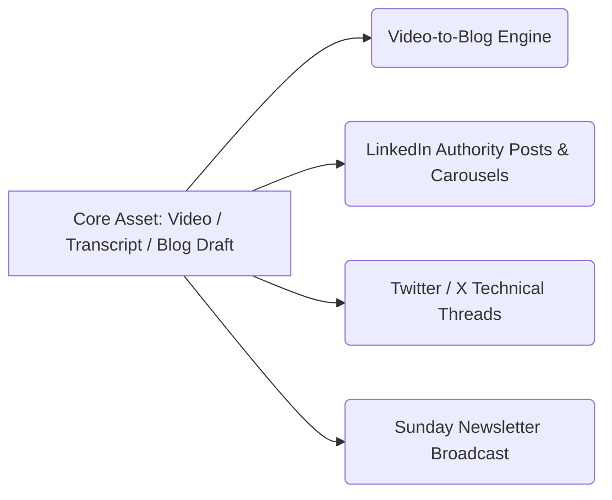

# Content Repurposing Suite (`content-repurposing`)

Use this skill to multiply the impact of technical content created on **Gcloudcafe**. Never write an article as a standalone silo: every piece of content should cleanly repurpose across developer channels.

---

## 🔄 Supported Repurposing Workflows

---

## 🎬 1. Video-to-Blog Engine (`video-to-blog`)

When given a YouTube video, conference recording, podcast, or raw transcript:
1. **Timestamp Extraction:** Identify key architectural shifts, code demos, or benchmarks with exact timestamps (e.g., `[14:22] Configuring Express Mode API Key`).
2. **Concept Distillation:** Group rambling spoken audio into structured H2/H3 technical sections.
3. **Diagram Reconstruction:** Convert visual slides or whiteboard explanations described by the speaker into responsive ASCII or Mermaid architecture diagrams.
4. **Lab Verification:** Reconstruct mentioned commands into tested, copy-pasteable bash/Python snippets with expected output blocks.
5. **Gcloudcafe Framing:** Weave in the **Offvia** travel platform case study and the 12-step Gcloudcafe blog blueprint.

---

## 💼 2. LinkedIn Authority Posts & Carousels (`linkedin-repurpose`)

LinkedIn demands high hook-to-read retention and scannable technical value without fluff:

### Format A: The 1,300-Character Thought-Leadership Post
- **Line 1 (The Scroll-Stopping Hook):** High-stakes friction, cost explosion, or counter-intuitive architectural shift.
  *(e.g., "Google Cloud just rebranded Vertex AI to Agent Platform. But beneath the console UI lies an architectural shift most platform teams are missing.")*
- **Lines 2-3 (The Pain Point):** 3 weeks of enterprise IAM approval vs instant prototyping.
- **Lines 4-8 (The 3 Core Takeaways):** Bullet points using clear emojis and bold technical terms.
- **Lines 9-11 (The Code/Architecture Highlight):** Highlight one key code or protocol innovation (e.g., Google ADK, remote MCP).
- **Line 12 (Engagement Question & Link):** Ask a provocative practitioner question and link to the full Gcloudcafe post in the comments or bio.

### Format B: The 8-Slide Technical Carousel Blueprint
- **Slide 1:** Bold Cover + Hook Question + High-Contrast Visual.
- **Slide 2:** The Old Way (Model-Centric Vertex AI bottleneck).
- **Slide 3:** The New Way (Autonomous Cognitive Loops & Express Mode).
- **Slide 4:** Authentication Showdown (API Key Sandbox vs ADC Enterprise).
- **Slide 5:** Architecture Diagram (Supervisor Agent + Specialists).
- **Slide 6:** Code Spotlight (Clean Pydantic V2 intent parser).
- **Slide 7:** 3 Production Gotchas to Avoid.
- **Slide 8:** Summary Cheat Sheet + Follow @Tharun Vempati / Read on Gcloudcafe.

---

## 🐦 3. Twitter / X Technical Threads (`twitter-repurpose`)

Structure high-velocity, technical threads for Cloud & DevOps engineers:
- **Tweet 1 (Hook):** The breaking change or paradigm shift with a compelling metric or architecture diagram.
- **Tweet 2:** What is Express Mode? (Sandbox project, zero billing friction, instant API key).
- **Tweet 3:** Code snippet image or formatted block demonstrating Google ADK / Gemini 3.8 Flash.
- **Tweet 4:** The multi-agent coordination pattern (Supervisor + Specialists).
- **Tweet 5:** MCP tool integration (connecting BigQuery and live APIs).
- **Tweet 6:** Link to the complete Gcloudcafe blog post with bookmark CTA.

---

## 📬 4. Sunday Weekly Newsletter Broadcast (`newsletter-repurpose`)

Integrate directly with Gcloudcafe's automated Sunday Newsletter system (`data/newsletter_archive.json` and `tests/weekly-newsletter.test.js`):
- **Subject Line:** High open-rate subject line combining curiosity and engineering specificity.
  *(e.g., "⚡ GCloudCafe Digest: Inside Gemini Enterprise Agent Platform & Express Mode")*
- **Executive TL;DR (3 Sentences):** Why this matters to cloud architects this week.
- **Deep-Dive Breakdown:** The core architectural shift, the Offvia case study, and the copy-pasteable Python parser.
- **Community Poll / Question:** An interactive poll prompt for reader feedback.
- **Direct Article Link:** Clean tracking-free URL to `https://gcloudcafe.com/blog/<slug>/`.

---

## 📋 Repurposing Checklist
- [ ] Hook tested for high curiosity and zero corporate cliché.
- [ ] Code snippets formatted properly for the destination platform.
- [ ] Visual asset or diagram included for carousel/thread preview.
- [ ] Newsletter summary compatible with Hugo newsletter template.
- [ ] All URLs pointing back to Gcloudcafe verified live.
