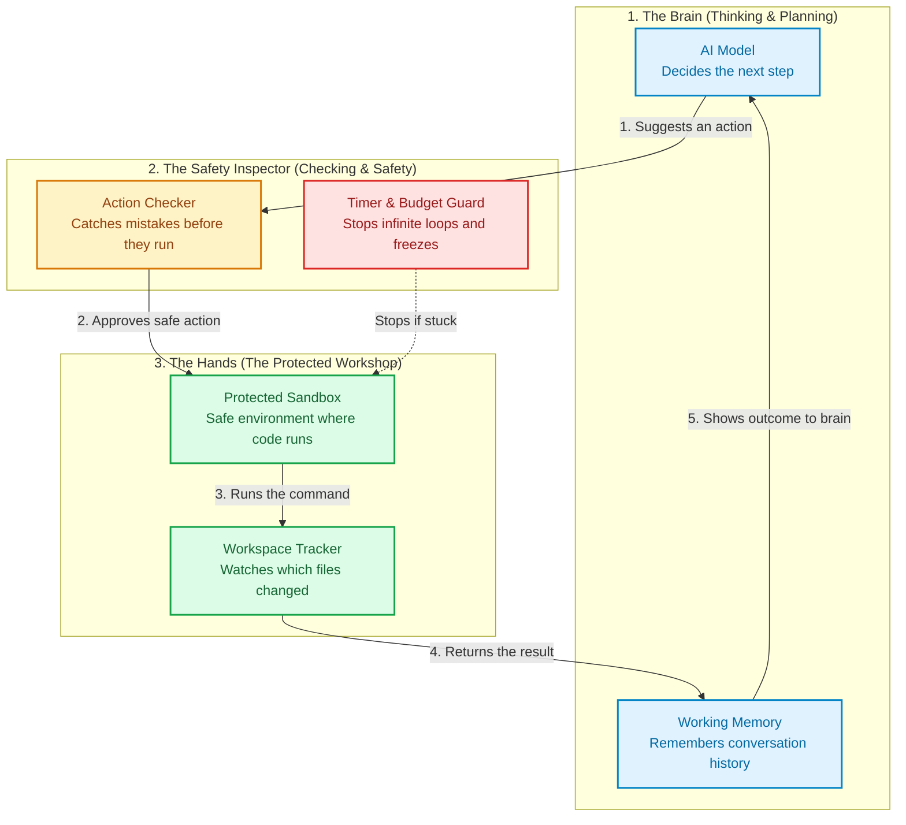
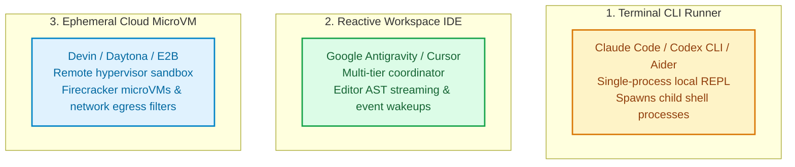
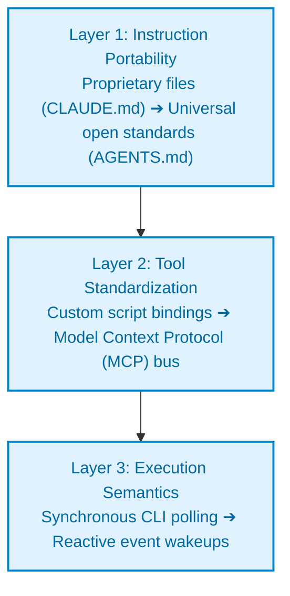
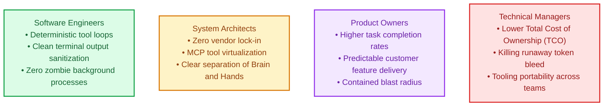

---
title: "Beyond the Prompt: Inside the AI Agent Harness"
meta_title: "Inside the AI Agent Harness: Architecture & Portability"
description: "Master AI agent harness engineering: The Brain vs Hands mental model, 4 core concepts, 3 harness archetypes, and how to switch runtimes without vendor lock-in."
date: 2026-10-24
image: "/images/agent-harness-architecture-part1.jpg"
categories: ["Architecture", "AI Engineering", "DevOps"]
tags: ["AI Agents", "System Design", "Harness Engineering", "Model Context Protocol", "Antigravity", "Distributed Systems"]
author: tharun-vempati
featured: true
draft: false
series: "Harness Engineering for AI Agents"
series_order: 1
series_description: "A 3-part systems architecture deep dive into AI agent execution harnesses: sandboxing, tool idempotency, state management, and moving between CLI, IDE, and cloud runtimes."
series_image: "/images/series-images/harness-engineering-series.jpg"
faqs:
  - question: "What is an AI agent harness?"
    answer: "An AI agent harness is the deterministic runtime infrastructure surrounding a large language model. It governs process execution, state persistence, tool dispatch, sandboxed isolation, and observation feedback loops."
  - question: "Why is an agent defined as Model plus Harness?"
    answer: "A base LLM is a stateless token predictor without system access or memory. The harness provides the operating system layer: file access, network boundaries, tool execution, and error verification."
  - question: "How do you switch agent harnesses without rewriting tool integrations?"
    answer: "By standardizing on the Model Context Protocol (MCP) for tool definitions and open instruction standards like AGENTS.md, decoupling the model's tools and instructions from any single runtime."
---

You swap your agent's model from a standard open-weights checkpoint to a frontier reasoning model. You expect autonomous engineering.

Instead, the agent hangs. It enters a recursive loop. It reads the same configuration file six times, deletes a database directory, and crashes on a missing environment variable.

The model was not the bottleneck. The **execution harness** was.

---

> ### 🎯 Core Definition
> An **AI agent harness** is the deterministic runtime infrastructure that surrounds a large language model. It governs process execution, state persistence, tool dispatch, sandboxed isolation, and observation feedback loops to turn text predictions into reliable software changes.

---

## 🏛️ The First-Principles Formula

At its mathematical core, a Large Language Model is a pure, stateless function:

Output Tokens = f(Input Tokens)

It has no clock. It has no filesystem. It cannot see a terminal. It cannot send a network packet. It remembers nothing between invocations.

The **Harness** is the machine that surrounds this function:

Agent = Model + Harness

The model is the **reasoning engine**. The harness is the **operating system** that provides:
1. **Hands:** Tools, process execution, and filesystem mutations.
2. **Senses:** Observation loops, terminal output capture, and error parsing.
3. **Memory:** Context compaction, workspace tracking, and persistent state.
4. **Guardrails:** Timeouts, resource limits, and isolation boundaries.

---

## 💡 4 Fundamental Concepts of Harness Engineering

To understand how production agents work, engineers must separate probabilistic text generation from deterministic runtime execution.

1. REASONING VS. STATE

The model plans the logical step. The harness maintains the state machine.

MECHANISM:

Models do not remember past turns. The harness stores conversation transcripts, tracks git diffs, compacts token history, and feeds condensed state back into the next prompt.

2. PROMPTS VS. KERNEL BOUNDARIES

Prompts are soft suggestions. Harnesses are hard security boundaries.

MECHANISM:

Telling a model "Do not delete production files" provides zero security. The harness enforces isolation using operating system primitives: Linux namespaces, seccomp syscall filters, and read-only volume mounts.

3. THE ACTION-OBSERVATION LOOP

An agent loop is not a simple script. It is a transactional workflow.

MECHANISM:

The harness intercepts model intents, runs tools deterministically, sanitizes multi-megabyte terminal outputs, strips ANSI escape sequences, and formats raw errors into clear semantic feedback.

4. EPHEMERAL EXECUTION & RECOVERY

Untrusted execution requires instant recovery points.

MECHANISM:

When an agent corrupts a file or hangs on a prompt, the harness rolls back state immediately. High-performance harnesses use Copy-on-Write (CoW) disk layers and memory snapshots restored in under 150 milliseconds.

---

## 🏛️ The Core Mental Model: The Brain, The Hands, and The Workshop

To understand an AI agent, you do not need a degree in distributed systems. 

Think of the model as an architect sitting in a room with no doors and no windows. The architect can write brilliant instructions on paper, but has no hands to touch a computer or build anything.

The **Harness** is everything outside that room:
- It takes the architect's note.
- It checks whether the instruction is safe.
- It hands the instruction to a worker in a protected workshop.
- It reports back what happened so the architect can plan the next step.

### How the Three Parts Work Together:

1. **The Brain (The Model):** It only reads text and writes text. It decides which tool to use next, but it never touches your real machine directly.
2. **The Safety Inspector (The Guard):** It checks the model's request before anything runs. Did the model ask to delete a critical project folder? Did it freeze waiting for input? The inspector blocks dangerous actions and kills frozen tasks.
3. **The Hands & The Workshop (The Execution Sandbox):** This is the protected environment where commands execute. If the model makes a mistake or crashes a script, the damage stays trapped inside this room. Your primary machine remains safe.
4. **The Senses (The Feedback Loop):** Once a command finishes, the harness captures the outcome: *Did the test pass? Did the build fail?* It hands that result back to the brain so it can plan the next move.

*(In technical architecture books, engineers often call this the **Control Plane** for the brain, and the **Execution Plane** for the hands).*

---

## 🧭 The 3 Modern Harness Archetypes

Engineers encounter three distinct harness architectures in production today:

---

## 📊 Technical Comparison Across Harness Archetypes

| Engineering Dimension | 1. Terminal CLI Runner (Claude Code, Codex CLI) | 2. Reactive Workspace IDE (Antigravity, Cursor) | 3. Cloud MicroVM (Devin, Daytona, E2B) |
| :--- | :--- | :--- | :--- |
| **Process Model** | Single local Node.js or Python CLI process. | Multi-tier client/server coordinator inside the editor. | Remote hypervisor managing ephemeral virtual machines. |
| **Execution Sandbox** | Directly on host OS via child process pipes. | Local workspace with background task managers. | Isolated Firecracker microVM or container boundary. |
| **Context Awareness** | Manual file reading; blind to open editor tabs. | Live editor stream (open files, active cursor coordinates). | Remote git repository clone; headless environment. |
| **Concurrency Model** | Synchronous blocking; user waits for completion. | Asynchronous daemon tasks with **reactive event wakeups**. | Parallel remote job queues with webhook callbacks. |
| **Tool Extensibility** | Hardcoded tool functions and local CLI scripts. | Dynamic **Model Context Protocol (MCP)** server bus. | Remote containerized REST/gRPC API microservices. |
| **Blast Radius** | High; can modify uncommitted host workspace files. | Medium; constrained to active workspace folder. | Zero; isolated remote virtual machine instance. |

---

## 🔄 The Mechanics of Switching Harnesses (Zero Vendor Lock-in)

When an engineering team migrates between agent environments (for example, moving from **Claude Code** to **Google Antigravity**, or from **Codex** to **Cursor**), they are not changing models. 

They are **switching the runtime harness**.

A clean harness switch decouples configuration across three independent layers:

### 1. Instruction Portability: Moving to Universal Standards
Early agent tools tied instructions to proprietary files, such as `CLAUDE.md` or `.cursorrules`. 
- **The Problem:** Instructions grew into massive 2,000-line monolithic files, burning 20% of the token context on every request.
- **The Modern Architecture:** Move to open standards like **`AGENTS.md`** at the repository root, supported by modular rule directories (`.agents/rules/`).
- **Result:** You change harnesses without rewriting your repository instructions.

### 2. Tool Standardization via Model Context Protocol (MCP)
In legacy setups, adding a database inspection tool required writing custom Python wrappers for one specific framework.
- **The Problem:** Rewriting tool bindings every time a new agent tool emerged.
- **The Modern Architecture:** Standardize on the **Model Context Protocol (MCP)**. MCP virtualizes tools into standalone JSON-RPC servers running over `stdio` or Server-Sent Events (SSE).
- **Result:** Claude Code, Google Antigravity, and Codex CLI connect to the exact same database or GitHub tool server without code changes.

### 3. Execution Semantics: Polling vs. Reactive Event Wakeups
In terminal CLI runners, running an integration test forces the agent to block or poll a process.
- **The Problem:** Polling loops burn tokens, flood history transcripts, and risk network timeouts.
- **The Modern Architecture:** Modern harnesses use **Reactive Event Wakeups**. The agent issues a background command and terminates tool calls. The operating system notifies the coordinator when the process exits, reviving the agent with the exact exit code and log summary.
- **Result:** Zero wasted tokens while waiting for multi-minute compilers, test suites, or Docker builds.

---

## 👥 The 4-Stakeholder Lens: Why Harness Architecture Matters to Everyone

* **For Software Engineers:** You understand why agent loops hang, how tool responses are sanitized, and how to debug background processes.
* **For System Architects:** You design modular platforms that decouple models from runtimes, preventing vendor lock-in through open standards.
* **For Product Owners:** You recognize that agent reliability depends on harness determinism, not prompt tweaks, directly improving feature delivery rates.
* **For Technical Managers:** You evaluate the operational trade-offs between CLI, IDE, and Cloud environments, managing infrastructure costs and team productivity.

---

## ⚖️ The Architectural Decision Matrix

| Evaluation Dimension | Terminal CLI Runner | Reactive Workspace IDE | Ephemeral Cloud MicroVM |
| :--- | :--- | :--- | :--- |
| **Startup Latency** | **Fastest (<1s)** | **Fast (1–3s)** | **Moderate (10–30s)** |
| **Resource Overhead** | Very Low (single process) | Medium (IDE engine) | High (Remote VM infrastructure) |
| **Editor Awareness** | Blind to active tabs | Full AST and cursor context | Headless git context |
| **Blast Radius Containment**| Manual review required | Constrained to folder | Fully isolated VM sandbox |
| **Task Concurrency** | Synchronous blocking | Asynchronous reactive daemons| Distributed queue workers |
| **Best Production Fit** | Quick terminal scripts & triage | Daily full-stack software development | Automated CI/CD & untrusted code runs |

---

## 🔮 What Comes Next

Understanding the harness is the first step. But what happens when an agent executes tools that mutate files, databases, and network connections?

What happens when an agent drops a socket connection halfway through writing a database migration? How do you prevent partial writes from corrupting your system?

In **Part 2**, we explore the **Tool Execution Pipeline**:
* Why distributed agent tools need **Two-Phase Commits**.
* How **Idempotency Keys** stop duplicate writes during network retries.
* The mechanics of **Instant Copy-on-Write Snapshot Rollbacks** when an action fails.
