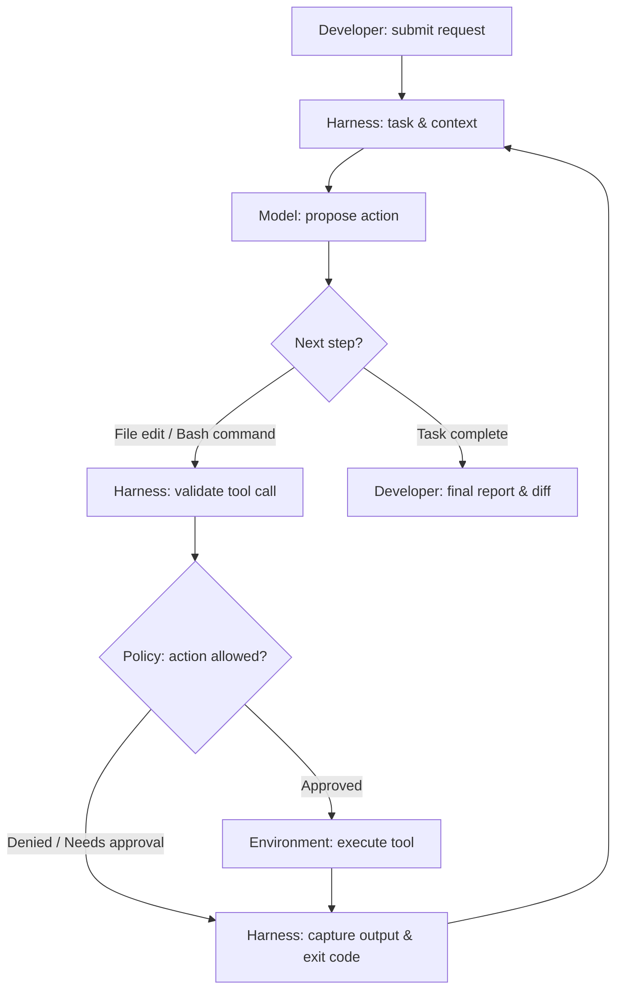

You ask an AI coding agent to fix a failing test. A few seconds later, it opens a file, reads the error, edits the implementation, runs a command, and reports that the test passed.

It feels like the model did everything.

But consider what actually happened. Something had to decide which files the agent could access, expose a tool for reading them, execute the test command, collect the output, and feed that result back to the model. If the command hung, something needed to stop it. If the proposed edit was risky, something needed to ask for approval.

**That surrounding system is the agent harness.** And understanding it is a useful step toward understanding why AI coding agents sometimes feel remarkably capable—and sometimes make surprisingly basic operational mistakes.

In this first article of the *Harness Engineering for AI Agents* series, we'll unpack the harness using **[Cline](https://github.com/cline/cline)**, an open-source coding agent, as a concrete reference. We won't compare vendors or migrate configurations yet. First, we need to understand what we're working with.

## The model is not the whole agent

A language model receives context and generates a response. That response might be prose, code, or a structured request to call a tool. On its own, the model does not automatically own your terminal, repository, filesystem, or credentials.

An **agent** is a system that uses the model to work toward a goal over multiple steps. A **harness** is the runtime and integration layer that makes those steps possible and governs how they happen.

A useful mental model is:

```text
Coding agent experience
    = Model reasoning
    + Harness orchestration and controls
    + Tools and execution environment
    + Project context and user decisions
```

This is a teaching model, not a universal formula. Real products distribute responsibilities differently. But it gives us a good starting point: **the model proposes; the harness coordinates, executes, and observes.**

## Follow one task through the harness

Imagine asking Cline:

> The `/health` endpoint is returning 500. Find the bug, fix it, and run the relevant tests. Don't change unrelated files.

A simplified execution loop might look like this:



This diagram is intentionally simplified. It shows **responsibilities**, not a claim about Cline's exact internal function calls or the order of every event in every release.

Let's follow the sequence.

**1. Assemble context.** The harness gives the model the user's request, relevant conversation, available tool descriptions, and applicable project instructions. It cannot put an unlimited repository into the context window, so it must choose what to include or retrieve.

**2. Propose an action.** The model may ask to inspect the endpoint handler or read the failing test. It is proposing an action through a tool interface—not directly opening the file itself.

**3. Check and execute.** The harness handles the request under the configured permissions and approval policy. Reading a file and running a potentially destructive shell command are not equivalent operations.

**4. Observe the outcome.** The harness returns useful feedback: file content, an error message, command output, or a denial. The model uses that observation to decide what to do next.

**5. Repeat or stop.** The model may edit code, run tests, inspect a diff, or explain why it cannot proceed. This repeated action–observation cycle is the **agent loop**.

The crucial insight is that intelligence is only one part of the loop. **Execution boundaries and feedback quality shape the result.**

## Why Cline is a useful example

Cline is an open-source coding agent with a visible codebase and documentation. It lets us discuss familiar engineering concepts—repository instructions, terminal commands, tool integrations, approvals, and reusable workflows—without treating the entire system as a mysterious black box.

There is an important distinction, though: **Cline is the product; its harness is the set of orchestration and runtime mechanisms inside that product.** Not every feature is a standalone harness component, and the exact configuration paths and lifecycle features can evolve between versions.

The following sections describe the major capabilities worth looking for in Cline and in agent harnesses more generally.

## 1. Rules: telling the agent how to work

Imagine your team has a few non-negotiable conventions:

- Never edit generated code by hand.
- Run unit tests before claiming a change is complete.
- Ask before modifying database migrations.
- Prefer existing logging utilities over adding new dependencies.

You could repeat those instructions in every chat. Or you could put them in project guidance that the agent can load as context.

Cline supports repository guidance such as `.clinerules` and rules directories; the exact supported locations and conditional-loading behavior should be checked against the version you're using. See the [Cline documentation](https://docs.cline.bot/).

For example, a project rule could contain:

```markdown
# Backend engineering guidelines

- Follow the existing error-handling conventions in `src/api/`.
- Add or update tests for behavior changes.
- Do not modify generated files in `src/generated/`.
- Ask for approval before changing database schemas.
```

**What rules do:** influence how the model interprets a task and chooses actions.

**What rules do not automatically do:** enforce filesystem permissions, prevent every prohibited command, or guarantee that tests really ran. A rule is an instruction, not an operating-system security boundary.

That distinction matters. A developer might say, "I told the agent not to touch that directory." A harness engineer asks, "Was that merely in the prompt, or was the directory inaccessible to the execution tool?"

## 2. Hooks: connecting behavior to lifecycle events

A hook is different from a rule. Instead of only providing guidance, a hook lets the surrounding system execute custom logic at a supported point in a workflow.

Depending on the agent and version, lifecycle integrations might be used to inspect an attempted action, capture telemetry, supply extra context, or run validation. Cline documents hook functionality; consult the [current Cline hook documentation](https://docs.cline.bot/) for supported events, configuration, and execution semantics rather than assuming every imaginable event exists.

Consider the engineering intent:

> Before accepting a code change, verify that the repository still passes its checks.

A **rule** can ask the model to run `./scripts/verify.sh`.

A **hook**, where the runtime supports the required event and enforcement behavior, can invoke a check at a defined lifecycle point.

A **CI gate** can independently refuse to merge a change when checks fail.

These three mechanisms serve related purposes but provide different guarantees. Even a hook is only as strong as its failure handling, coverage, and ability to block an action. For critical checks, don't rely on a prompt instruction—or an assumed hook behavior—as your only defense.

## 3. Skills: packaging repeatable engineering knowledge

Suppose you regularly ask the agent to diagnose Kubernetes deployments. Your workflow always involves checking rollout status, reading events, inspecting probes, and avoiding changes to production without approval.

Rather than explaining the process from scratch each time, you can package the guidance as a reusable **skill**. Skills typically describe when they apply, what procedure to follow, and which supporting resources to use. Their discovery and invocation depend on the particular agent implementation.

A skill is especially useful when the work is more than a single rule. "Prefer structured logs" is a rule; "diagnose a failing Kubernetes rollout using this sequence of checks" is a workflow-sized capability.

A skill also does not grant permissions by itself. It may describe how to run a deployment, but the harness and environment still decide whether the agent can execute the command.

## 4. Tools and MCP: giving the model controlled capabilities

A model can request a tool action such as reading a file, searching a codebase, or running a terminal command. The harness exposes tool definitions, routes requests, executes them, and returns results.

The **Model Context Protocol (MCP)** provides a standard way for compatible AI applications to connect to external tools and data sources. An MCP server might expose an issue tracker, documentation search, or internal API.

```text
Cline / agent harness
  |-- Built-in file and terminal tools
  |-- Model and context orchestration
  `-- MCP client
        |-- Documentation server
        `-- Issue tracker server
```

MCP helps standardize connectivity. It **does not replace** the harness, and it does not automatically make an integration secure. Credentials, tool authorization, confirmation policies, network access, and auditability remain design responsibilities. (We explored building production tool servers in our hands-on guide on [Enterprise Multi-Agent Swarms with ADK and MCP](/blog/gemini-enterprise-multi-agent-swarm-adk-mcp/)).

A good question to ask whenever you add a tool is: *What can this tool change, and who decides whether the change is allowed?*

## 5. Context and state: remembering enough to act sensibly

Coding tasks rarely fit into one model response. The agent needs to keep track of the request, previous tool results, files inspected, edits made, tests run, and unresolved problems.

But model context is limited. If a test prints thousands of lines, blindly returning all of them can crowd out the information the model actually needs. A well-designed harness balances observation detail against context cost.

It also helps to separate three kinds of state:

| State | Example | Why it matters |
|---|---|---|
| Conversation state | What the user requested and what the model has seen | Keeps the agent oriented |
| Workspace state | Files, diffs, branches, and test artifacts | Shows what has actually changed |
| External state | A deployment, issue, database record, or API side effect | May persist even if the conversation ends |

The model's recollection of an action is not proof that the action succeeded. The source of truth for a file change is the filesystem and diff; for a test, it is the test result; for a deployment, it is the deployment system.

## 6. Permissions and execution boundaries

This is where harness engineering starts to look familiar to DevOps engineers.

If an agent can execute shell commands, its operational risk depends on where those commands run and what they can access. A command inside a restricted container is different from the same command running with broad access to a developer's machine.

Useful controls include scoped filesystem access, approvals for consequential actions, restricted credentials, network policies, process timeouts, resource limits, and audit trails. Which controls Cline actually provides in a given setup depends on its version, settings, host environment, and integrations.

**Don't confuse an approval prompt with a sandbox.** Approval asks a human whether to proceed. Isolation constrains what the action can affect even if it proceeds. Stronger systems use both where appropriate.

## 7. Failure handling: the unglamorous part of reliability

Imagine an agent starts a test command that never exits. The model may keep waiting, ask for status repeatedly, or attempt the command again. None of those behaviors automatically fixes the underlying problem.

A harness needs useful failure signals: exit codes, timeouts, bounded logs, cancellation, and clear reporting of partial results. For operations that mutate external systems, retries need extra care. Re-running a read-only test is very different from re-running a payment, migration, or deployment request.

This is why **harness engineering is not simply prompt engineering with more files**. It includes the ordinary discipline of reliable software systems: permissions, observability, state management, failure boundaries, and verification.

## A five-minute exercise: inspect your own agent loop

You don't need to read Cline's entire source code to start thinking like a harness engineer. Pick a small repository and ask it to fix one failing unit test.

Before starting, note which project rules are active and which tools are available. During the task, watch for five moments:

1. What information did the agent read before editing?
2. Which actions required permission or confirmation?
3. What did the agent receive after a command completed or failed?
4. How did it decide the work was finished?
5. Can you independently verify the claimed result with a diff and a test run? (For structuring automated evaluation gates and test run tracking, see our guide on [Enterprise Multi-Agent Evaluation & CI/CD Runbooks](/blog/gemini-enterprise-multi-agent-evaluation-cicd-runbook/)).

If you want to go deeper, inspect Cline's open-source implementation and trace the corresponding UI, tool, and state-management paths. The point is not to memorize internal class names. It is to connect what you see in the interface to the responsibilities of the harness.

## A practical checklist for evaluating a harness

When exploring any coding agent, ask:

| Question | What to look for |
|---|---|
| How are project instructions loaded? | Scope, precedence, and conditional activation |
| What tools can it call? | Tool inventory and argument validation |
| What can those tools access? | Filesystem, network, credentials, and host privileges |
| How are risky actions approved? | Confirmation policy and bypass conditions |
| What happens when commands fail? | Timeouts, error output, cancellation, and retry behavior |
| Where does task state live? | Conversation, workspace, checkpoints, and external systems |
| How is success verified? | Test results, diffs, independent checks, and audit logs |

You may not have answers to all of these on day one. The value is learning to ask the questions before trusting the result.

## What comes next

We started with a simple observation: when a coding agent edits a file or runs a test, the model is only one part of the system. The harness supplies the loop, the tools, the context, and the execution controls that turn proposed actions into real work.

Cline gives us a concrete way to explore those layers: **rules guide behavior, hooks connect to lifecycle events, skills package reusable workflows, tools and MCP expose capabilities, and runtime controls determine what actually happens.**

That leaves a question worth exploring next: if you've invested time in all of those mechanisms, **what happens when you open the same repository in another coding agent?**

In **Part 2**, we'll investigate portability: which instructions and integrations can be reused, which behaviors require adaptation, and how to reason about a migration without assuming that copying files is enough.

In **Part 3**, we'll look at the next challenge: using multiple agents together without sacrificing reviewability, workspace isolation, or engineering control.

The model may be the brain, but the harness determines how its decisions meet the real world.

---

### Further reading

- [Cline: open-source repository](https://github.com/cline/cline)
- [Cline documentation](https://docs.cline.bot/)
- [Model Context Protocol documentation](https://modelcontextprotocol.io/introduction)

*Note: Product-specific configuration and lifecycle features evolve. The examples above illustrate harness concepts; consult the documentation for your installed version before depending on a particular path, hook event, or security behavior.*
