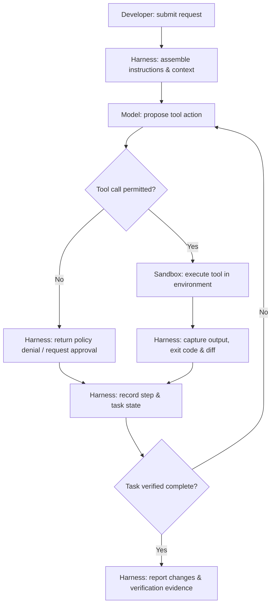
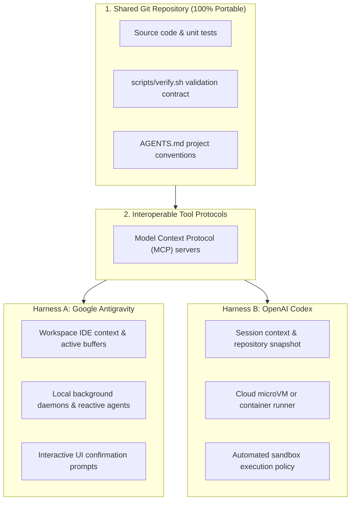

You give two coding agents the same repository and the same request:

> Add a health-check endpoint, write tests, and tell me exactly what changed.

One agent explores the repository, edits two files, runs tests, and reports a clean result. The other repeatedly inspects the same files, requests approval before a command, or declares success without running the test suite.

It is tempting to say that one **model** is smarter. But that conclusion skips an important layer: **the agent harness**.

This is the first article in a three-part series about what happens *around* the language model. We'll use **Google Antigravity** and **OpenAI Codex** as recurring examples—not to crown a winner, but to understand why agent products behave differently and what that means if we want to switch between them.

> **Scope:** This article explains the architecture and proposes a fair comparison method. It is **not** a benchmark or a verified feature-by-feature audit of current Antigravity and Codex releases. Capabilities, defaults, and permission settings can change; any empirical claim needs to be tested against named versions and configurations.

## First, separate the model from the agent

At a useful conceptual level, the model receives context and generates a response or proposes a tool call. It does not inherently provide a filesystem, terminal, approval dialog, repository checkout, or persistent task history.

The **harness** is the surrounding software that makes those capabilities available and governs their use. In real products, the boundary between model provider, agent application, and infrastructure may be distributed across several services.

A useful mental model is:

```text
Coding agent experience
  = model + orchestration + tools + execution environment
    + context/state + policies + user interface
```

This is a teaching model, not a universal implementation formula.

| Layer | What it does | Question to ask |
|---|---|---|
| Model | Interprets context and proposes actions | Which model and settings are being used? |
| Orchestrator | Runs the plan/action/observation loop | When does the agent retry, pause, or stop? |
| Tools | Expose file operations, shell commands, searches, and integrations | What actions can the agent request? |
| Execution environment | Runs commands and holds working files | Is it on the host, in a container, or remote? |
| Context and state | Supplies instructions, history, observations, and task progress | What persists across steps and sessions? |
| Policy and permissions | Approves or blocks actions | What requires human consent? |
| Interface | Presents plans, diffs, logs, and results | What can the developer inspect and control? |

A stronger model can improve decisions, but it cannot compensate for every missing tool, incomplete observation, or unsafe permission boundary.

## The loop behind a coding agent

Imagine the health-check request again. A typical harness might coordinate the following cycle:



The diagram is deliberately simplified. Some products schedule background tasks, use parallel workers, or interrupt the loop for approvals. But the central idea holds: the model does not directly become a terminal or a filesystem. The surrounding system interprets and executes actions.

Notice how many failure modes exist outside model reasoning:

- The agent receives a truncated error log and misses the actual failure.
- A command waits for interactive input while the model expects it to finish.
- The environment has no network access, so dependency installation fails.
- The agent edits a file but loses the task state before verifying it.
- A permission policy blocks the correct command, but the denial is not explained clearly.

These are harness and environment questions as much as model questions.

## Antigravity vs Codex: compare workflows, not logos

Suppose you start a task in **Google Antigravity** and later want to perform a similar task with **OpenAI Codex**. The interesting question is not simply *which model is underneath?* It is *which parts of the working environment and execution contract change?*

Both names refer to agent products/workflows rather than a single immutable harness implementation. Codex, for example, may be used through different interfaces and execution setups; any comparison must name the mode being tested. Likewise, Antigravity behavior should be evaluated in the actual product version and workspace configuration in use.

Here is the comparison worksheet I would use before making claims about either product:

| Dimension | What to inspect in Antigravity | What to inspect in Codex | Why it matters |
|---|---|---|---|
| Context discovery | Which files and editor/workspace signals are included? | Which files and session context are included? | Changes what the agent knows before acting |
| Instructions | How are project rules loaded and prioritized? | How are project rules loaded and prioritized? | Determines whether shared guidance is followed |
| Tool surface | Which file, terminal, browser, and external tools are available? | Which file, terminal, browser, and external tools are available? | Determines what the agent can actually do |
| Execution boundary | Where do commands run, and with what filesystem/network access? | Where do commands run, and with what filesystem/network access? | Determines safety and reproducibility |
| Approval model | Which actions pause for confirmation? | Which actions pause for confirmation? | Affects autonomy and risk |
| State and recovery | Can interrupted work resume, and what state survives? | Can interrupted work resume, and what state survives? | Affects long-running tasks |
| Verification | What evidence of tests and changes is shown? | What evidence of tests and changes is shown? | Distinguishes real completion from plausible narration |

**Do not treat a row in this table as a product feature claim.** It is a checklist for collecting evidence. A fair evaluation requires matching task, repository revision, dependencies, credentials, network conditions, and allowed operations as closely as possible.

### A simple comparison experiment

Use a small repository with a failing test and a clearly defined task:

```text
agent-harness-lab/
├── README.md
├── AGENTS.md
├── src/
│   └── app.py
├── tests/
│   └── test_health.py
└── scripts/
    └── verify.sh
```

Give both agents the same instruction:

> Implement `GET /health` so it returns HTTP 200 and `{ "status": "ok" }`. Do not modify unrelated files. Run `scripts/verify.sh` and report the command result and changed files.

Record **observations**, not impressions:

1. Did the agent discover and follow the repository guidance?
2. Which tools and commands did it actually use?
3. Did it ask for approval, and for which action?
4. Did it modify only the expected files?
5. Did it run the verification script, and what was its exit code?
6. Could you reproduce the result from a clean checkout?

A single run is illustrative, not a statistically meaningful benchmark. For a stronger comparison, repeat the task across clean checkouts, record versions/settings, and distinguish model variability from harness behavior. (For structuring repeatable automated tests and evaluation gates, see our guide on [Enterprise Multi-Agent Evaluation & CI/CD Runbooks](/blog/gemini-enterprise-multi-agent-evaluation-cicd-runbook/)).

## Why this matters to DevOps and platform engineers

When an agent writes code, the result is not just a chat answer. It can change a repository, run a shell command, install dependencies, or interact with services. That makes familiar engineering concerns relevant:

**Permissions.** A prompt saying "do not touch production" is not an access-control mechanism. Real controls must be enforced by the execution environment, credentials, and approval policy.

**Observability.** A claim like "tests passed" is weaker than a captured command, exit code, and relevant test output.

**Isolation.** An agent running directly on a developer's host has a different blast radius from one operating in a restricted disposable environment. Isolation still does not eliminate risks from credentials or network access.

**State.** Long tasks need a way to distinguish completed steps from planned steps. Otherwise an interrupted agent may repeat work or lose track of modifications.

**Recovery.** Re-running a read-only command is not the same as retrying a database migration or deployment. Safe retries require understanding side effects.

None of these concerns is unique to AI. What changes is that a probabilistic decision-maker now selects which operations to request next.

## The portability trap

Let's say your team uses Antigravity for several months. You have built up project instructions, workflow conventions, integrations, and habits. Now you want to try Codex—or another coding agent.

Your Git repository still exists. Your tests still exist. But not everything you relied on necessarily moves with it.

I find it useful to separate portability into four layers:

| Portability layer | What you want to reuse | Typical limitation |
|---|---|---|
| **Code and verification** | Source files, tests, build commands, CI checks | Environment differences can still affect results |
| **Instructions** | Repository rules, coding conventions, task contracts | Agents may discover or prioritize instructions differently |
| **Tool integrations** | Access to repositories, APIs, databases, internal services | Tool support, authentication, and policies may differ |
| **Runtime behavior** | Approvals, sandboxing, state, retries, UI feedback | Usually the least portable layer |

This explains why *switching models* and *switching agent products* are different projects.



### Where AGENTS.md and MCP fit

Two useful building blocks appear in this conversation:

- **`AGENTS.md`** provides repository-level guidance in a format recognized by some coding agents. It can describe build commands, conventions, and boundaries. It is not an enforcement mechanism, and agents do not necessarily interpret it identically.
- **Model Context Protocol (MCP)** defines ways for AI applications to connect to tools and data sources. It can reduce the need to rewrite every integration, but it does not standardize the entire harness, permission model, or agent lifecycle. (We explored building production tool servers in our hands-on guide on [Enterprise Multi-Agent Swarms with ADK and MCP](/blog/gemini-enterprise-multi-agent-swarm-adk-mcp/)).

The practical strategy is to keep your *source of truth* as agent-neutral as possible: source code, tests, documented workflows, and explicit task acceptance criteria. Add thin product-specific adapters only where necessary.

For example, a `scripts/verify.sh` command is useful even if the agent changes. It is a repeatable verification contract outside any particular chat interface. By contrast, a proprietary approval screen or hidden session state cannot simply be checked into Git and replayed elsewhere.

**Portability is not identical behavior.** The goal is to make outcomes verifiable and switching costs manageable—not to pretend that all agents will make the same decisions.

## A practical checklist before choosing an agent

Before adopting an agent for important repository work, ask:

- Can I inspect the commands it ran and the files it changed?
- Can I restrict its filesystem, network, and credential access?
- Can I provide shared project instructions without duplicating everything?
- Can I run the same tests independently of the agent?
- Can I tell the difference between a proposed action and an executed action?
- Can I recover or restart work after an interruption?
- If I switch agent products, which instructions and integrations must be rewritten?

These questions are more durable than a leaderboard screenshot. Models and products will change. The engineering contract around your repository should be easier to reason about.

## What's next in this three-part series?

**Part 1 — Beyond the Model: Understanding AI Agent Harnesses** *(this article)*  
We separated the model from the harness, explored the execution loop, and established a fair way to examine Antigravity and Codex.

**Part 2 — Breaking Agent Lock-In: AGENTS.md, MCP, and Portable Workflows**  
We'll design a sample repository with shared instructions, reusable verification commands, tool interfaces, and minimal agent-specific adapters. We'll be explicit about what remains non-portable.

**Part 3 — Trust but Verify: Testing Agent Reliability Across Harnesses**  
We'll run controlled tasks across agent setups, capture execution evidence, and explore failure handling, permission boundaries, retries, idempotency, and recovery.

## Final thought

A model can suggest a good next step. The harness determines **how that step is executed, observed, constrained, and carried forward**.

If you only compare models, you miss much of the system that shapes the developer experience. And if you plan for portability only after adopting an agent, you may discover that the hardest things to move were never in your repository.

In Part 2, we'll turn that observation into a concrete repository design.

---

### Further reading

- [AGENTS.md project](https://agents.md/) — repository guidance conventions and examples.
- [Model Context Protocol documentation](https://modelcontextprotocol.io/) — protocol concepts, tools, and transports.
- [OpenAI Codex documentation](https://developers.openai.com/codex/) — consult the current product and configuration documentation before comparing behavior.

*Note: Product behavior discussed in this article is framed as a testable comparison, not as measured results. For an empirical comparison, publish the product versions, runtime settings, repository commit, task prompts, and execution logs alongside the findings.*
