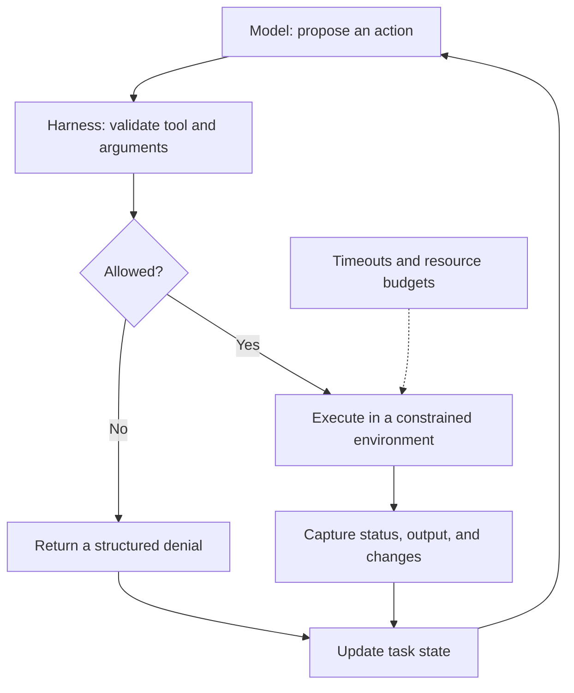

---
title: "AI Agent Harness Architecture: Why Better Models Don't Guarantee Reliable Agents"
meta_title: "AI Agent Harness Architecture: Tools, Sandboxes, State & Recovery"
description: "Learn what an AI agent harness does, how its execution loop works, and how to build a minimal guarded Python tool runner with timeouts, workspace checks, and structured results."
date: 2026-10-24
image: "/images/agent-harness-architecture-part1.jpg"
categories: ["Architecture", "AI Engineering", "DevOps"]
tags: ["AI Agents", "System Design", "Harness Engineering", "Model Context Protocol", "AGENTS.md", "Sandboxing"]
author: tharun-vempati
featured: true
draft: false
series: "Harness Engineering for AI Agents"
series_order: 1
series_description: "A practical series on AI agent execution harnesses: sandboxing, tool idempotency, state management, failure recovery, and portability across CLI, IDE, and cloud runtimes."
series_image: "/images/series-images/harness-engineering-series.jpg"
faqs:
  - question: "What is an AI agent harness?"
    answer: "An AI agent harness is the software around a model that coordinates tools, execution, permissions, working state, observations, and recovery."
  - question: "Is a stronger AI model enough to make an agent reliable?"
    answer: "No. Better reasoning helps, but reliable execution also needs bounded tools, meaningful feedback, durable state, and safe failure handling."
  - question: "Does MCP make an AI agent secure?"
    answer: "No. MCP defines interoperability for tools and context; authentication, authorization, isolation, and auditing still need to be designed and enforced."
  - question: "Can AGENTS.md and MCP eliminate vendor lock-in?"
    answer: "They can reduce migration friction for repository guidance and integrations, but runtime behavior, permissions, and context handling still vary."
---

Imagine upgrading your coding agent from a small model to a much stronger reasoning model. You expect cleaner patches and fewer failed runs.

Instead, the agent reads the same config file three times, launches a test process that never returns, and retries an operation without knowing whether the first attempt succeeded. The model might be capable of solving the programming problem. The system around it still cannot reliably *execute* the solution.

This is the problem an **AI agent harness** addresses.

> **Definition:** An agent harness is the runtime and coordination layer around a model. It exposes controlled tools, maintains working state, applies execution policies, returns observations, and handles interruptions or failures.
>
> 💡 **The Browser Analogy:** Think of the LLM as JavaScript running on a webpage, and the harness as the web browser. The code can calculate whatever it wants, but it cannot touch your local hard drive or open a raw socket unless the browser explicitly grants and mediates that permission.

In this first article of the **Harness Engineering for AI Agents** series, we'll examine the architecture and build a deliberately small Python tool runner. The goal isn't to create a production agent in 50 lines. It's to make the boundaries concrete enough that you can evaluate a real one.

## A model is not an execution environment

A useful conceptual shorthand is:

```text
Agent system ≈ Model + Harness + Tools + Environment
```

This is a teaching model, not a formal industry definition. In practice, products distribute these responsibilities differently, and some providers include orchestration features in their APIs.

The model interprets context and proposes actions. A surrounding runtime can decide whether a proposed tool call is permitted, execute it, capture results, and supply the next observation. The model does not intrinsically have access to your filesystem, terminal, network, or persistent workspace; those capabilities depend on the system in which it runs.

| Concern | Model | Harness / runtime |
|---|---|---|
| Choose a plausible next step | Reasons from context | Presents available tools and constraints |
| Read or edit repository files | Requests an action | Exposes and mediates file operations |
| Run a test | Requests execution | Launches a process and captures its result |
| Persist task progress | Uses supplied context | Stores authoritative state outside the model |
| Enforce security boundaries | Can follow instructions, imperfectly | Applies actual permissions and isolation |
| Handle failures | Interprets an error | Detects timeouts, records outcomes, and controls retries |

The crucial distinction: **a prompt asking an agent to be careful is not the same thing as an enforceable boundary.**

## The agent loop: propose, validate, execute, observe

Think of the architecture as three collaborating parts:

1. **Reasoning:** the model interprets the task and proposes the next operation.
2. **Control:** the harness validates arguments, permissions, resource budgets, and workflow state.
3. **Execution:** tools run in an appropriately constrained environment and return structured observations.



This diagram is a *desired design*, not a guarantee about every commercial agent. Some local CLI agents run commands directly on the developer's machine. Others use containers, virtual machines, or remote sandboxes. The blast radius depends on the actual configuration.

A useful separation is the **control plane**, which authorizes and coordinates actions, and the **execution plane**, which performs them. The observation loop connects the two. If it returns only “something went wrong,” the model has little to work with. If it dumps 50,000 log lines into context, the signal is buried in noise.

## A real failure pattern: the test that never finishes

Suppose an agent edits a Python service and calls `pytest`. The command starts a test that waits forever on a network dependency. Without a timeout, the agent may block indefinitely. With a naive polling loop, it may keep asking “is it done?” and fill its context with repetitive status messages.

A more useful execution contract is:

```text
request:  run approved test command
result:   status=timeout
          duration_seconds=10.0
          exit_code=null
          stderr_excerpt="Test process exceeded the deadline"
next:     inspect the test/dependency, adjust the plan, or ask for help
```

The harness does not magically repair the test. It converts a vague hang into a bounded, inspectable failure. That's a practical reliability improvement even if the model stays exactly the same.

## Build a minimal guarded tool runner in Python

The following example uses only the Python standard library. It demonstrates a fixed command allowlist, a workspace check, a timeout, and a structured result. It is **illustrative, not a secure sandbox**: the approved test command can still execute arbitrary code from the repository and access whatever the host process can access.

> 📌 **Executive takeaway for architects & managers:** Even without complex infrastructure, a dependable runner must enforce three non-negotiables: **(1)** a strict allowlist of executable tools, **(2)** an unyielding deadline so runs never freeze, and **(3)** a structured output envelope that separates stdout from fatal timeouts.

```python
from pathlib import Path
import subprocess
import time

WORKSPACE = Path("/workspace/service").resolve()
ALLOWED_TOOLS = {
    "run_tests": ["python", "-m", "pytest", "-q"],
}


def run_tool(tool_name: str, working_directory: str, timeout: int = 30) -> dict:
    started = time.monotonic()
    command = ALLOWED_TOOLS.get(tool_name)
    if command is None:
        return {"status": "denied", "reason": "Unknown tool"}

    directory = Path(working_directory).resolve()
    # Verify working directory is within allowed workspace boundary
    try:
        directory.relative_to(WORKSPACE)
    except ValueError:
        return {"status": "denied", "reason": "Working directory outside boundary"}
    if not directory.is_dir():
        return {"status": "error", "reason": "Workspace does not exist"}
    if not isinstance(timeout, int) or isinstance(timeout, bool) or not 1 <= timeout <= 60:
        return {"status": "denied", "reason": "Timeout must be 1-60 seconds"}

    try:
        completed = subprocess.run(
            command,
            cwd=directory,
            capture_output=True,
            text=True,
            errors="replace",
            timeout=timeout,
            shell=False,
        )
        return {
            "status": "ok" if completed.returncode == 0 else "failed",
            "exit_code": completed.returncode,
            "duration_seconds": round(time.monotonic() - started, 2),
            "stdout_excerpt": completed.stdout[-2000:],
            "stderr_excerpt": completed.stderr[-2000:],
        }
    except subprocess.TimeoutExpired:
        return {
            "status": "timeout",
            "exit_code": None,
            "duration_seconds": round(time.monotonic() - started, 2),
            "reason": "Command exceeded its deadline",
        }
    except OSError as exc:
        return {"status": "error", "reason": type(exc).__name__}
```

**How to try it:** Create `/workspace/service` with a small Python project and `pytest` installed in the Python environment, then call `run_tool("run_tests", "/workspace/service", timeout=10)`. Adjust the workspace constant for your own test environment. The example is not executed as part of this article, so the output shown above is an illustrative contract, not a measured benchmark.

**What this example gets right:** the model cannot supply an arbitrary shell command, the runner refuses other working directories, a deadline limits the wait, and the result distinguishes test failure from timeout and policy denial.

**What it does not secure:** Python tests can read files outside the workspace, spawn subprocesses, access the network, or exfiltrate secrets available to the process. A timeout may also leave descendant processes running on some systems. Truncating the *returned* output does not bound memory used while `subprocess.run` captures it. Production designs need OS-level isolation, bounded output streaming, process-group cleanup, and carefully scoped credentials.

This distinction matters: **checking the `cwd` is not filesystem isolation.**

## Four responsibilities of a dependable harness

### 1. Keep state outside the model

The context window is not a durable task database. A long-running agent needs an authoritative record of the goal, approved actions, repository revision, pending operations, test outcomes, and what has already been attempted.

For example, after a restart, a harness should be able to distinguish “tests have not run” from “tests ran and failed” without asking the model to reconstruct history from a partial transcript. Summaries help control token usage, but they should not replace the authoritative execution record. (For an operational deep-dive into automated evaluation gates and test run tracking, see our guide on [Enterprise Multi-Agent Evaluation & CI/CD Runbooks](/blog/gemini-enterprise-multi-agent-evaluation-cicd-runbook/)).

### 2. Treat tool calls as governed operations

Every tool call should have a defined input schema, permission policy, timeout, result format, and failure semantics. The model might request `deploy_service`; the harness must determine whether the environment, target, and credentials make that operation acceptable.

Prefer structured observations such as `status`, `exit_code`, `duration`, and relevant error excerpts over a wall of raw logs. Treat tool output as **untrusted data**: repository text, web pages, and logs may contain malicious instructions that should not override system policy.

### 3. Enforce isolation rather than merely requesting obedience

For untrusted code, consider disposable containers or VMs, restricted mounts, network egress rules, CPU and memory quotas, short-lived credentials, and approval gates for consequential operations. Linux namespaces, cgroups, and seccomp can be part of a defense-in-depth design, but none is a universal one-line security solution.

The right controls depend on the threat model. A personal coding assistant on a laptop and an autonomous agent modifying production infrastructure should not share the same default permissions.

### 4. Design recovery before adding retries

A timeout does **not** prove that an operation had no effect. A deployment API may have accepted a request just before the connection dropped. Retrying blindly can create duplicate resources or trigger a second deployment.

Record operation identifiers and outcomes, distinguish retryable from uncertain failures, and use idempotency keys where the target API supports them. For destructive changes, design explicit checkpoints, rollback plans, or compensating actions. A rollback is not always possible; some external side effects cannot be undone.

We'll implement these recovery mechanics in Part 2 rather than pretending a basic subprocess wrapper solves distributed systems problems.

## Three common harness shapes

These are useful patterns, not rigid product categories. A single product may combine them.

| Dimension | Local CLI | IDE-integrated | Remote sandbox |
|---|---|---|---|
| Main advantage | Close to shell and repository workflows | Rich editor diagnostics and file context | Disposable environments and parallel jobs |
| Typical risk | Broad host access if not isolated | Coupling to editor-specific behavior | Remote credentials and network permissions |
| Operational cost | Usually low to start | Integration and event complexity | Provisioning, latency, and infrastructure |
| Best fit | Developer triage and scripts | Iterative code changes | CI-like tasks and untrusted execution |

**CLI:** convenient, but check whether commands run directly on your host. A confirmation prompt is not equivalent to a container boundary.

**IDE:** can respond to compiler errors and editor events, but portability may suffer if your workflow depends on proprietary editor state.

**Cloud runtime:** can reduce local-machine risk with disposable environments, but isolation alone does not make repository credentials, outbound requests, or production APIs safe.

## Portability: where AGENTS.md and MCP help

A common operational problem is rewriting project guidance and integrations every time you switch agent products. Two useful building blocks address different parts of that problem.

### AGENTS.md: share repository guidance

[AGENTS.md](https://agents.md/) is a convention for giving coding agents repository-level instructions. For example:

```text
my-service/
├── AGENTS.md
├── src/
├── tests/
└── Makefile
```

```markdown
# Agent guidance

## Build and test
- Run `make test` before proposing a change.
- Do not edit files under `generated/`.

## Safety
- Ask for approval before database migrations.
- Never commit secrets or `.env` files.

## Conventions
- Follow the existing error-handling patterns.
```

This is a **reviewable instruction document**, not an enforcement mechanism. A rule in `AGENTS.md` saying “do not run migrations” must still be backed by permissions or approval controls if violating it would be dangerous. Different tools may also interpret instruction files differently.

### MCP: standardize tool connectivity

The [Model Context Protocol](https://modelcontextprotocol.io/introduction) provides a common way for AI applications to interact with tools and data sources. Its architecture includes client-server communication, and the protocol uses JSON-RPC messages; supported transports include stdio and Streamable HTTP. See the [MCP specification](https://modelcontextprotocol.io/specification/) for the current protocol details.

```text
Agent harness ── MCP ──> Repository integration
Agent harness ── MCP ──> Database inspection tool
Agent harness ── MCP ──> Internal deployment API
```

MCP reduces integration friction, but it does **not** grant safe permissions automatically. The application still needs to decide which tools are available, whose credentials they use, whether a write needs approval, and how actions are audited. Compatibility also varies by client and supported protocol features. We explored building production tool servers in our hands-on architecture guide on [Enterprise Multi-Agent Swarms with ADK and MCP](/blog/gemini-enterprise-multi-agent-swarm-adk-mcp/).

**Practical takeaway:** `AGENTS.md` can make *instructions* more portable; MCP can make *tool interfaces* more portable. Neither guarantees equivalent behavior across runtimes or eliminates vendor lock-in.

## Prefer completion signals to wasteful polling

Imagine a build that takes eight minutes. Asking for its status every five seconds can generate dozens of unhelpful tool calls and observations. When the runtime supports asynchronous jobs, prefer a completion event or a single resumable job handle:

```text
1. Agent submits build job and receives job_id.
2. Harness records job_id and suspends active waiting.
3. Worker executes the job with its own limits.
4. Completion event updates durable state.
5. Agent receives exit status and relevant diagnostics.
```

Event-driven execution reduces repetitive context traffic. It doesn't eliminate token costs, and it introduces its own engineering requirements: job identity, durable events, duplicate delivery handling, and recovery after coordinator restarts.

## A checklist before trusting an agent runtime

| Ask this | Why it matters |
|---|---|
| Where is authoritative task state stored? | Supports restart and auditability |
| Can the model invoke arbitrary commands? | Defines the execution risk |
| Is the workspace actually isolated? | Limits access beyond the intended repository |
| What happens on timeout? | Prevents indefinite hangs and orphaned work |
| Are outputs bounded and treated as untrusted? | Controls cost and prompt-injection risk |
| Are writes idempotent or tracked? | Reduces duplicate side effects |
| Can risky actions require human approval? | Adds control before irreversible changes |
| Are credentials scoped and actions logged? | Limits and investigates incidents |
| Can instructions and integrations move to another runtime? | Reduces migration effort |

The most important question isn't “Which model does this agent use?” It's **“What exactly happens when the model proposes a bad action, a tool hangs, or a write succeeds but the response is lost?”**

## What comes next

This article established the architecture: reasoning, control, execution, observations, and state. The minimal Python runner showed how a timeout and a permission check improve the execution contract—and why those checks alone are not a sandbox.

In **Part 2: Safe Tool Execution**, we'll go deeper into idempotency keys, retry classification, partial failures, snapshots, compensating actions, and the difference between a recoverable error and a decision that needs human intervention.

**A stronger model may make better decisions. A stronger harness makes those decisions safer to execute, easier to observe, and more recoverable when things go wrong.**

---

*Thanks for reading. This is Part 1 of the Harness Engineering for AI Agents series.*

### References and further reading

- [AGENTS.md — project guidance for coding agents](https://agents.md/)
- [Model Context Protocol — introduction](https://modelcontextprotocol.io/introduction)
- [Model Context Protocol — specification](https://modelcontextprotocol.io/specification/)
- [Python documentation — subprocess](https://docs.python.org/3/library/subprocess.html)
- [OWASP — LLM Prompt Injection Prevention Cheat Sheet](https://cheatsheetseries.owasp.org/cheatsheets/LLM_Prompt_Injection_Prevention_Cheat_Sheet.html)
