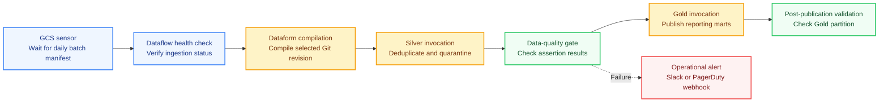

# Data Engineering on GCP (Part 7): Enterprise Pipeline Orchestration with Cloud Composer and Workflows

At 03:45 on a Wednesday morning, Offvia’s automated revenue alert fired.

The executive dashboard showed a 42% fall in European flight-booking revenue. Two partner carriers had recorded no reservations at all. The initial assumption was obvious: either the data had not arrived, the ingestion pipeline had failed, or something had broken downstream.

None of those things had happened.

The partner carrier’s nightly batch file eventually landed at 03:18—eighteen minutes late because of an upstream storage delay. But Offvia’s Dataform transformation was scheduled with a fixed cron expression, `0 3 * * *`. At 03:00, it started regardless of whether the expected input had arrived. It processed the Bronze data available at that moment, deduplicated it against the previous day, and published the Gold reporting mart.

When the late file finally landed, the pipeline had already completed. The Gold layer contained a partial view of the day, and the business had made decisions from incomplete data.

This is a common production failure. It is also a useful reminder:

**A cron schedule tells you when to start. It does not tell you whether you are ready to start.**

In this final part of the series, we will connect the components built earlier—Cloud Storage landing zones ([Part 1](/blog/gcp-data-engineering-storage-building-blocks/)), BigLake external tables ([Part 2](/blog/gcp-data-engineering-hands-on-storage-pipeline-lab/)), streaming ingestion ([Part 3](/blog/gcp-data-engineering-streaming-batch-ingestion-pubsub-dataflow/) & [Part 4](/blog/gcp-data-engineering-streaming-pipeline-lab/)), and Dataform Medallion transformations ([Part 5](/blog/gcp-data-engineering-transformations-dataform-dbt/) & [Part 6](/blog/gcp-data-engineering-dataform-medallion-lab/))—into a resilient orchestration graph using **Managed Service for Apache Airflow** (formerly Cloud Composer) and **Google Cloud Workflows**.

## Scheduling is not orchestration

A cron timer is useful for one thing: starting work at a known time.

It does not know whether a file has arrived. It does not know whether an upstream job has completed. It cannot inspect data-quality results, wait for a streaming job to become healthy, trigger a backfill safely, or notify the right people when an SLA is missed.

An orchestrator makes those dependencies explicit.

Instead of saying:

> “Run ingestion at 01:00 and transformation at 02:00.”

you define:

> “Run transformation only after ingestion succeeds and the required source manifest exists.”

That difference matters when volumes change, upstream systems are late, or a job occasionally takes longer than expected.

## An airport analogy

Think of a busy airport.

A static schedule is like announcing a departure solely because the clock says 09:00. If passengers have not boarded, fuel has not arrived, or the runway is unavailable, the aircraft still leaves.

An orchestrator behaves more like ground operations and air-traffic control. It checks the preconditions before allowing the next step:

- Has the fuel truck finished?
- Are the cabin doors sealed?
- Has the runway cleared?
- Has an engine warning been raised?

Only when the required conditions pass does it authorize pushback.

If something fails, the sequence stops, the aircraft is routed to maintenance, and the operations team is notified.

That is the role of an orchestrator in a data platform.

## Managed Airflow vs. Cloud Workflows

Google Cloud provides two complementary orchestration services. They overlap in some use cases, but they are not interchangeable.

| Dimension | Managed Service for Apache Airflow | Google Cloud Workflows |
|---|---|---|
| Core engine | Managed Apache Airflow, built on Google Kubernetes Engine | Fully managed, serverless workflow engine |
| Definition style | Python DAGs, operators, sensors, macros, and plugins | Declarative YAML or JSON state machines |
| Cost model | Depends on the environment generation; may include environment, compute, storage, and database charges | Charges are based on workflow execution; no charges while idle |
| Latency profile | Scheduler and worker scheduling introduce some delay | Designed for fast, event-driven execution |
| Strong fit | Complex batch graphs, dependencies, retries, backfills, cross-system ETL | Lightweight event reactions, API orchestration, GCS landing events |
| Typical role | Central control plane for the data platform | Serverless glue between events and services |

Managed Airflow is usually the better choice when you need a durable, observable control plane for many pipelines. Workflows is often a better fit for a focused, serverless reaction to an event—such as validating a newly uploaded partner file.

The two are complementary, not competing.

## A practical hybrid pattern

A robust enterprise architecture often uses both services:

1. **Cloud Workflows reacts to a landing event.**  
   When a partner uploads a file to a Cloud Storage bucket, Eventarc triggers a workflow. The workflow validates the file, records telemetry, and publishes a notification.

2. **Managed Airflow governs the end-to-end pipeline.**  
   A scheduled DAG waits for the expected manifest, triggers Dataform transformations, validates the resulting partitions, publishes Gold marts, and raises operational alerts when something fails.

This avoids using a large orchestration environment for every small event while still retaining central visibility and dependency control.

## The Offvia orchestration graph

The target pipeline looks like this:



The important detail is that the failure edge is conceptual. In Airflow, a normal downstream task does **not** run after an upstream task fails. To make alerting reliable, use an `on_failure_callback`, an alerting service integrated with Cloud Monitoring, or a separately triggered alert workflow.

## Hands-on lab

This lab builds a production-oriented master DAG for Offvia.

It uses:

- `GCSObjectExistenceSensor` to wait for a partner manifest.
- Google Cloud Dataform operators to compile and invoke SQLX transformations.
- BigQuery to validate the published Gold partition.
- A failure callback to send an operational alert.

### Step 1: Configure project variables

Set the values you will use throughout the lab:

```bash
export PROJECT_ID=$(gcloud config get-value project)
export REGION="europe-west1"
export COMPOSER_ENV="offvia-orchestrator"
export COMPOSER_SA="composer-worker@${PROJECT_ID}.iam.gserviceaccount.com"
```

For a production environment, avoid hard-coding project IDs or credentials in DAG files. Inject them through environment variables, Airflow Connections, Secret Manager, or workload identity federation where appropriate.

### Step 2: Grant required IAM roles

The Composer worker service account needs permission to submit Dataform workflows and run BigQuery jobs.

```bash
gcloud projects add-iam-policy-binding "${PROJECT_ID}" \
  --member="serviceAccount:${COMPOSER_SA}" \
  --role="roles/dataform.editor"

gcloud projects add-iam-policy-binding "${PROJECT_ID}" \
  --member="serviceAccount:${COMPOSER_SA}" \
  --role="roles/bigquery.jobUser"

gcloud projects add-iam-policy-binding "${PROJECT_ID}" \
  --member="serviceAccount:${COMPOSER_SA}" \
  --role="roles/bigquery.dataEditor"
```

Apply the principle of least privilege. In many production environments, `roles/bigquery.dataEditor` is broader than necessary; scope access to the relevant datasets where possible.

### Step 3: Create the DAG

Create a file named `offvia_master_lakehouse_dag.py`.

```python
"""
Offvia Master Lakehouse Orchestrator DAG.

Coordinates:
1. Verification that the daily partner manifest has landed.
2. Compilation of the Dataform project from a selected Git revision.
3. Execution of Silver transformations and assertions.
4. Publication of Gold reporting marts.
5. Post-publication validation of the Gold partition.
"""

import os
from datetime import datetime, timedelta

from airflow import DAG
from airflow.operators.empty import EmptyOperator
from airflow.providers.google.cloud.operators.bigquery import (
    BigQueryInsertJobOperator,
)
from airflow.providers.google.cloud.operators.dataform import (
    DataformCreateCompilationResultOperator,
    DataformCreateWorkflowInvocationOperator,
)
from airflow.providers.google.cloud.sensors.gcs import (
    GCSObjectExistenceSensor,
)

PROJECT_ID = os.environ.get("GCP_PROJECT_ID")
REGION = os.environ.get("GCP_REGION", "europe-west1")
REPOSITORY_ID = "offvia-lakehouse"
GIT_REVISION = "main"

default_args = {
    "owner": "offvia-data-platform",
    "retries": 2,
    "retry_delay": timedelta(minutes=3),
    "execution_timeout": timedelta(hours=1),
    "on_failure_callback": lambda context: print(
        "CRITICAL ALERT: "
        f"Task {context['task_instance'].task_id} failed. "
        f"Exception: {context.get('exception')}"
    ),
}

with DAG(
    dag_id="offvia_master_lakehouse_pipeline",
    default_args=default_args,
    description="End-to-end Medallion Lakehouse pipeline coordinator",
    schedule="0 4 * * *",
    start_date=datetime(2026, 10, 1),
    catchup=False,
    max_active_runs=1,
    tags=["production", "dataform", "medallion", "bigquery"],
) as dag:

    pipeline_start = EmptyOperator(task_id="pipeline_start")

    wait_for_partner_manifest = GCSObjectExistenceSensor(
        task_id="wait_for_daily_partner_manifest",
        bucket="offvia-landing-bucket",
        object=(
            "partners/manifests/"
            "{{ ds_nodash }}_batch_completed.json"
        ),
        timeout=1800,
        poke_interval=60,
        mode="reschedule",
    )

    compile_dataform_project = DataformCreateCompilationResultOperator(
        task_id="compile_dataform_project",
        project_id=PROJECT_ID,
        region=REGION,
        repository_id=REPOSITORY_ID,
        compilation_result={
            "git_commitish": GIT_REVISION,
            "code_compilation_config": {
                "default_schema": "offvia_bronze",
                "assertion_schema": "offvia_assertions",
            },
        },
    )

    run_silver_transformations = DataformCreateWorkflowInvocationOperator(
        task_id="invoke_silver_transformations",
        project_id=PROJECT_ID,
        region=REGION,
        repository_id=REPOSITORY_ID,
        workflow_invocation={
            "compilation_result": (
                "{{ task_instance.xcom_pull("
                "'compile_dataform_project'"
                ")['name'] }}"
            ),
            "invocation_config": {
                "included_tags": ["silver", "assertions"],
                "transitive_dependencies_included": True,
            },
        },
    )

    run_gold_marts = DataformCreateWorkflowInvocationOperator(
        task_id="invoke_gold_reporting_marts",
        project_id=PROJECT_ID,
        region=REGION,
        repository_id=REPOSITORY_ID,
        workflow_invocation={
            "compilation_result": (
                "{{ task_instance.xcom_pull("
                "'compile_dataform_project'"
                ")['name'] }}"
            ),
            "invocation_config": {
                "included_tags": ["gold"],
                "transitive_dependencies_included": False,
            },
        },
    )

    validate_gold_partition = BigQueryInsertJobOperator(
        task_id="validate_gold_reporting_partition",
        configuration={
            "query": {
                "query": """
                    SELECT
                      COUNT(*) AS row_count
                    FROM `offvia_gold.mart_daily_route_profitability`
                    WHERE flight_date = DATE('{{ ds }}')
                """,
                "useLegacySql": False,
            }
        },
    )

    pipeline_complete = EmptyOperator(task_id="pipeline_complete")

    (
        pipeline_start
        >> wait_for_partner_manifest
        >> compile_dataform_project
        >> run_silver_transformations
        >> run_gold_marts
        >> validate_gold_partition
        >> pipeline_complete
    )
```

### Why this version is safer

The original draft assigned a Jinja expression to a Python constant:

```python
PROJECT_ID = "{{ var.value.gcp_project_id }}"
```

That does not work as intended. Jinja templates are rendered when Airflow evaluates task arguments, not when Python imports the DAG module. The revised version reads the project ID from an environment variable instead.

The revised DAG also avoids setting:

```python
"depends_on_past": True
```

That setting can be useful for strict sequential execution, but it interacts poorly with `catchup=False` and can make recovery confusing after a failed run. If you need run-to-run dependencies, make that decision deliberately and test the recovery path.

## Deploy the DAG

First, find the Cloud Storage prefix used by your Managed Airflow environment:

```bash
DAGS_BUCKET=$(gcloud composer environments describe "${COMPOSER_ENV}" \
  --location="${REGION}" \
  --format="get(config.dagGcsPrefix)")
```

Then copy the DAG file:

```bash
gcloud storage cp offvia_master_lakehouse_dag.py "${DAGS_BUCKET}/"
```

Trigger a manual test run:

```bash
gcloud composer environments run "${COMPOSER_ENV}" \
  --location="${REGION}" \
  dags trigger -- offvia_master_lakehouse_pipeline
```

You can inspect DAG runs from the Airflow UI. For command-line monitoring, list recent DAG runs:

```bash
gcloud composer environments run "${COMPOSER_ENV}" \
  --location="${REGION}" \
  dags list-runs -- offvia_master_lakehouse_pipeline
```

## Production gotchas

### Use reschedule mode for sensors

A sensor in `poke` mode holds a worker slot while it waits. If several DAGs wait for files or long-running jobs, they can exhaust the worker pool and delay unrelated work.

Use:

```python
mode="reschedule"
```

The sensor checks once, releases the worker slot, and wakes again at the next poke interval.

### Keep XCom payloads small

Do not place full compiled Dataform payloads, raw JSON files, or large result sets into XCom. Airflow stores XCom data in its metadata database, and large values create operational and performance problems.

Pass only the minimum required metadata between tasks, such as:

```text
projects/<project>/locations/<region>/repositories/<repository>/compilationResults/<id>
```

### Do not treat a query as a cache refresh

A `SELECT COUNT(*)` statement validates that rows exist. It does not refresh BI Engine, Materialized Views, or any other cache.

If you use BI Engine, manage acceleration and caching through the appropriate BigQuery and BI Engine configuration. If you use Materialized Views, refresh them explicitly or rely on their configured refresh strategy.

### Alert on failure correctly

This pattern will not work as intended:

```python
data_quality_gate >> send_alert
```

If `data_quality_gate` fails, Airflow marks downstream tasks as upstream failed rather than running them.

Use one of these approaches instead:

- Configure `on_failure_callback` on the DAG or individual tasks.
- Use Cloud Monitoring alert policies based on Airflow or Cloud Logging metrics.
- Create a separate alerting DAG triggered by a failure event.
- Use a task with `trigger_rule="one_failed"` only when you understand the broader DAG topology and retry behaviour.

## Series retrospective

This series built a practical Google Cloud data platform:

1. **[Part 1: Storage and access building blocks](/blog/gcp-data-engineering-storage-building-blocks/)** — Cloud Storage, lifecycle policies, and BigLake external tables.
2. **[Part 2: Production storage and access layer](/blog/gcp-data-engineering-hands-on-storage-pipeline-lab/)** — Fine-grained access controls, masking, and storage transfer patterns.
3. **[Part 3: Choosing a real-time ingestion path](/blog/gcp-data-engineering-streaming-batch-ingestion-pubsub-dataflow/)** — Pub/Sub, Kafka, BigQuery subscriptions, and Dataflow.
4. **[Part 4: Real-time streaming pipeline](/blog/gcp-data-engineering-streaming-pipeline-lab/)** — Apache Beam processing, windowing, and dead-letter queues.
5. **[Part 5: Medallion transformations](/blog/gcp-data-engineering-transformations-dataform-dbt/)** — Dataform and dbt contracts, transformations, and assertions.
6. **[Part 6: Dataform Medallion Lakehouse](/blog/gcp-data-engineering-dataform-medallion-lab/)** — Incremental SQLX models, partition pruning, and quarantine isolation.
7. **Part 7: Enterprise orchestration** — Managed Airflow, Cloud Workflows, dependency governance, alerting, and recovery.

The central lesson is simple: build pipelines as explicit, observable dependency graphs—not as a sequence of timers.

## Official references

- [Managed Service for Apache Airflow documentation](https://cloud.google.com/composer/docs)
- [Managed Service for Apache Airflow product page](https://cloud.google.com/products/managed-service-for-apache-airflow)
- [Managed Service for Apache Airflow pricing](https://cloud.google.com/products/managed-service-for-apache-airflow/pricing)
- [Google Cloud Workflows overview](https://cloud.google.com/workflows/docs/overview)
- [Apache Airflow Google Dataform operators](https://airflow.apache.org/docs/apache-airflow-providers-google/stable/operators/cloud/dataform.html)
- [Apache Airflow sensors](https://airflow.apache.org/docs/apache-airflow/stable/core-concepts/sensors.html)
