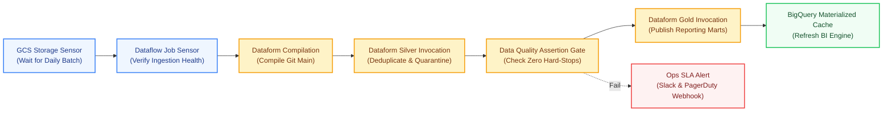

# Data Engineering on GCP (Part 7): Enterprise Pipeline Orchestration with Cloud Composer and Workflows (Hands-On Lab)

At 03:45 AM on a Wednesday, the automated executive revenue alert at Offvia fired. The morning dashboard displayed a catastrophic 42% drop in flight booking revenue across European routes, with zero reservations logged for two partner carriers. 

Ten minutes of forensic debugging revealed the culprit. The underlying booking data was not lost, nor was there a network outage. Instead, the partner carrier’s nightly batch file had arrived 18 minutes late due to an upstream storage delay. Offvia’s nightly Dataform SQLX transformation was scheduled on a static cron timer (`0 3 * * *`). It obediently launched at 03:00 AM, processed whatever data was currently in the Bronze tables, deduplicated against yesterday’s records, and published the Gold reporting mart. 

When the late batch finally landed at 03:18 AM, the pipeline had already run. The Gold layer was frozen with partial data for the day.

This incident demonstrates the fundamental rule of production data systems: **scheduling is not orchestration.** A cron timer only knows what time it is; it knows nothing about file arrival, upstream job completion, data quality thresholds, or retry dependencies. 

In this finale of our 7-part Google Cloud Data Engineering masterclass, we will unite everything we built across the series—Cloud Storage landing, BigLake external tables, Dataflow streaming pipelines, and Dataform Medallion transformations—into an enterprise-grade, failure-resilient orchestration graph using **Cloud Composer (Managed Apache Airflow 2)** and **Google Cloud Workflows**.

---

## The Real-World Analogy: Airport Ground Operations vs. A Wall Clock

To understand modern cloud data orchestration, imagine operating a busy international airport:

<div class="p-5 sm:p-6 rounded-2xl bg-slate-50 dark:bg-slate-900/60 border border-slate-200 dark:border-slate-800 my-8 shadow-xs">
<div class="flex items-center gap-2.5 font-bold text-slate-900 dark:text-white text-base mb-2">
<span class="text-xl">✈️</span>
<span>The Airport Dispatch Analogy</span>
</div>
<p class="text-sm text-slate-700 dark:text-slate-300 leading-relaxed mb-0">
A static cron schedule is like a flight departure announcement based solely on a clock: <em>"It is 09:00 AM, therefore Flight OF-104 is taking off."</em> If the passengers have not boarded, the fuel truck was delayed, or the runway has crosswinds, the flight departs anyway—disastrously empty or unsafe.<br><br>
An <strong>orchestrator (Cloud Composer / Airflow)</strong> is the <strong>Air Traffic Control & Ground Operations Coordinator</strong>. It evaluates real-world preconditions: <em>Did the fuel truck finish? (Upstream Sensor)</em> ➔ <em>Are the cabin doors sealed? (Data Quality Assertion)</em> ➔ <em>Has the runway cleared? (Dependency Gate)</em>. Only when every verified condition passes does it grant pushback clearance. If an engine alert trips (Pipeline Error), it halts the sequence, routes the plane to a service bay (Quarantine), and notifies the operations tower (SLA Alerting).
</p>
</div>

---

## Cloud Composer vs. Cloud Workflows: The Decision Framework

Google Cloud offers two primary services for orchestration: **Cloud Composer** and **Cloud Workflows**. Choosing the wrong tool can lead to excessive infrastructure costs or fragile pipeline logic.

<div class="overflow-x-auto my-8 rounded-xl border border-slate-200 dark:border-slate-800 shadow-xs">
<table class="w-full text-left text-xs sm:text-sm text-slate-800 dark:text-slate-200 m-0">
<thead class="bg-slate-100 dark:bg-slate-900/80 font-mono text-[11px] sm:text-xs uppercase tracking-wider text-slate-900 dark:text-white border-b border-slate-200 dark:border-slate-800">
<tr>
<th class="py-3 px-4">Evaluation Dimension</th>
<th class="py-3 px-4 text-sky-700 dark:text-sky-400">Cloud Composer (Airflow 2.x)</th>
<th class="py-3 px-4 text-amber-700 dark:text-amber-400">Google Cloud Workflows</th>
</tr>
</thead>
<tbody class="divide-y divide-slate-100 dark:divide-slate-800 font-sans">
<tr class="hover:bg-slate-50/50 dark:hover:bg-slate-900/40">
<td class="py-3 px-4 font-semibold text-slate-900 dark:text-white">Underlying Engine</td>
<td class="py-3 px-4">Managed Apache Airflow running on GKE Autopilot</td>
<td class="py-3 px-4">Fully managed, serverless YAML/JSON state engine</td>
</tr>
<tr class="hover:bg-slate-50/50 dark:hover:bg-slate-900/40">
<td class="py-3 px-4 font-semibold text-slate-900 dark:text-white">Pricing Model</td>
<td class="py-3 px-4">Continuous cluster cost (Composer environment baseline)</td>
<td class="py-3 px-4">Pay-per-execution step (fraction of a cent; free tier available)</td>
</tr>
<tr class="hover:bg-slate-50/50 dark:hover:bg-slate-900/40">
<td class="py-3 px-4 font-semibold text-slate-900 dark:text-white">Cold Start Latency</td>
<td class="py-3 px-4">15–60 seconds (Airflow Scheduler heartbeat & worker queue)</td>
<td class="py-3 px-4">Sub-second (&lt; 100 milliseconds)</td>
</tr>
<tr class="hover:bg-slate-50/50 dark:hover:bg-slate-900/40">
<td class="py-3 px-4 font-semibold text-slate-900 dark:text-white">Workflow Definition</td>
<td class="py-3 px-4">Python scripts with custom classes, macros, and operators</td>
<td class="py-3 px-4">Declarative YAML state machine definitions</td>
</tr>
<tr class="hover:bg-slate-50/50 dark:hover:bg-slate-900/40">
<td class="py-3 px-4 font-semibold text-slate-900 dark:text-white">Best Use Case</td>
<td class="py-3 px-4 font-medium text-sky-700 dark:text-sky-300">Complex batch graphs, cross-system ETL, backfilling, data lineage</td>
<td class="py-3 px-4 font-medium text-amber-700 dark:text-amber-300">Event-driven triggers, GCS landing reactions, serverless APIs</td>
</tr>
</tbody>
</table>
</div>

### The Enterprise Pattern: The Hybrid Orchestration Topology

Production systems at scale combine both technologies:
1. **Cloud Workflows** handles **event-driven reactions**: When a flight partner uploads an unexpected payload to `gs://offvia-landing-bucket/`, an Eventarc trigger calls a lightweight Cloud Workflow. It validates file integrity, publishes a notification message, and logs telemetry in sub-second time.
2. **Cloud Composer** handles **global dependency governance**: The scheduled enterprise DAG runs nightly, coordinates across multiple data stores, triggers Dataform compilations, waits for BigQuery partition validation, handles backfills, and triggers operational alerts if SLAs are breached.

---

## 🚨 5 Fatal Misconceptions Every Data Engineer Must Unlearn

<div class="grid grid-cols-1 md:grid-cols-2 gap-4 my-8">
<div class="p-4 rounded-xl border border-red-200 dark:border-red-900/50 bg-red-50/40 dark:bg-red-950/20">
<div class="font-bold text-xs uppercase font-mono tracking-wider text-red-700 dark:text-red-400 mb-1">
❌ Misconception 1: "Dataform has release configs, so Airflow is redundant."
</div>
<p class="text-xs sm:text-[13px] text-slate-700 dark:text-slate-300 leading-relaxed m-0">
<strong>Reality:</strong> Dataform release configurations can only orchestrate inside Dataform itself. They cannot wait for an upstream Cloud Storage file sensor, check a Dataflow streaming job metric, trigger an external machine learning model evaluation, or ping an on-call PagerDuty service.
</p>
</div>
<div class="p-4 rounded-xl border border-red-200 dark:border-red-900/50 bg-red-50/40 dark:bg-red-950/20">
<div class="font-bold text-xs uppercase font-mono tracking-wider text-red-700 dark:text-red-400 mb-1">
❌ Misconception 2: "Airflow tasks should run heavy transformation logic in Python."
</div>
<p class="text-xs sm:text-[13px] text-slate-700 dark:text-slate-300 leading-relaxed m-0">
<strong>Reality:</strong> Airflow is a control plane, not a compute engine. Loading gigabytes of data into Pandas inside an Airflow worker causes Out-Of-Memory (OOM) worker restarts and scheduler crashes. Airflow should only dispatch work to BigQuery, Dataform, or Dataflow, passing lightweight metadata (job IDs and table names).
</p>
</div>
<div class="p-4 rounded-xl border border-red-200 dark:border-red-900/50 bg-red-50/40 dark:bg-red-950/20">
<div class="font-bold text-xs uppercase font-mono tracking-wider text-red-700 dark:text-red-400 mb-1">
❌ Misconception 3: "Scheduling pipelines with fixed time gaps guarantees dependency safety."
</div>
<p class="text-xs sm:text-[13px] text-slate-700 dark:text-slate-300 leading-relaxed m-0">
<strong>Reality:</strong> Running Ingestion at 01:00 AM and Transformation at 02:00 AM is brittle. If ingestion takes 65 minutes on high-volume days, your transformation will process incomplete records. Use declarative task dependencies (<code>ingestion >> transformation</code>) or sensors instead of time buffers.
</p>
</div>
<div class="p-4 rounded-xl border border-red-200 dark:border-red-900/50 bg-red-50/40 dark:bg-red-950/20">
<div class="font-bold text-xs uppercase font-mono tracking-wider text-red-700 dark:text-red-400 mb-1">
❌ Misconception 4: "Dataform compilation always executes the latest Git code automatically."
</div>
<p class="text-xs sm:text-[13px] text-slate-700 dark:text-slate-300 leading-relaxed m-0">
<strong>Reality:</strong> In Google Cloud Dataform, compiling and executing are separate steps. An Airflow DAG must explicitly create a <code>CompilationResult</code> specifying the desired Git commit/branch before creating a <code>WorkflowInvocation</code>. Skipping compilation results in running stale, cached SQL definitions.
</p>
</div>
</div>

---

## The End-to-End Enterprise Orchestration Graph

Below is the lifecycle orchestration graph we will implement for Offvia:



---

## Hands-On Lab: Implementing the Pipeline in Cloud Composer

In this hands-on lab, we will build Offvia’s master DAG using modern Apache Airflow 2 providers (`google-cloud-pipeline-components` and `apache-airflow-providers-google`).

### Step 1: Set Up Environment Variables and IAM Roles

Ensure your Cloud Composer service account has permissions to invoke Dataform workflows and submit BigQuery jobs:

```bash
export PROJECT_ID=$(gcloud config get-value project)
export REGION="europe-west1"
export COMPOSER_ENV="offvia-orchestrator"
export COMPOSER_SA="composer-worker@${PROJECT_ID}.iam.gserviceaccount.com"

# Grant Dataform and BigQuery access to the Composer worker
gcloud projects add-iam-policy-binding "${PROJECT_ID}" \
  --member="serviceAccount:${COMPOSER_SA}" \
  --role="roles/dataform.editor"

gcloud projects add-iam-policy-binding "${PROJECT_ID}" \
  --member="serviceAccount:${COMPOSER_SA}" \
  --role="roles/bigquery.jobUser"

gcloud projects add-iam-policy-binding "${PROJECT_ID}" \
  --member="serviceAccount:${COMPOSER_SA}" \
  --role="roles/bigquery.dataEditor"
```

---

### Step 2: Write the Production Airflow DAG

Create a new file named `offvia_master_lakehouse_dag.py`. This DAG uses the official Google Cloud Dataform Airflow operators:

```python
# Offvia Master Lakehouse Orchestrator DAG
# Coordinates Cloud Storage verification, Dataform Medallion compilation & invocation,
# and downstream BigQuery data quality validation.

from datetime import datetime, timedelta
from airflow import DAG
from airflow.providers.google.cloud.operators.dataform import (
    DataformCreateCompilationResultOperator,
    DataformCreateWorkflowInvocationOperator,
)
from airflow.providers.google.cloud.sensors.gcs import GCSObjectExistenceSensor
from airflow.providers.google.cloud.operators.bigquery import BigQueryInsertJobOperator
from airflow.operators.empty import EmptyOperator

PROJECT_ID = "{{ var.value.gcp_project_id }}"
REGION = "europe-west1"
REPOSITORY_ID = "offvia-lakehouse"
GIT_BRANCH = "main"

default_args = {
    "owner": "offvia-data-platform",
    "depends_on_past": True,
    "email_on_failure": True,
    "email": ["data-alerts@offvia.com"],
    "retries": 2,
    "retry_delay": timedelta(minutes=3),
    "execution_timeout": timedelta(hours=1),
}

with DAG(
    dag_id="offvia_master_lakehouse_pipeline",
    default_args=default_args,
    description="End-to-end Medallion Lakehouse pipeline coordinator",
    schedule_interval="0 4 * * *",  # 04:00 AM UTC daily
    start_date=datetime(2026, 10, 1),
    catchup=False,
    max_active_runs=1,
    tags=["production", "dataform", "medallion", "bigquery"],
) as dag:

    start_task = EmptyOperator(task_id="pipeline_start")

    # 1. Sensor: Ensure daily flight partner raw manifest has landed in GCS
    wait_for_raw_manifest = GCSObjectExistenceSensor(
        task_id="wait_for_daily_partner_manifest",
        bucket="offvia-landing-bucket",
        object="partners/manifests/{{ ds_nodash }}_batch_completed.json",
        timeout=1800,  # 30 minute SLA timeout
        poke_interval=60,
        mode="reschedule",
    )

    # 2. Compile Dataform code against the target Git branch with environment overrides
    compile_dataform_project = DataformCreateCompilationResultOperator(
        task_id="compile_dataform_project",
        project_id=PROJECT_ID,
        region=REGION,
        repository_id=REPOSITORY_ID,
        compilation_result={
            "git_commitish": GIT_BRANCH,
            "code_compilation_config": {
                "default_schema": "offvia_bronze",
                "assertion_schema": "offvia_assertions",
            },
        },
    )

    # 3. Execute Silver Layer: Deduplication, Quarantine, and Assertions
    run_silver_medallion = DataformCreateWorkflowInvocationOperator(
        task_id="invoke_silver_transformations",
        project_id=PROJECT_ID,
        region=REGION,
        repository_id=REPOSITORY_ID,
        workflow_invocation={
            "compilation_result": (
                "{{ task_instance.xcom_pull('compile_dataform_project')['name'] }}"
            ),
            "invocation_config": {
                "included_tags": ["silver", "assertions"],
                "transitive_dependencies_included": True,
            },
        },
    )

    # 4. Execute Gold Layer: Aggregated Revenue & Operational Performance Marts
    run_gold_marts = DataformCreateWorkflowInvocationOperator(
        task_id="invoke_gold_reporting_marts",
        project_id=PROJECT_ID,
        region=REGION,
        repository_id=REPOSITORY_ID,
        workflow_invocation={
            "compilation_result": (
                "{{ task_instance.xcom_pull('compile_dataform_project')['name'] }}"
            ),
            "invocation_config": {
                "included_tags": ["gold"],
                "transitive_dependencies_included": False,
            },
        },
    )

    # 5. Refresh BigQuery BI Engine & Cache for executive dashboards
    refresh_bi_cache = BigQueryInsertJobOperator(
        task_id="refresh_bi_reporting_cache",
        configuration={
            "query": {
                "query": """
                    SELECT COUNT(*)
                    FROM `offvia_gold.mart_daily_route_profitability`
                    WHERE flight_date = DATE('{{ ds }}');
                """,
                "useLegacySql": False,
            }
        },
    )

    end_task = EmptyOperator(task_id="pipeline_complete")

    # Define strict execution graph
    (
        start_task
        >> wait_for_raw_manifest
        >> compile_dataform_project
        >> run_silver_medallion
        >> run_gold_marts
        >> refresh_bi_cache
        >> end_task
    )
```

---

### Step 3: Deploy and Test the DAG in Cloud Composer

1. Upload the DAG file directly to your Cloud Composer DAGs Google Cloud Storage bucket:

```bash
# Retrieve Composer DAG bucket location
DAGS_BUCKET=$(gcloud composer environments describe "${COMPOSER_ENV}" \
  --location="${REGION}" \
  --format="get(config.dagGcsPrefix)")

# Copy DAG to Composer GCS bucket
gsutil cp offvia_master_lakehouse_dag.py "${DAGS_BUCKET}/"
```

2. Trigger an ad-hoc test run from the CLI without waiting for the nightly cron:

```bash
gcloud composer environments run "${COMPOSER_ENV}" \
  --location="${REGION}" \
  dags trigger -- offvia_master_lakehouse_pipeline
```

3. Monitor real-time task progression in the Airflow UI or via Cloud Logging:

```bash
gcloud composer environments run "${COMPOSER_ENV}" \
  --location="${REGION}" \
  tasks states-for-dag-run -- offvia_master_lakehouse_pipeline $(date +%Y-%m-%d)
```

---

## Production Gotchas to Keep in Mind

### 1. The `mode="poke"` Sensor Bottleneck in Airflow Workers

When using `GCSObjectExistenceSensor` or `WorkflowInvocationSensor`, setting `mode="poke"` keeps the Airflow worker slot locked during the entire wait period. If multiple DAGs wait for files, you will exhaust your worker slot pool, preventing other tasks from starting.

Always set `mode="reschedule"`. In reschedule mode, the task checks once, releases the worker slot back to the cluster pool, and sleeps until the next interval.

### 2. XCom Size Limits with Dataform Compilation Payloads

The `DataformCreateCompilationResultOperator` returns metadata about the compiled project. Avoid storing full compiled execution graphs or JSON file contents into Airflow XComs. XComs in Composer are stored in the Airflow metadata database (Cloud SQL), which enforces a strict payload limit. Only pull the compilation resource `name` attribute between tasks.

### 3. Graceful SLA Alerting on Assertion Failures

When Dataform assertions fail (e.g., negative revenue detected), the `DataformCreateWorkflowInvocationOperator` raises an `AirflowException`. 

Configure an `on_failure_callback` on your Airflow DAG to send rich incident context directly to your DevOps webhook:

```python
def notify_pagerduty_slack(context):
    task_id = context['task_instance'].task_id
    error_msg = context.get('exception')
    # Dispatch alert with Cloud Run or Webhook URL
    print(f"🚨 CRITICAL ALERT: Task {task_id} failed with error: {error_msg}")

default_args["on_failure_callback"] = notify_pagerduty_slack
```

---

## 🏆 Complete 7-Part Architecture Retrospective

Congratulations! You have completed the entire **Data Engineering on Google Cloud** masterclass. Here is the complete production stack we built together:

1. **[Part 1: Storage & Access Building Blocks Demystified](/blog/gcp-data-engineering-storage-building-blocks/)** — Designed zero-copy BigLake external tables and storage lifecycle management.
2. **[Part 2: Building the Production Storage & Access Layer](/blog/gcp-data-engineering-hands-on-storage-pipeline-lab/)** — Implemented fine-grained column-level masking and storage transfer pipelines.
3. **[Part 3: Choosing a Reliable Real-Time Ingestion Path](/blog/gcp-data-engineering-streaming-batch-ingestion-pubsub-dataflow/)** — Evaluated Pub/Sub, Kafka, BigQuery Direct Subscriptions, and Dataflow streaming.
4. **[Part 4: Production Real-Time Streaming Pipeline](/blog/gcp-data-engineering-streaming-pipeline-lab/)** — Implemented Apache Beam windowing and Dead-Letter Queues (DLQ).
5. **[Part 5: Medallion Architecture with Dataform and dbt](/blog/gcp-data-engineering-transformations-dataform-dbt/)** — Formulated the Bronze-Silver-Gold transformation contracts and data quality assertions.
6. **[Part 6: Building a Medallion Lakehouse with Dataform](/blog/gcp-data-engineering-dataform-medallion-lab/)** — Implemented incremental SQLX models, partition pruning, and quarantine isolation.
7. **Part 7: Enterprise Pipeline Orchestration with Cloud Composer and Workflows** — United all ingestion, transformation, and alerting steps into a hardened, production-grade DAG.

---

## Official References

- [Google Cloud Composer Documentation](https://cloud.google.com/composer/docs)
- [Airflow Google Provider Dataform Operators](https://airflow.apache.org/docs/apache-airflow-providers-google/stable/operators/cloud/dataform.html)
- [Google Cloud Workflows Overview](https://cloud.google.com/workflows/docs/overview)
- [Airflow Sensors Best Practices](https://airflow.apache.org/docs/apache-airflow/stable/core-concepts/sensors.html)
- [Eventarc and Cloud Workflows Integration](https://cloud.google.com/eventarc/docs/workflows/create-trigger-storage-console)
