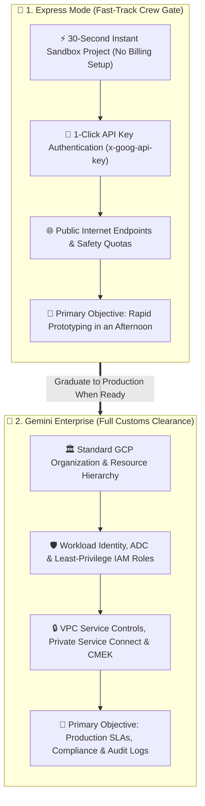
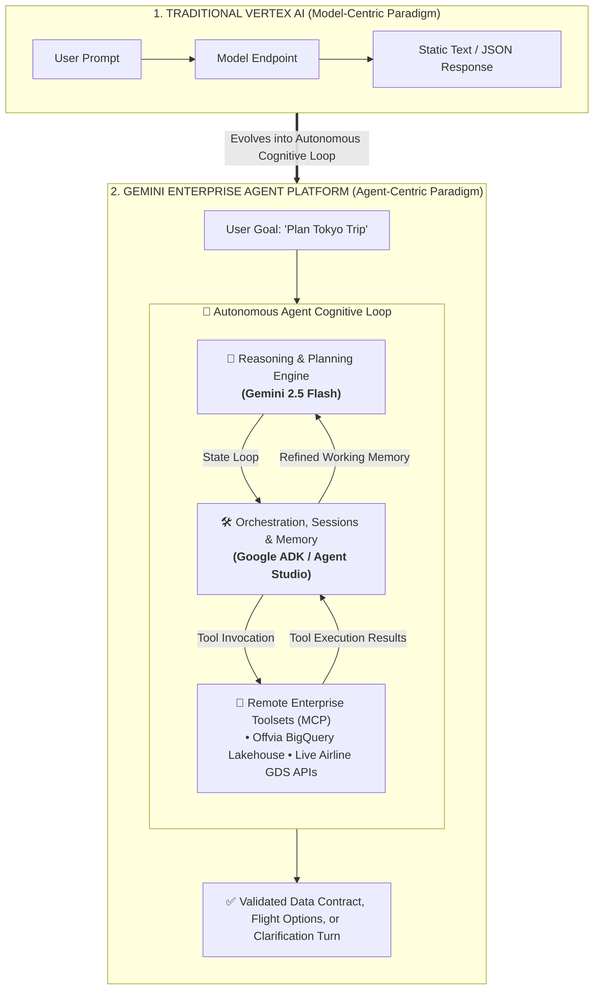
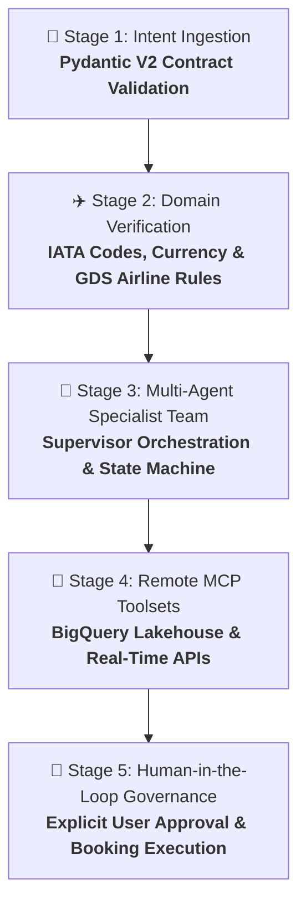

Prototypes are easy. Production boundaries are not.

Picture this: your executive team wants an AI travel concierge for our platform, **Offvia**. A customer types:

> *"Find me a four-day tech-conference trip to Tokyo from San Francisco for under $2,200, departing next Wednesday. I need a non-stop flight, a boutique hotel near Shibuya with high-speed Wi-Fi, and free cancellation in case my visa decision is delayed."*

You open your cloud console to build a prototype. But before you can send a single prompt, enterprise reality hits: you need a new GCP project, billing account approvals, IAM security clearance, and private VPC routing. 

**Estimated turnaround: three weeks.**

By the time the security review clears, business momentum is dead. 

Google Cloud recognized this enterprise bottleneck. Alongside evolving Vertex AI into **Gemini Enterprise Agent Platform**, Google introduced **Express Mode**—a zero-friction sandbox that compresses weeks of bureaucratic onboarding into a 30-second start.

In this first guide of our 3-part masterclass trilogy, we will bypass the red tape, dissect Google Cloud's agentic shift, and build a bulletproof, schema-constrained Python intent parser for Offvia.

> 📌 **Official Terminology:** Google Cloud officially designates this architecture as **Gemini Enterprise Agent Platform (formerly Vertex AI)**. In this series, we explore its **Express Mode** sandbox alongside **Agent Studio** and the **Agent Development Kit (ADK)**, backed by foundational [Vertex AI capabilities](https://cloud.google.com/vertex-ai/docs) and [Gemini Enterprise](https://cloud.google.com/products/gemini).

---

## ✈️ The Mental Model: Fast-Track Gate vs Customs Clearance

To understand where Express Mode fits, picture an international airport:



When an airline crew lands for a 45-minute turnaround, they don't stand in a two-hour general customs line. They flash their badge at the crew gate and walk straight onto the tarmac. 

Conversely, permanent immigration requires rigorous visa checks and background audits. 

* **Express Mode is your Fast-Track Gate:** An ephemeral sandbox for testing prompts, validating data schemas, and proving business value before lunch.
* **Gemini Enterprise is your Customs Clearance:** The governed runtime you graduate to before touching live credit cards, private customer PII, or internal VPC networks.

---

## 📊 Architectural Cheat Sheet: Express Mode vs. Enterprise Agent Platform

Before writing code, use this decision matrix to evaluate your security and governance requirements:

| Architecture Vector | Express Mode (Fast-Track Sandbox) | Gemini Enterprise Agent Platform (Production) |
| :--- | :--- | :--- |
| **Onboarding Velocity** | **30 Seconds** (Instant cloud workspace) | **2–4 Weeks** (IAM review, billing accounts, VPC peering) |
| **Authentication** | Ephemeral API Key (`x-goog-api-key`) | **Workload Identity Federation / ADC** (`roles/aiplatform.user`) |
| **Network Security** | Public Google Cloud API endpoints | **VPC Service Controls & Private Service Connect (PSC)** |
| **Data Encryption** | Google-managed default encryption | **Customer-Managed Encryption Keys (CMEK)** |
| **Rate Limits & Quota** | Strict prototype tier caps (RPM/TPM) | **Custom provisioned quota & Enterprise 99.9% SLAs** |
| **Audit & Governance** | Basic console logs | **Cloud Audit Logs, Access Transparency & BigQuery export** |
| **Best Used For** | Prototyping prompts, Pydantic schemas, unit tests | **Live booking transactions, private lakehouses, user PII** |

---

## 🏛️ The Paradigm Shift: Model Endpoints vs Cognitive Loops

For four years, Vertex AI operated on a **model-centric** paradigm: you sent tokens in, you received static tokens out. The model had no memory, no tools, and no operational awareness.

Modern **Gemini Enterprise Agent Platform** applications shift the entire center of gravity to **autonomous cognitive loops**:



The platform unifies four critical primitives:
1. **Agent Studio:** Visual playground to craft prompts, wire models, and export code.
2. **Agent Development Kit (ADK):** Open-source framework in Python and TypeScript for multi-agent state loops.
3. **Agent Garden:** Enterprise blueprints for common workflows (RAG, financial advisory, support).
4. **Gemini Enterprise Agent Platform MCP:** Native [Model Context Protocol (MCP)](https://modelcontextprotocol.io/) integration for connecting private lakehouses and external APIs securely.

---

## 🚨 5 Fatal Misconceptions About Cloud AI Agents

Before writing code, let's dispel the 5 most common, costly enterprise assumptions:

<div class="grid grid-cols-1 md:grid-cols-2 gap-4 my-8">
<div class="p-5 rounded-2xl border border-rose-500/25 bg-rose-50/50 dark:bg-rose-950/20 dark:border-rose-800/40">
<div class="flex items-center gap-2 mb-2 font-mono text-xs font-bold uppercase text-rose-600 dark:text-rose-400">
<i class="fa-solid fa-triangle-exclamation"></i> Misconception 1: "Express Mode Is A Toy Sandbox"
</div>
<p class="text-sm text-text/90 dark:text-darkmode-text/90 mb-0">
<strong>The Reality:</strong> Express Mode provisions a genuine Google Cloud project under the hood. Your API key calls the exact same production-grade Gemini 2.5 Flash infrastructure with full multimodal reasoning. It is an onboarding accelerator, not a crippled model runtime.
</p>
</div>
<div class="p-5 rounded-2xl border border-rose-500/25 bg-rose-50/50 dark:bg-rose-950/20 dark:border-rose-800/40">
<div class="flex items-center gap-2 mb-2 font-mono text-xs font-bold uppercase text-rose-600 dark:text-rose-400">
<i class="fa-solid fa-triangle-exclamation"></i> Misconception 2: "Structured JSON Guarantees Truth"
</div>
<p class="text-sm text-text/90 dark:text-darkmode-text/90 mb-0">
<strong>The Reality:</strong> Pydantic models strictly enforce <em>syntax and data types</em>, not real-world reality. The LLM can easily generate a syntactically valid $40 flight to Tokyo. Factual verification is the exclusive responsibility of downstream database tools.
</p>
</div>
<div class="p-5 rounded-2xl border border-rose-500/25 bg-rose-50/50 dark:bg-rose-950/20 dark:border-rose-800/40">
<div class="flex items-center gap-2 mb-2 font-mono text-xs font-bold uppercase text-rose-600 dark:text-rose-400">
<i class="fa-solid fa-triangle-exclamation"></i> Misconception 3: "LLMs Know What 'Next Wednesday' Means"
</div>
<p class="text-sm text-text/90 dark:text-darkmode-text/90 mb-0">
<strong>The Reality:</strong> LLMs have zero internal clock synchronization. Without explicitly passing an ISO reference date and traveler timezone in the prompt, relative expressions produce date hallucinations shifting across UTC midnight boundaries.
</p>
</div>
<div class="p-5 rounded-2xl border border-rose-500/25 bg-rose-50/50 dark:bg-rose-950/20 dark:border-rose-800/40">
<div class="flex items-center gap-2 mb-2 font-mono text-xs font-bold uppercase text-rose-600 dark:text-rose-400">
<i class="fa-solid fa-triangle-exclamation"></i> Misconception 4: "API Keys Are Fine In Production Staging"
</div>
<p class="text-sm text-text/90 dark:text-darkmode-text/90 mb-0">
<strong>The Reality:</strong> An API key identifies the billing project, but provides zero caller identity. A compromised key allows anyone to drain quotas. Production runtimes must strictly use Workload Identity with least-privilege IAM roles.
</p>
</div>
<div class="p-5 rounded-2xl border border-rose-500/25 bg-rose-50/50 dark:bg-rose-950/20 dark:border-rose-800/40 md:col-span-2">
<div class="flex items-center gap-2 mb-2 font-mono text-xs font-bold uppercase text-rose-600 dark:text-rose-400">
<i class="fa-solid fa-triangle-exclamation"></i> Misconception 5: "Monolithic Agents Can Handle Multi-Step Trips"
</div>
<p class="text-sm text-text/90 dark:text-darkmode-text/90 mb-0">
<strong>The Reality:</strong> Jamming flight search, hotel booking, budget math, and policy rules into one single giant system prompt causes severe context drift and hallucinated tool calls. Production reliability requires the <strong>Supervisor Pattern</strong> with isolated specialist sub-agents.
</p>
</div>
</div>

---

## 🧪 Hands-On Lab: Build Offvia's Travel-Intent Parser

Most AI agent tutorials jump straight into autonomous tool loops while ignoring the unglamorous foundation: **data contracts**. If your agent ingests unformatted human prose and emits unpredictable JSON, your downstream booking APIs will crash on call one.

Here is the architectural rule: **Separate model extraction from domain reference resolution.**

If a traveler says "Tokyo", Tokyo has two major international hubs: Haneda (HND) and Narita (NRT). Do *not* ask the LLM to guess which one. Extract the city, flag it for resolution, and let your downstream flight tool expand it deterministically.

### Step 1: Environment Setup
```bash
mkdir -p ~/offvia-agent-platform && cd ~/offvia-agent-platform
python3 -m venv .venv && source .venv/bin/activate
pip install --upgrade google-genai pydantic tzdata
```

Retrieve your API key from the Express Mode console and set your shell environment:
```bash
export GEMINI_API_KEY="your-express-mode-api-key"
export GEMINI_MODEL="gemini-2.5-flash"
```

### Step 2: Write `offvia_intent_parser.py`

```python
#!/usr/bin/env python3
# -*- coding: utf-8 -*-
"""
Offvia Travel Concierge -- Schema-Constrained Intent Parser (Part 1)
Bootstrapped on Google Cloud Gemini Enterprise Agent Platform Express Mode.
"""

from __future__ import annotations

import os
import sys
import logging
from datetime import date, datetime
from time import perf_counter
from uuid import uuid4
from zoneinfo import ZoneInfo
from typing import List, Optional

from google import genai
from google.genai import types
from pydantic import BaseModel, Field, ValidationError, field_validator

logging.basicConfig(level=logging.INFO, format="%(asctime)s [%(levelname)s] %(message)s")
logger = logging.getLogger("offvia.intent_parser")

MODEL_ID = os.getenv("GEMINI_MODEL", "gemini-2.5-flash")
REFERENCE_TIMEZONE = os.getenv("OFFVIA_TIMEZONE", "Europe/Rome")


class HotelCriteria(BaseModel):
    preferred_area: Optional[str] = Field(default=None, description="Neighborhood, e.g. Shibuya")
    min_star_rating: Optional[float] = Field(default=None, ge=1.0, le=5.0)
    required_amenities: List[str] = Field(default_factory=list)
    free_cancellation_required: bool = Field(default=False)


class TripIntent(BaseModel):
    # Separate raw traveler inputs from authoritative domain resolution
    origin_city: str = Field(description="Origin city, e.g. San Francisco")
    destination_city: str = Field(description="Destination city, e.g. Tokyo")
    supplied_origin_iata: Optional[str] = Field(
        default=None, 
        description="Populate ONLY if the traveler explicitly specified a 3-letter IATA code (e.g. SFO)"
    )
    airport_resolution_required: bool = Field(
        default=True, 
        description="True when downstream tools must resolve city to airport codes (e.g. Tokyo -> HND/NRT)"
    )
    
    trip_duration_days: int = Field(ge=1, le=60)
    
    # Preserve original wording for auditing alongside normalized ISO date
    departure_date_expression: Optional[str] = Field(default=None, description="Raw expression, e.g. 'next Wednesday'")
    departure_date: Optional[str] = Field(default=None, description="Resolved date in YYYY-MM-DD format")
    
    budget_limit: float = Field(gt=0)
    budget_currency: str = Field(description="3-letter currency code, e.g. USD")
    non_stop_required: bool = Field(default=False)
    
    hotel_preferences: HotelCriteria
    special_constraints: List[str] = Field(default_factory=list)
    unresolved_questions: List[str] = Field(default_factory=list)

    @field_validator("budget_currency")
    @classmethod
    def validate_currency(cls, v: str) -> str:
        code = v.strip().upper()
        if len(code) != 3 or not code.isalpha():
            raise ValueError("budget_currency must be a 3-letter code")
        return code

    @field_validator("departure_date")
    @classmethod
    def validate_date(cls, v: Optional[str]) -> Optional[str]:
        if v:
            date.fromisoformat(v)
        return v


def build_client() -> genai.Client:
    api_key = os.getenv("GEMINI_API_KEY")
    project_id = os.getenv("GOOGLE_CLOUD_PROJECT")

    # Express Mode: Rapid local prototyping via API key
    if api_key:
        logger.info("Initializing Google GenAI client in Express Mode (API Key)")
        return genai.Client(
            api_key=api_key,
            http_options=types.HttpOptions(
                retry_options=types.HttpRetryOptions(attempts=4, initial_delay=1.0, max_delay=8.0)
            ),
        )

    # Enterprise Mode: Production runtime with Workload Identity / ADC
    if project_id:
        logger.info("Initializing Google GenAI client in Enterprise Mode (ADC / Workload Identity)")
        return genai.Client(
            enterprise=True,
            project=project_id,
            location=os.getenv("GOOGLE_CLOUD_LOCATION", "global"),
            http_options=types.HttpOptions(
                retry_options=types.HttpRetryOptions(attempts=4, initial_delay=1.0, max_delay=8.0)
            ),
        )

    raise RuntimeError(
        "Neither GEMINI_API_KEY nor GOOGLE_CLOUD_PROJECT is configured. "
        "Export GEMINI_API_KEY for Express Mode or authenticate via ADC."
    )


def parse_traveler_request(client: genai.Client, request_text: str, ref_date: date, tz: str) -> TripIntent:
    system_instruction = (
        "You are the intent ingestion component for Offvia travel platform. "
        "Extract only facts stated by the traveler. If the user states a city rather than an airport code, "
        "leave supplied_origin_iata as null and set airport_resolution_required to true. "
        "Capture raw date phrasing in departure_date_expression and normalized date in departure_date."
    )
    prompt = f"Reference Date: {ref_date.isoformat()}\nTimezone: {tz}\n\nQuery:\n{request_text}"

    response = client.models.generate_content(
        model=MODEL_ID,
        contents=prompt,
        config=types.GenerateContentConfig(
            system_instruction=system_instruction,
            response_mime_type="application/json",
            response_schema=TripIntent,
        ),
    )
    return TripIntent.model_validate_json(response.text)


if __name__ == "__main__":
    req_id = str(uuid4())[:8]
    sample_request = (
        "Find me a four-day tech-conference trip to Tokyo from San Francisco for no more than "
        "$2,200, departing next Wednesday. I need a non-stop flight, a four-star hotel near "
        "Shibuya with dedicated high-speed Wi-Fi, and free cancellation in case my visa decision is delayed."
    )

    ref_date = datetime.now(ZoneInfo(REFERENCE_TIMEZONE)).date()
    logger.info("Processing request [%s] via model [%s]", req_id, MODEL_ID)

    client = build_client()
    start = perf_counter()

    try:
        intent = parse_traveler_request(client, sample_request, ref_date, REFERENCE_TIMEZONE)
        elapsed_ms = (perf_counter() - start) * 1000
        logger.info("Request [%s] parsed in %.0f ms", req_id, elapsed_ms)
        print("\n=== Offvia Parsed Travel Contract ===")
        print(intent.model_dump_json(indent=2))
    except ValidationError as e:
        logger.error("Schema validation failed: %s", e)
        sys.exit(1)
    finally:
        client.close()
```

### Step 3: Run and Inspect Output
```bash
python3 offvia_intent_parser.py
```

Output:
```json
{
  "origin_city": "San Francisco",
  "destination_city": "Tokyo",
  "supplied_origin_iata": null,
  "airport_resolution_required": true,
  "trip_duration_days": 4,
  "departure_date_expression": "next Wednesday",
  "departure_date": "2026-09-30",
  "budget_limit": 2200.0,
  "budget_currency": "USD",
  "non_stop_required": true,
  "hotel_preferences": {
    "preferred_area": "Shibuya",
    "min_star_rating": 4.0,
    "required_amenities": [
      "dedicated high-speed Wi-Fi"
    ],
    "free_cancellation_required": true
  },
  "special_constraints": [
    "Japanese visa decision might be delayed"
  ],
  "unresolved_questions": []
}
```

Notice what happened:
* **Zero Hallucination:** Pydantic guarantees valid types. The output cannot be broken JSON.
* **Date Traceability:** Both `"next Wednesday"` and `"2026-09-30"` are preserved for debugging.
* **Clean System Boundaries:** The parser extracted the traveler's intent; it made no false claims about flight availability or live pricing.

---

## ⚠️ 3 Critical Production Gotchas (From the On-Call Trenches)

<div class="space-y-4 my-8">
<div class="p-5 rounded-2xl border border-amber-500/30 bg-amber-50/50 dark:bg-amber-950/20 dark:border-amber-800/50">
<div class="flex items-center gap-2 mb-1.5 font-mono text-xs font-bold uppercase text-amber-700 dark:text-amber-400">
<i class="fa-solid fa-clock"></i> Gotcha 1: The Temporal Anchoring Shift
</div>
<p class="text-sm text-text/85 dark:text-darkmode-text/85 mb-0">
When a user in San Francisco books at 9:00 PM on a Tuesday, UTC is already Wednesday. If your backend servers in <code>us-central1</code> or <code>europe-west1</code> run on UTC, passing an un-anchored query causes the model to resolve "next Wednesday" to the wrong calendar week. Always anchor both <code>REFERENCE_TIMEZONE</code> and <code>ref_date</code> into the system prompt.
</p>
</div>

<div class="p-5 rounded-2xl border border-amber-500/30 bg-amber-50/50 dark:bg-amber-950/20 dark:border-amber-800/50">
<div class="flex items-center gap-2 mb-1.5 font-mono text-xs font-bold uppercase text-amber-700 dark:text-amber-400">
<i class="fa-solid fa-gauge-high"></i> Gotcha 2: The Express Mode Concurrency Wall
</div>
<p class="text-sm text-text/85 dark:text-darkmode-text/85 mb-0">
Express Mode projects have aggressive default concurrency caps (typically 15 RPM). If you run automated unit tests with <code>pytest-xdist</code> running 8 parallel workers, you will immediately hit <code>429 RESOURCE_EXHAUSTED</code>. Production pipelines require client-side token-bucket rate limiters and exponential backoff retry policies.
</p>
</div>

<div class="p-5 rounded-2xl border border-amber-500/30 bg-amber-50/50 dark:bg-amber-950/20 dark:border-amber-800/50">
<div class="flex items-center gap-2 mb-1.5 font-mono text-xs font-bold uppercase text-amber-700 dark:text-amber-400">
<i class="fa-solid fa-key"></i> Gotcha 3: Git Key Leaks & The CI/CD Migration Path
</div>
<p class="text-sm text-text/85 dark:text-darkmode-text/85 mb-0">
Because Express Mode keys look like standard strings, engineers frequently paste them into <code>.env</code> files and commit them to Git. Always add <code>.env*</code> to <code>.gitignore</code> and configure pre-commit hooks (e.g. <code>trufflehog</code> or <code>git-secrets</code>). When graduating from Express Mode to staging, seamlessly switch to Google Workload Identity Federation so zero static secrets exist on disk.
</p>
</div>
</div>

---

## 🛡️ Production Roadmap: What Comes Next?

Extracting a validated `TripIntent` object is step one. In a production architecture, the lifecycle expands into five governed stages:



1. **Domain Lookup:** Downstream services resolve "Tokyo" to `HND` and `NRT` via authoritative database queries—never via LLM memory.
2. **Quota Resiliency:** Express Mode has lower rate limits. Production systems combine SDK exponential backoff with Redis token-bucket rate limiting.
3. **Secret Security:** Graduate to Google Cloud Workload Identity Federation so static API keys never touch production source code.
4. **Human in the Loop:** Agents propose bookings; they never charge corporate credit cards without an explicit human confirmation gate.

---

## 🚀 What's Next in Part 2?

In [**Part 2: Architecting a Production Multi-Agent Swarm with Google ADK & MCP**](/blog/gemini-enterprise-multi-agent-swarm-adk-mcp/), we:
* Break free of monolithic LLMs by implementing the **Supervisor Pattern** with specialized sub-agents (Flight Specialist, Hotel Concierge, Policy Guardrail).
* Connect Offvia's analytical BigQuery lakehouse and live flight inventory using **Model Context Protocol (MCP)** tool servers.
* Coordinate multi-turn state handoffs and prevent infinite token-burning loops.
* Transition from visual Agent Studio prototyping to modular, tested **Google ADK (`google-adk`)** Python code.

---

## 📖 Official Documentation & Verified Standards

* [Google Cloud Gemini Enterprise Overview](https://cloud.google.com/products/gemini)
* [Vertex AI Documentation](https://cloud.google.com/vertex-ai/docs)
* [Vertex AI Agent Builder & Generative AI Overview](https://cloud.google.com/generative-ai-app-builder/docs/introduction)
* [Google Cloud Application Default Credentials (ADC) Guide](https://cloud.google.com/docs/authentication/application-default-credentials)
* [Structured Output & Schema Control with Gemini](https://cloud.google.com/vertex-ai/generative-ai/docs/multimodal/control-generated-output)
* [Google GenAI Python SDK Documentation](https://github.com/googleapis/python-genai)
* [Model Context Protocol (MCP) Specification](https://modelcontextprotocol.io/)
* [Pydantic V2 Documentation](https://docs.pydantic.dev/)
