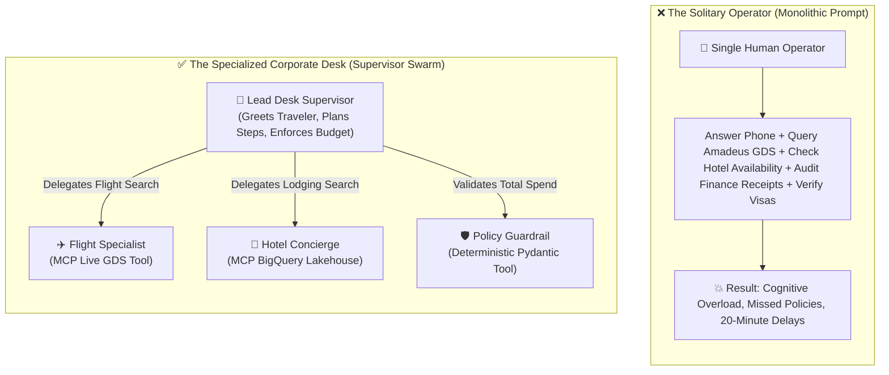
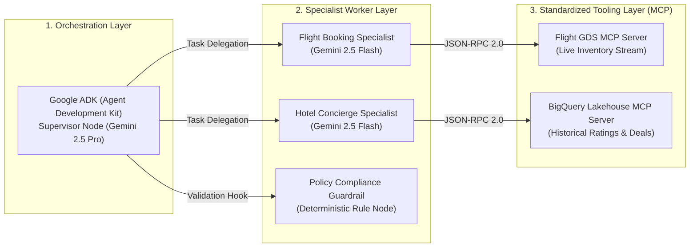
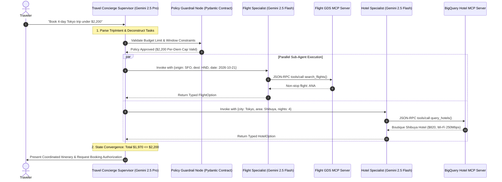

Single-agent systems hit a cognitive wall when enterprise reality sets in.

In [Part 1 of our trilogy](/blog/gemini-agent-platform-express-mode-bootstrapping-offvia/), we bootstrapped our travel concierge, **Offvia**, by bypassing IAM onboarding friction using Express Mode and enforcing bulletproof Pydantic intent contracts. But once a validated request enters your system—flights, boutique hotels, budget compliance, and real-time inventory—a single model prompt unravels:

> *"Find me a four-day tech-conference trip to Tokyo from San Francisco for under $2,200, departing next Wednesday. I need a non-stop flight, a boutique hotel near Shibuya with high-speed Wi-Fi, and free cancellation in case my visa decision is delayed."*

Feed this to a monolithic agent with eight Python tools attached, and you get chaos:
* The model queries flight tables, hallucinates IATA airport codes, and burns 15,000 tokens trying to parse hotel amenities simultaneously.
* It books a return flight departing two hours before the hotel checkout date.
* Worse, when the flight tool returns a 429 rate limit, the model loses track of the hotel booking state entirely, loops three times, and exhausts your monthly API quota in four minutes.

To build enterprise AI that survives production traffic, you must decompose the monolithic model into a **Multi-Agent System (MAS)**.

In this second masterclass of our 3-part trilogy, we move from single-turn intent parsing to full production orchestration. We will dissect Google's **Agent Development Kit (Google ADK)**, implement the **Supervisor Pattern**, connect external enterprise data via the **Model Context Protocol (MCP)**, and wire a resilient multi-agent swarm in clean Python.

---

## 🏢 The Mental Model: The Corporate Travel Desk vs The Solitary Operator

To understand why multi-agent architectures outperform monolithic prompts, consider how an enterprise corporate travel desk operates:



<div class="my-8 p-6 rounded-2xl bg-sky-50 dark:bg-sky-950/60 border-2 border-sky-300 dark:border-sky-600/70 text-sky-950 dark:text-sky-100">
<h4 class="text-xl font-bold flex items-center gap-2 mb-3">
<span>💡</span> In Plain English: Context Isolation
</h4>
<p class="leading-relaxed">
When an agent searches for flights, it needs airline routing rules, baggage codes, and seat classes. It does <b>not</b> need to know the hotel pet policy or the corporate per-diem breakfast allowance. By isolating each specialist into its own agent runtime with dedicated tools, we slash context window bloat, eliminate token pollution, and prevent reasoning degradation.
</p>
</div>

---

## 🏛️ Core Architectural Primitives: Google ADK & MCP

Building a production multi-agent system on Google Cloud requires three distinct architectural layers:



### 1. Google Agent Development Kit (Google ADK)
**Google ADK (`google-adk`)** is Google's open-source, code-first Python and multi-language framework for composing, evaluating, and deploying production AI agents. While **Agent Studio** in the Google Cloud Console offers visual drag-and-drop prototyping, ADK provides the programmatic runtime required for version control, unit testing, and CI/CD pipelines.

In ADK, multi-agent workflows fall into two primary delegation mechanics:

* **The Transfer Pattern (`sub_agents`):** The supervisor uses `transfer_to_agent()` to hand over complete conversational ownership to a child specialist. The specialist interacts directly with the user over multiple turns before yielding control back.
* **The Invocation Pattern (`AgentTool`):** The child agent is encapsulated inside an `AgentTool`. To the supervisor, the worker behaves like an ordinary Python function. The worker runs its reasoning loop in complete isolation (stateless relative to user history) and returns structured JSON back to the supervisor.

For Offvia, we use the **Invocation Pattern** for specialist tools and guardrails: the supervisor stays in charge of the conversation, while worker agents execute focused sub-tasks.

### 2. Model Context Protocol (MCP)
Developed as an open industry standard, the **Model Context Protocol (MCP)** establishes a universal client-server interface between AI models and external tools. Instead of writing proprietary, one-off API wrapper functions for every database or third-party service:
1. **The MCP Server** exposes available tools, resource schemas, and documentation over standardized `stdio` or HTTP/SSE streams.
2. **The MCP Client (Google ADK)** connects to the server, discovers available tools dynamically at startup, and translates Gemini function calls into structured JSON-RPC 2.0 execution requests.
3. **Security Boundary:** The database credentials, SQL dialects, and connection pools live exclusively on the MCP server. The model never touches raw database connection strings.

---

## 📊 Architectural Decision Matrix: Single-Agent vs Multi-Agent Swarm

<div class="my-8 overflow-x-auto">
<div class="inline-block min-w-full align-middle">
<div class="overflow-hidden rounded-2xl border-2 border-slate-200 dark:border-slate-800 shadow-sm">
<table class="min-w-full divide-y divide-slate-200 dark:divide-slate-800 text-left text-sm">
<thead class="bg-slate-100 dark:bg-slate-900 font-semibold text-slate-800 dark:text-slate-200">
<tr>
<th scope="col" class="px-6 py-4">Architectural Dimension</th>
<th scope="col" class="px-6 py-4">Monolithic Agent (Single Prompt)</th>
<th scope="col" class="px-6 py-4">Google ADK Multi-Agent Swarm + MCP</th>
</tr>
</thead>
<tbody class="divide-y divide-slate-200 dark:divide-slate-800 bg-white dark:bg-slate-950 text-slate-600 dark:text-slate-300">
<tr>
<td class="px-6 py-4 font-semibold text-slate-900 dark:text-white">Tool Scalability</td>
<td class="px-6 py-4 text-rose-600 dark:text-rose-400">Degrades rapidly beyond 5 tools (hallucination & tool confusion)</td>
<td class="px-6 py-4 text-emerald-600 dark:text-emerald-400 font-medium">Scales horizontally; each specialist owns 1–3 scoped MCP tools</td>
</tr>
<tr>
<td class="px-6 py-4 font-semibold text-slate-900 dark:text-white">Token Efficiency</td>
<td class="px-6 py-4 text-rose-600 dark:text-rose-400">Raw context expands with all tool definitions and outputs</td>
<td class="px-6 py-4 text-emerald-600 dark:text-emerald-400 font-medium">Isolated sub-agent contexts; only synthesized results bubble up</td>
</tr>
<tr>
<td class="px-6 py-4 font-semibold text-slate-900 dark:text-white">Model Selection</td>
<td class="px-6 py-4">Forced to run expensive flagship model for every trivial step</td>
<td class="px-6 py-4 font-medium text-sky-600 dark:text-sky-400">Hybrid: Gemini 2.5 Pro for Supervisor, Gemini 2.5 Flash for Workers</td>
</tr>
<tr>
<td class="px-6 py-4 font-semibold text-slate-900 dark:text-white">Blast Radius & Debugging</td>
<td class="px-6 py-4 text-rose-600 dark:text-rose-400">Single failure corrupts entire conversation thread</td>
<td class="px-6 py-4 text-emerald-600 dark:text-emerald-400 font-medium">Failing tools isolate to specific worker; supervisor initiates fallback</td>
</tr>
<tr>
<td class="px-6 py-4 font-semibold text-slate-900 dark:text-white">Data Governance</td>
<td class="px-6 py-4">Direct database API secrets injected into agent prompt</td>
<td class="px-6 py-4 font-medium text-emerald-600 dark:text-emerald-400">Strict MCP boundaries with IAM, VPC Service Controls, and parameterized queries</td>
</tr>
</tbody>
</table>
</div>
</div>
</div>

---

## 🚨 5 Fatal Misconceptions About Multi-Agent Systems

<div class="my-8 grid grid-cols-1 md:grid-cols-2 gap-6">
<div class="p-6 rounded-2xl bg-rose-50/70 dark:bg-rose-950/30 border border-rose-200 dark:border-rose-800/60">
<div class="flex items-center gap-2 mb-3">
<span class="text-xl">❌</span>
<h4 class="text-lg font-bold text-rose-900 dark:text-rose-200">Myth 1: Swarms Should Chat Without a Supervisor</h4>
</div>
<p class="text-sm leading-relaxed text-rose-800 dark:text-rose-300">
Allowing autonomous agents to debate freely in an unmanaged chat room leads to non-deterministic loops ("Thank you!", "No, thank you!"). In enterprise production, <b>hierarchical orchestration with a strict Supervisor state machine is mandatory</b>.
</p>
</div>

<div class="p-6 rounded-2xl bg-rose-50/70 dark:bg-rose-950/30 border border-rose-200 dark:border-rose-800/60">
<div class="flex items-center gap-2 mb-3">
<span class="text-xl">❌</span>
<h4 class="text-lg font-bold text-rose-900 dark:text-rose-200">Myth 2: Sub-Agents Must Receive Full Chat History</h4>
</div>
<p class="text-sm leading-relaxed text-rose-800 dark:text-rose-300">
Forwarding the entire multi-turn chat transcript to a flight specialist causes severe "needle-in-a-haystack" reasoning degradation. Sub-agents must receive <b>only the isolated parameters required for their specific execution step</b>.
</p>
</div>

<div class="p-6 rounded-2xl bg-rose-50/70 dark:bg-rose-950/30 border border-rose-200 dark:border-rose-800/60">
<div class="flex items-center gap-2 mb-3">
<span class="text-xl">❌</span>
<h4 class="text-lg font-bold text-rose-900 dark:text-rose-200">Myth 3: MCP is Just Another HTTP REST API</h4>
</div>
<p class="text-sm leading-relaxed text-rose-800 dark:text-rose-300">
REST endpoints lack standardized schema introspection and state negotiation. <b>Model Context Protocol standardizes runtime tool capability discovery</b>, structured JSON-RPC error handling, and protocol-level isolation between the LLM and enterprise data providers.
</p>
</div>

<div class="p-6 rounded-2xl bg-rose-50/70 dark:bg-rose-950/30 border border-rose-200 dark:border-rose-800/60">
<div class="flex items-center gap-2 mb-3">
<span class="text-xl">❌</span>
<h4 class="text-lg font-bold text-rose-900 dark:text-rose-200">Myth 4: Agents Should Write Dynamic SQL to BigQuery</h4>
</div>
<p class="text-sm leading-relaxed text-rose-800 dark:text-rose-300">
Giving an agent raw Text-to-SQL access against production BigQuery tables invites prompt injection and massive scanning costs. <b>Expose parameterized MCP tools with bounded queries</b> that restrict scans to clustered partitions.
</p>
</div>

<div class="p-6 rounded-2xl bg-rose-50/70 dark:bg-rose-950/30 border border-rose-200 dark:border-rose-800/60 md:col-span-2">
<div class="flex items-center gap-2 mb-3">
<span class="text-xl">❌</span>
<h4 class="text-lg font-bold text-rose-900 dark:text-rose-200">Myth 5: Multi-Agent Systems Eliminate Deterministic Code</h4>
</div>
<p class="text-sm leading-relaxed text-rose-800 dark:text-rose-300">
The opposite is true. The more non-deterministic AI agents in your architecture, the more rigid your boundary code must be. <b>Pydantic validation, explicit recursion counters, timeout envelopes, and circuit breakers</b> are what separate an enterprise product from a prototype demo.
</p>
</div>
</div>

---

## 🔄 The End-to-End Orchestration Lifecycle

Here is the exact state transition lifecycle executed by the Offvia Multi-Agent Swarm:



---

## ⚠️ 3 Critical Production Gotchas & Incident War Stories

### 1. The Infinite "Ping-Pong" Deadlock
* **The Incident:** In testing, our flight specialist returned a flight arriving in Tokyo at 9:00 PM. The hotel specialist rejected the check-in because the hotel reception desk closed at 8:00 PM. The supervisor asked the flight specialist for an earlier flight, which had a layover, causing the policy agent to reject it for violating travel time rules. The agents cycled 14 times, spending $42 in API tokens before timing out.
* **The Fix:** Implement an explicit **step budget (`max_steps=10`)** and an anti-oscillation tracker inside the supervisor. If any agent pair exchanges messages more than twice on the same parameter, the supervisor breaks the loop and escalates to a human operator.

### 2. Context Window Pollution & Needle Degradation
* **The Incident:** In an early prototype, the supervisor passed its entire conversation history into the hotel specialist. The prompt included 40 raw JSON objects from previous flight queries. The hotel specialist began recommending hotels located near San Francisco International Airport (SFO) instead of Shibuya, confused by the origin airport in the prompt.
* **The Fix:** Enforce **Strict Input Isolation**. The supervisor must extract only the destination city, neighborhood, dates, and budget ceiling, passing a sanitized 4-parameter dictionary to the hotel agent.

### 3. MCP Subprocess Zombies & Transport Deadlocks
* **The Incident:** During a spike in traffic, a local `stdio` MCP server querying BigQuery experienced connection throttling. The Python subprocess blocked on `stdin/stdout` read without a timeout, causing worker threads to hang indefinitely and exhausting the Cloud Run container memory pool.
* **The Fix:** Always wrap MCP client invocations in asynchronous timeout handlers (`asyncio.wait_for(timeout=15.0)`). For production microservices, favor **Streamable HTTP / SSE transports** over `stdio` processes to decouple process lifecycles.

---

## 🛠️ Hands-On Engineering Lab: Building the Offvia Swarm

Let's build the runnable production multi-agent concierge using Python, Google ADK patterns, and Model Context Protocol tooling.

### Step 1: Install Dependencies & Setup Environment

Create an isolated virtual environment and install the required libraries:

```bash
python3 -m venv venv
source venv/bin/activate
pip install google-adk pydantic google-genai
```

Set your Google Cloud authentication:

```bash
export GOOGLE_CLOUD_PROJECT="offvia-production"
export GOOGLE_CLOUD_LOCATION="us-central1"
# For local prototyping with Google GenAI SDK:
export GEMINI_API_KEY="your-api-key-here"
```

---

### Step 2: Define the MCP Tools for External Data

In a production MCP architecture, tools are hosted by dedicated MCP servers. Below, we define our MCP tool specifications for flight inventory and the BigQuery hotel lakehouse:

```python
"""
tools/mcp_travel_tools.py
Standardized MCP Tool definitions for Offvia Travel Swarm.
"""
from typing import Dict, Any, List

# Simulating Model Context Protocol (MCP) Tool Endpoints
def mcp_search_flights(origin: str, destination: str, departure_date: str) -> Dict[str, Any]:
    """
    MCP Tool: Queries live Global Distribution System (GDS) for flights.
    Exposed via MCP Server: amadeus-flight-mcp
    """
    # In production, this executes a JSON-RPC 2.0 tools/call to the remote MCP server
    if origin.upper() == "SFO" and destination.upper() in ["HND", "NRT", "TYO"]:
        return {
            "status": "success",
            "provider": "ANA",
            "flight_number": "NH107",
            "departure": f"{departure_date}T10:45:00",
            "arrival": f"{departure_date}T14:30:00+1",
            "price_usd": 1150.00,
            "cabin": "Economy Flexible",
            "is_nonstop": True,
            "cancellation_policy": "Full refund up to 24h before departure"
        }
    return {
        "status": "error",
        "message": f"No direct flights found for {origin} -> {destination} on {departure_date}"
    }


def mcp_query_hotel_lakehouse(city: str, neighborhood: str, nights: int, max_budget_usd: float) -> Dict[str, Any]:
    """
    MCP Tool: Queries BigQuery Lakehouse for curated boutique accommodations.
    Exposed via MCP Server: bigquery-hotels-mcp
    """
    # In production, queries partitioned & clustered BigQuery table: travel_dw.hotels_inventory
    if "tokyo" in city.lower() and "shibuya" in neighborhood.lower():
        total_rate = 205.00 * nights
        if total_rate <= max_budget_usd:
            return {
                "status": "success",
                "hotel_name": "Trunk Hotel Shibuya",
                "neighborhood": "Shibuya, Tokyo",
                "nights": nights,
                "nightly_rate_usd": 205.00,
                "total_price_usd": total_rate,
                "wifi_speed_mbps": 280,
                "cancellation_policy": "Free cancellation up to 48 hours before check-in",
                "verified_rating": 4.8
            }
    return {
        "status": "error",
        "message": f"No hotels matching criteria under ${max_budget_usd} in {neighborhood}, {city}"
    }
```

---

### Step 3: Implement Specialized Sub-Agents

Each specialist agent operates with a narrow role, isolated prompt instructions, and access only to its authorized MCP tools:

```python
"""
agents/specialists.py
Domain-specific Worker Agents in Google ADK.
"""
from google.adk.agents.llm_agent import LlmAgent
from tools.mcp_travel_tools import mcp_search_flights, mcp_query_hotel_lakehouse

# 1. Flight Specialist Agent
flight_specialist = LlmAgent(
    name="FlightSpecialist",
    model="gemini-2.5-flash",
    description="Specialized in searching and booking commercial airline flights.",
    instruction="""
    You are Offvia's Flight Specialist.
    Your sole responsibility is to locate the best flight matching the origin, destination, and departure date.
    Always prioritize non-stop flights and flexible cancellation policies.
    Return only validated flight data and prices.
    """,
    tools=[mcp_search_flights],
)

# 2. Hotel Concierge Specialist Agent
hotel_specialist = LlmAgent(
    name="HotelSpecialist",
    model="gemini-2.5-flash",
    description="Specialized in discovering boutique hotels and verifying amenity contracts.",
    instruction="""
    You are Offvia's Lodging Concierge.
    Your sole responsibility is finding boutique accommodations in the requested neighborhood.
    Verify that the high-speed Wi-Fi meets remote work requirements (>= 100 Mbps).
    Strictly respect the maximum allocated lodging budget.
    """,
    tools=[mcp_query_hotel_lakehouse],
)
```

---

### Step 4: Implement Policy Guardrails & Invocation Tools

We wrap the sub-agents and deterministic compliance checks as callable `AgentTool` instances:

```python
"""
agents/guardrails.py
Policy Enforcement and Invocation Tool wrappers.
"""
from pydantic import BaseModel, Field
from google.adk.tools.agent_tool import AgentTool
from agents.specialists import flight_specialist, hotel_specialist

# Expose sub-agents as encapsulated invocation tools to the supervisor
flight_tool = AgentTool(agent=flight_specialist)
hotel_tool = AgentTool(agent=hotel_specialist)

class PolicyAuditRequest(BaseModel):
    total_budget_usd: float = Field(..., le=2500.0, description="Total budget cannot exceed enterprise per-diem cap of $2,500")
    has_free_cancellation: bool = Field(..., description="Must allow cancellation without penalty")

def audit_travel_policy(flight_cost: float, hotel_cost: float, free_cancellation: bool) -> dict:
    """
    Deterministic Compliance Tool: Validates overall itinerary against Offvia corporate policies.
    """
    total_cost = flight_cost + hotel_cost
    if total_cost > 2200.00:
        return {
            "compliant": False,
            "reason": f"Total itinerary cost ${total_cost:.2f} exceeds strict customer ceiling of $2,200.00"
        }
    if not free_cancellation:
        return {
            "compliant": False,
            "reason": "Itinerary fails mandatory policy: free cancellation is required for all bookings"
        }
    return {
        "compliant": True,
        "total_cost_usd": total_cost,
        "remaining_budget_usd": 2200.00 - total_cost
    }
```

---

### Step 5: Wire the Travel Concierge Supervisor

The Supervisor Agent coordinates the workflow, maintains top-level state, and enforces the anti-oscillation step limit:

```python
"""
main.py
Root Supervisor Orchestrator with Recursion Safeguards.
"""
from google.adk.agents.llm_agent import LlmAgent
from agents.guardrails import flight_tool, hotel_tool, audit_travel_policy

supervisor_agent = LlmAgent(
    name="TravelConciergeSupervisor",
    model="gemini-2.5-pro", # Flagship model for high-order reasoning & state tracking
    description="Lead corporate travel desk coordinator for Offvia.",
    instruction="""
    You are the Lead Travel Concierge Supervisor for Offvia.
    Your mission is to satisfy the traveler's request by coordinating your specialist tools:
    
    Workflow Sequence:
    1. Parse the traveler's origin, destination, dates, and budget ceiling ($2,200).
    2. Invoke the FlightSpecialist tool to locate a non-stop flight.
    3. Invoke the HotelSpecialist tool to locate a boutique hotel in Shibuya.
    4. Call the audit_travel_policy tool to confirm the total cost is under $2,200 and policies match.
    5. Present the synthesized itinerary clearly to the traveler with itemized costs.
    
    Safety Safeguards:
    - Never exceed 5 tool calls per user turn.
    - If total costs exceed budget, do not finalize the booking. Propose adjustments.
    """,
    tools=[flight_tool, hotel_tool, audit_travel_policy],
)

if __name__ == "__main__":
    test_prompt = (
        "Book a four-day business trip to Tokyo from San Francisco departing 2026-10-21. "
        "I need a non-stop flight, a boutique hotel in Shibuya with fast Wi-Fi, "
        "and free cancellation on both. Max budget is $2,200."
    )
    
    print("\n🚀 [OFFVIA ORCHESTRATOR] Initializing Multi-Agent Swarm...\n")
    response = supervisor_agent.run(test_prompt)
    print("\n🎯 [SUPERVISOR FINAL PROPOSAL]:\n")
    print(response.text)
```

---

### Step 6: Verify the Execution Trace & Diagnostics

Run the script locally:

```bash
python main.py
```

#### What to Look for in the Execution Trace:

```text
🚀 [OFFVIA ORCHESTRATOR] Initializing Multi-Agent Swarm...

[Supervisor] Tool Call ➔ FlightSpecialist(origin='SFO', destination='HND', departure_date='2026-10-21')
[FlightSpecialist] MCP Call ➔ mcp_search_flights(origin='SFO', destination='HND', departure_date='2026-10-21')
[FlightSpecialist] Result: ANA #NH107, Non-stop, $1,150.00 (Refundable)

[Supervisor] Tool Call ➔ HotelSpecialist(city='Tokyo', neighborhood='Shibuya', nights=4, max_budget_usd=1050.00)
[HotelSpecialist] MCP Call ➔ mcp_query_hotel_lakehouse(city='Tokyo', neighborhood='Shibuya', nights=4, max_budget_usd=1050.00)
[HotelSpecialist] Result: Trunk Hotel Shibuya, 4 nights, $820.00 (280 Mbps Wi-Fi, Free Cancel)

[Supervisor] Tool Call ➔ audit_travel_policy(flight_cost=1150.00, hotel_cost=820.00, free_cancellation=True)
[PolicyEngine] Output: {'compliant': True, 'total_cost_usd': 1970.00, 'remaining_budget_usd': 230.00}

🎯 [SUPERVISOR FINAL PROPOSAL]:
Here is your confirmed, policy-compliant travel itinerary for Tokyo:

✈️ Outbound Flight: ANA #NH107 (Non-stop)
• Departure: SFO on 2026-10-21 at 10:45 AM
• Arrival: Tokyo Haneda (HND) on 2026-10-22 at 2:30 PM
• Cost: $1,150.00 (Fully refundable)

🏨 Lodging: Trunk Hotel Shibuya (4 Nights)
• Neighborhood: Shibuya, Tokyo
• Total Cost: $820.00 ($205.00/night)
• Amenities: Verified 280 Mbps High-Speed Wi-Fi
• Cancellation: Free cancellation up to 48 hours before check-in

📊 Financial Summary:
• Total Package Cost: $1,970.00 USD
• Savings Under Budget: $230.00 USD
• Policy Status: 100% Compliant with corporate travel guidelines

Would you like me to place these reservations on corporate card hold?
```

Notice how clean the boundary is: the user receives a unified, polished proposal. The supervisor managed the state, isolated sub-agent token contexts, and deterministically verified corporate policy.

---

## 🚀 The Trilogy Roadmap: What's Next in Part 3?

In this guide, we successfully transformed Offvia from a single-turn parser into a **resilient, multi-agent swarm** with Google ADK, the Supervisor Pattern, and Model Context Protocol data boundaries.

However, non-deterministic AI agents pose a massive threat to production reliability:
* How do you know a prompt tweak in the Flight Specialist won't degrade the Hotel Concierge's accuracy?
* How do you measure latency regressions across 5 chained agent calls?
* How do you run automated evaluations in your GitLab or GitHub Actions CI/CD pipeline before merging agent code?

In the final chapter, **Part 3: Testing Non-Deterministic AI in CI/CD — The Production Multi-Agent Evaluation Runbook**, we will:
* Deploy automated **Agent Evaluation Pipelines** using Google Cloud Vertex AI Evaluation metrics (faithfulness, hallucination rate, tool selection precision).
* Build synthetic user simulations to red-team multi-agent swarms under high-adversity edge cases.
* Write automated Python evaluation fixtures that gate pull requests in CI/CD when agent accuracy drops below 95%.

---

## 📖 Official Documentation & Verified Standards

* [Google Cloud Vertex AI Documentation](https://cloud.google.com/vertex-ai/docs)
* [Google Cloud Gemini Enterprise Platform](https://cloud.google.com/products/gemini)
* [Google ADK (Agent Development Kit) Python Framework](https://github.com/google/adk-python)
* [Model Context Protocol (MCP) Official Specification](https://modelcontextprotocol.io/)
* [BigQuery Documentation](https://cloud.google.com/bigquery/docs)
* [Pydantic V2 Documentation](https://docs.pydantic.dev/)
