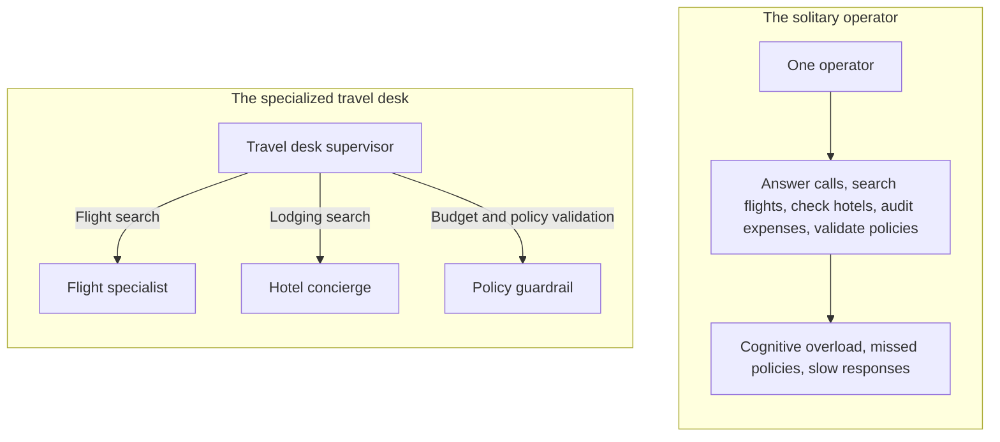
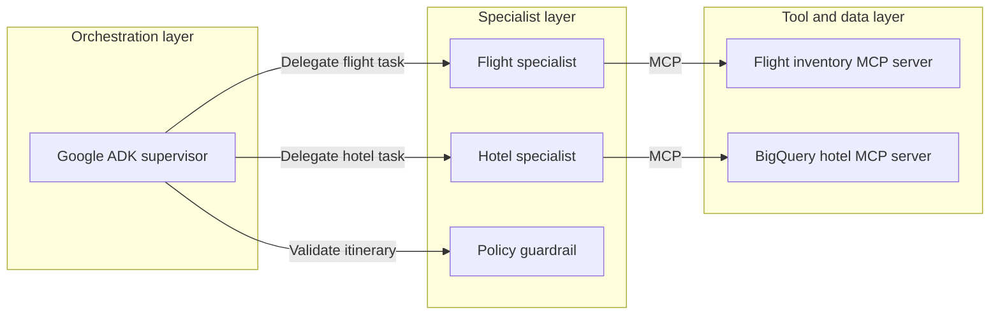
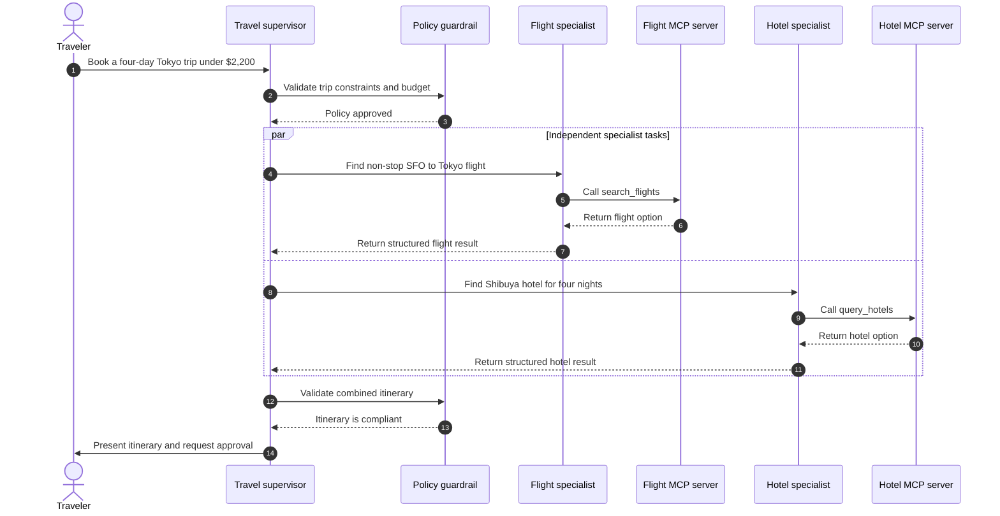

Single-agent systems hit a cognitive wall when enterprise reality sets in.

In [Part 1 of our trilogy](/blog/gemini-agent-platform-express-mode-bootstrapping-offvia/), we bootstrapped **Offvia**, our travel concierge, by reducing IAM onboarding friction with Express Mode and enforcing structured intent contracts with Pydantic.

But once a validated request enters the system—flights, boutique hotels, budget compliance, and live inventory—a single model prompt starts to struggle:

> “Find me a four-day tech-conference trip to Tokyo from San Francisco for under $2,200, departing next Wednesday. I need a non-stop flight, a boutique hotel near Shibuya with high-speed Wi-Fi, and free cancellation in case my visa decision is delayed.”

Give this request to one monolithic agent with eight Python tools attached, and things can go wrong quickly:

- The model may mix up airport codes, hotel amenities, cancellation rules, and budget constraints.
- It may choose a return flight that conflicts with the hotel checkout date.
- If a flight API returns a rate-limit error, the agent may lose track of the booking state, retry repeatedly, and burn tokens without making progress.

To build AI systems that survive production traffic, we need to decompose the monolithic prompt into a **multi-agent system**.

In this second part of the trilogy, we move from single-turn intent parsing to production orchestration. We will use **Google ADK**, apply the **Supervisor pattern**, connect external systems through the **Model Context Protocol (MCP)**, and build a resilient multi-agent travel swarm in Python.

---

## The mental model: a corporate travel desk

A useful way to understand multi-agent systems is to compare them with a corporate travel desk.

A single travel operator trying to answer the phone, search airline inventory, check hotel availability, validate expenses, and review visa requirements at the same time will eventually make mistakes. A well-run travel desk separates those responsibilities:



The supervisor does not need to know every airline rule or hotel amenity. It needs to understand the traveler’s goal, break the work into tasks, delegate those tasks, reconcile the results, and enforce policy.

This is **context isolation**.

When the flight specialist searches for flights, it needs routing rules, cabin classes, baggage constraints, and cancellation policies. It does not need the hotel pet policy or the corporate breakfast allowance. By giving each specialist a narrow role and a limited set of tools, we reduce context bloat and make failures easier to isolate.

---

## Core architecture: Google ADK and MCP

A production multi-agent system on Google Cloud usually has three layers:



### Google Agent Development Kit

**Google ADK** (`google-adk`) is Google’s code-first framework for building, evaluating, and deploying AI agents. While visual tools are useful for prototyping, ADK gives you a programmatic runtime that fits naturally with version control, unit tests, and CI/CD.

ADK supports several ways to compose agents. For this use case, the two most relevant are:

- **Transfer pattern:** The supervisor delegates work to a child agent using `sub_agents`. The child agent can complete a focused task and return control to the supervisor.
- **Invocation pattern:** A child agent is exposed as a callable tool through `AgentTool`. The supervisor retains conversational ownership while the child completes a bounded sub-task.

For Offvia, the flight and hotel specialists perform focused, single-turn tasks. We will use ADK’s `sub_agents` mechanism with `mode="single_turn"`, which keeps the supervisor in charge of the conversation while allowing specialists to execute narrowly scoped work.

### Model Context Protocol

The **Model Context Protocol (MCP)** is an open standard for connecting AI applications to external tools, data sources, and systems.

Instead of writing a bespoke wrapper for every database, SaaS API, or internal service, you can expose capabilities through MCP servers:

1. The MCP server exposes tools, resource metadata, and schemas.
2. The MCP client—in this case, Google ADK—discovers the available tools.
3. The agent selects a tool, and ADK routes the invocation to the appropriate MCP server.
4. The MCP server executes the operation and returns a structured result.

MCP is valuable because it creates a clean architectural boundary between the agent runtime and enterprise systems. Database credentials, connection pools, query logic, and provider-specific details can remain on the server side.

However, MCP is not a security control by itself. You still need authentication, authorization, least-privilege IAM, network controls, input validation, rate limits, and audit logging.

---

## Single agent versus multi-agent swarm

| Dimension | Monolithic agent | Google ADK multi-agent swarm with MCP |
|---|---|---|
| Tool scalability | Tool-selection accuracy can decline as the number of loosely scoped tools grows | Each specialist owns a small, well-defined tool set |
| Context efficiency | All tool definitions and outputs compete for the same context | Specialists receive only task-scoped context |
| Model selection | One model handles every step | A stronger model can coordinate, while faster models handle focused tasks |
| Failure isolation | A tool failure can corrupt the whole reasoning thread | Failures can be contained within a specialist and handled by the supervisor |
| Debugging | Harder to identify which responsibility failed | Clearer boundaries between orchestration, domain logic, and tools |
| Data governance | Credentials and broad data access can leak into the agent runtime if implemented poorly | Tool servers can hold credentials and expose narrowly scoped operations |
| Determinism | More logic is delegated to the model | Deterministic validation can sit at task boundaries |

Multi-agent design does not automatically make a system scalable, secure, or cheaper. It improves modularity. You still need good evaluation, observability, access control, and deployment architecture.

---

## Five misconceptions about multi-agent systems

### 1. Agents should chat freely without a supervisor

Unstructured agent-to-agent conversation can become non-deterministic and expensive. Two agents may politely acknowledge each other, repeat requests, or disagree without converging on an answer.

In production, use a supervisor with a clear workflow. The supervisor decides what needs to happen next, delegates bounded tasks, and decides when to stop.

### 2. Sub-agents need the full chat history

Forwarding an entire conversation to every specialist creates noise. A hotel agent does not need forty raw flight-search JSON objects.

Pass only the minimum structured context required for the task:

```python
{
    "city": "Tokyo",
    "neighborhood": "Shibuya",
    "nights": 4,
    "max_budget_usd": 1050.00
}
```

### 3. MCP is just another REST API

MCP and REST solve overlapping but different problems. REST is a broad architectural style for HTTP-based services. MCP is specifically designed for connecting AI applications to tools and resources in a discoverable, structured way.

MCP provides standardized tool discovery and invocation semantics. It does not eliminate the need for API design, versioning, authentication, or operational monitoring.

### 4. Agents should write arbitrary SQL against BigQuery

Giving an agent unrestricted Text-to-SQL access to production tables is risky. It can lead to expensive scans, data exposure, and prompt-injection-driven queries.

Expose narrow, parameterized MCP tools instead. Use clustered and partitioned tables, query budgets, allowlisted columns, and service accounts with least-privilege access.

### 5. Multi-agent systems remove the need for deterministic code

The opposite is true.

The more non-deterministic components you add, the more important deterministic boundaries become. Use Pydantic models, explicit schemas, validation functions, timeouts, retry policies, recursion limits, and circuit breakers around agent execution.

---

## The Offvia orchestration lifecycle

Here is the intended execution flow for the travel request.



The `par` block describes the desired orchestration behavior: flight and hotel searches are independent and can run concurrently. In practice, parallelism must be implemented by the application, orchestration layer, or execution environment. A supervisor model choosing tools one at a time will not automatically parallelize them.

---

## Production gotchas

### 1. The ping-pong deadlock

Imagine this sequence:

1. The flight specialist finds a flight arriving in Tokyo at 9:00 PM.
2. The hotel specialist rejects it because hotel check-in closes at 8:00 PM.
3. The supervisor asks for an earlier flight.
4. The earlier flight has a layover.
5. The policy guardrail rejects the layover because it violates travel-time policy.
6. The supervisor asks for another flight.

Without limits, this can continue for many iterations.

The fix is not a better prompt alone. Add runtime controls:

- A maximum number of tool calls per user request
- A maximum recursion or delegation depth
- Detection of repeated tool calls with the same parameters
- A circuit breaker after repeated failures
- A human-escalation path when the system cannot converge

### 2. Context pollution

In an early prototype, the supervisor passed its entire conversation history to the hotel specialist. The prompt contained dozens of raw flight-search results. The hotel agent became confused by the origin airport and recommended hotels near San Francisco instead of Shibuya.

The fix is strict input isolation. The supervisor should extract only the fields the hotel agent needs:

```python
hotel_request = {
    "city": "Tokyo",
    "neighborhood": "Shibuya",
    "nights": 4,
    "max_budget_usd": 1050.00
}
```

### 3. MCP subprocess hangs

A local `stdio` MCP server can block if its subprocess hangs or its standard input/output pipes stall. Wrapping the call in `asyncio.wait_for()` prevents the calling coroutine from waiting forever, but it does not automatically terminate the subprocess or clean up its resources.

A production-ready implementation should also handle:

- Request-level timeouts
- Cancellation propagation
- Process termination and graceful shutdown
- Connection and subprocess lifecycle management
- Health checks and restart policies

For long-lived production services, consider Streamable HTTP or SSE-based MCP transports instead of local `stdio` processes.

---

## Hands-on lab: build the Offvia swarm

This example shows the architecture clearly. The flight and hotel tools are represented as local Python functions for readability; in a real deployment, they would be exposed by dedicated MCP servers and consumed through ADK’s `McpToolset`.

### Step 1: Set up the environment

```bash
python3 -m venv venv
source venv/bin/activate

pip install google-adk pydantic
```

For local prototyping with the Gemini API:

```bash
export GEMINI_API_KEY="your-api-key-here"
```

For a Vertex AI-based deployment, configure Google Cloud authentication and project settings instead:

```bash
export GOOGLE_CLOUD_PROJECT="offvia-production"
export GOOGLE_CLOUD_LOCATION="us-central1"
```

These are two different integration paths. Use the Gemini API key for quick local experimentation, and use Vertex AI with Google Cloud identities for production workloads.

### Step 2: Define the tool contracts

In production, these functions would live behind MCP servers. Here, they model the tool boundary and return structured data.

```python
"""
tools/travel_tools.py

Tool contracts for the Offvia travel swarm.

In production, expose these operations through dedicated MCP servers:
- flight-inventory-mcp
- bigquery-hotels-mcp
"""

from typing import Any, Dict


def search_flights(
    origin: str,
    destination: str,
    departure_date: str,
) -> Dict[str, Any]:
    """
    Search flight inventory.

    In production, this would be exposed by a flight-inventory MCP server
    and invoked through ADK's McpToolset.
    """
    if origin.upper() == "SFO" and destination.upper() in {"HND", "NRT", "TYO"}:
        return {
            "status": "success",
            "provider": "ANA",
            "flight_number": "NH107",
            "origin": origin.upper(),
            "destination": "HND",
            "departure": f"{departure_date}T10:45:00",
            "arrival": f"{departure_date}T14:30:00+1",
            "price_usd": 1150.00,
            "cabin": "Economy Flexible",
            "is_nonstop": True,
            "free_cancellation": True,
            "cancellation_policy": "Full refund up to 24 hours before departure",
        }

    return {
        "status": "error",
        "message": (
            f"No direct flights found for {origin} to {destination} "
            f"on {departure_date}."
        ),
    }


def query_hotels(
    city: str,
    neighborhood: str,
    nights: int,
    max_budget_usd: float,
) -> Dict[str, Any]:
    """
    Search the hotel lakehouse.

    In production, this would be exposed by a BigQuery-backed MCP server.
    The underlying query should be parameterized and cost-bounded.
    """
    if city.lower() == "tokyo" and neighborhood.lower() == "shibuya":
        nightly_rate = 205.00
        total_price = nightly_rate * nights

        if total_price <= max_budget_usd:
            return {
                "status": "success",
                "hotel_name": "Trunk Hotel Shibuya",
                "city": "Tokyo",
                "neighborhood": "Shibuya",
                "nights": nights,
                "nightly_rate_usd": nightly_rate,
                "total_price_usd": total_price,
                "wifi_speed_mbps": 280,
                "free_cancellation": True,
                "cancellation_policy": (
                    "Free cancellation up to 48 hours before check-in"
                ),
                "verified_rating": 4.8,
            }

    return {
        "status": "error",
        "message": (
            f"No hotels matching the criteria were found in {neighborhood}, "
            f"{city} under ${max_budget_usd:.2f}."
        ),
    }
```

### Step 3: Create the specialist agents

Each specialist has one job, a focused instruction, and access only to the tools it needs.

```python
"""
agents/specialists.py
"""

from google.adk.agents.llm_agent import LlmAgent
from tools.travel_tools import search_flights, query_hotels


flight_specialist = LlmAgent(
    name="FlightSpecialist",
    model="gemini-2.5-flash",
    description=(
        "Finds flights that match the requested route, date, cabin, "
        "cancellation, and budget constraints."
    ),
    instruction="""
    You are Offvia's Flight Specialist.

    Your only responsibility is to find a suitable flight using the
    available flight-search tool.

    Rules:
    - Prefer non-stop flights.
    - Prefer flexible or free-cancellation fares.
    - Do not invent airports, airlines, flight numbers, prices, or schedules.
    - If no suitable flight is found, return a clear failure result.
    - Do not search hotels or make policy decisions.
    """,
    tools=[search_flights],
    mode="single_turn",
)


hotel_specialist = LlmAgent(
    name="HotelSpecialist",
    model="gemini-2.5-flash",
    description=(
        "Finds hotels that match location, stay duration, amenities, "
        "and lodging-budget constraints."
    ),
    instruction="""
    You are Offvia's Hotel Specialist.

    Your only responsibility is to find suitable accommodation using the
    available hotel-search tool.

    Rules:
    - Respect the requested neighborhood and stay duration.
    - Require high-speed Wi-Fi of at least 100 Mbps.
    - Respect the lodging budget exactly.
    - Do not invent hotels, prices, ratings, or amenities.
    - If no suitable hotel is found, return a clear failure result.
    - Do not search flights or make policy decisions.
    """,
    tools=[query_hotels],
    mode="single_turn",
)
```

### Step 4: Add deterministic policy validation

The policy check should not depend on the model’s judgment. Make it a deterministic function with a strict input contract.

```python
"""
agents/policy.py
"""

from pydantic import BaseModel, Field


class PolicyAuditRequest(BaseModel):
    flight_cost_usd: float = Field(ge=0)
    hotel_cost_usd: float = Field(ge=0)
    flight_free_cancellation: bool
    hotel_free_cancellation: bool

    total_budget_usd: float = Field(default=2200.00, gt=0)


class PolicyAuditResult(BaseModel):
    compliant: bool
    total_cost_usd: float
    remaining_budget_usd: float | None = None
    reason: str | None = None


def audit_travel_policy(request: PolicyAuditRequest) -> PolicyAuditResult:
    """
    Deterministic compliance check for the proposed itinerary.
    """
    total_cost = request.flight_cost_usd + request.hotel_cost_usd

    if total_cost > request.total_budget_usd:
        return PolicyAuditResult(
            compliant=False,
            total_cost_usd=total_cost,
            reason=(
                f"Total itinerary cost ${total_cost:.2f} exceeds the "
                f"${request.total_budget_usd:.2f} budget."
            ),
        )

    if not request.flight_free_cancellation:
        return PolicyAuditResult(
            compliant=False,
            total_cost_usd=total_cost,
            reason="The selected flight does not include free cancellation.",
        )

    if not request.hotel_free_cancellation:
        return PolicyAuditResult(
            compliant=False,
            total_cost_usd=total_cost,
            reason="The selected hotel does not include free cancellation.",
        )

    return PolicyAuditResult(
        compliant=True,
        total_cost_usd=total_cost,
        remaining_budget_usd=request.total_budget_usd - total_cost,
    )
```

### Step 5: Build the supervisor

The supervisor coordinates the workflow. It does not search flights or hotels itself; it delegates those tasks and validates the combined result.

```python
"""
agents/supervisor.py
"""

from google.adk.agents.llm_agent import LlmAgent
from agents.policy import audit_travel_policy
from agents.specialists import flight_specialist, hotel_specialist


supervisor_agent = LlmAgent(
    name="TravelConciergeSupervisor",
    model="gemini-2.5-pro",
    description=(
        "Coordinates flight search, hotel search, policy validation, "
        "and itinerary presentation for Offvia."
    ),
    instruction="""
    You are Offvia's Lead Travel Concierge Supervisor.

    Your job is to coordinate specialists and return one coherent,
    policy-compliant travel proposal.

    Workflow:
    1. Extract the traveler's origin, destination, dates, stay duration,
       neighborhood preference, and total budget.
    2. Delegate flight search to FlightSpecialist.
    3. Delegate hotel search to HotelSpecialist.
    4. Combine the returned flight and hotel costs.
    5. Validate the combined itinerary with audit_travel_policy.
    6. If the itinerary is compliant, present it clearly with itemized costs.
    7. If it is not compliant, explain the issue and propose a practical adjustment.
    8. Do not finalize or charge anything without explicit user approval.

    Guardrails:
    - Prefer no more than five tool calls per user request.
    - Pass only task-specific parameters to specialists.
    - Never invent flight, hotel, price, availability, or policy data.
    - If specialists disagree or repeatedly fail, stop and escalate
      rather than looping.
    """,
    sub_agents=[flight_specialist, hotel_specialist],
    tools=[audit_travel_policy],
)
```

The instruction says “prefer no more than five tool calls” because it is guidance to the model. It is not a hard runtime limit. In production, enforce that limit in the orchestration layer.

### Step 6: Run the agent with ADK Runner

ADK agents are executed through a `Runner`. The runner manages sessions and emits a stream of events.

```python
"""
main.py
"""

import asyncio

from google.adk.runners import Runner
from google.adk.sessions import InMemorySessionService
from google.genai import types

from agents.supervisor import supervisor_agent


APP_NAME = "offvia"
USER_ID = "traveler_1"


async def run_offvia() -> None:
    session_service = InMemorySessionService()

    runner = Runner(
        agent=supervisor_agent,
        app_name=APP_NAME,
        session_service=session_service,
    )

    session = await session_service.create_session(
        app_name=APP_NAME,
        user_id=USER_ID,
    )

    test_prompt = (
        "Book a four-day business trip to Tokyo from San Francisco "
        "departing 2026-10-21. I need a non-stop flight, a boutique hotel "
        "in Shibuya with fast Wi-Fi, and free cancellation on both. "
        "The maximum budget is $2,200."
    )

    message = types.Content(
        role="user",
        parts=[types.Part(text=test_prompt)],
    )

    final_response = None

    async for event in runner.run_async(
        user_id=USER_ID,
        session_id=session.id,
        new_message=message,
    ):
        if event.is_final_response() and event.content and event.content.parts:
            final_response = "".join(
                part.text or ""
                for part in event.content.parts
                if part.text
            )

    print("\nOffvia final proposal:\n")
    print(final_response)


if __name__ == "__main__":
    asyncio.run(run_offvia())
```

Run it locally:

```bash
python main.py
```

### Step 7: Use real MCP servers

The local Python functions are useful for understanding the tool contracts, but they are not actual MCP servers.

For a production implementation, expose `search_flights` and `query_hotels` through dedicated MCP servers, then connect them with `McpToolset`:

```python
from google.adk.tools.mcp_tool.mcp_toolset import (
    McpToolset,
    StdioServerParameters,
)


flight_mcp = McpToolset(
    connection_params=StdioServerParameters(
        command="python",
        args=["-m", "offvia_mcp.flight_server"],
    ),
    tool_filter=["search_flights"],
)

hotel_mcp = McpToolset(
    connection_params=StdioServerParameters(
        command="python",
        args=["-m", "offvia_mcp.hotel_server"],
    ),
    tool_filter=["query_hotels"],
)
```

Then attach the toolsets to the relevant specialist agents:

```python
flight_specialist = LlmAgent(
    name="FlightSpecialist",
    model="gemini-2.5-flash",
    instruction="...",
    tools=[flight_mcp],
    mode="single_turn",
)

hotel_specialist = LlmAgent(
    name="HotelSpecialist",
    model="gemini-2.5-flash",
    instruction="...",
    tools=[hotel_mcp],
    mode="single_turn",
)
```

This keeps provider credentials, connection pools, SQL logic, and vendor-specific error handling on the MCP server side.

---

## Expected result

For the sample request, the expected high-level result is:

```text
Flight:
- ANA NH107
- SFO to Tokyo Haneda (HND)
- Departure: 2026-10-21 at 10:45 AM
- Arrival: 2026-10-22 at 2:30 PM
- Price: $1,150.00
- Non-stop and refundable

Hotel:
- Trunk Hotel Shibuya
- Shibuya, Tokyo
- Four nights
- Price: $820.00 total
- 280 Mbps Wi-Fi
- Free cancellation up to 48 hours before check-in

Financial summary:
- Flight: $1,150.00
- Hotel: $820.00
- Total: $1,970.00
- Remaining budget: $230.00
- Policy status: Compliant
```

The important point is not the specific hotel or flight. It is the boundary:

- The supervisor owns the traveler interaction and final synthesis.
- The flight specialist owns flight search.
- The hotel specialist owns accommodation search.
- The policy function owns deterministic validation.
- MCP servers own provider integrations and sensitive connection details.

---

## What this demo does not include

This example is intentionally focused on orchestration. A real booking platform would also need:

- Persistent sessions and user identity
- Real airline, hotel, and payment-provider integrations
- Human approval before irreversible bookings or charges
- Secure secrets management
- Rate limiting and retry budgets
- Structured tracing and audit logs
- Online and offline agent evaluations
- Deployment, autoscaling, and incident response

---

## Production checklist

- [ ] Use canonical reference data for airports, cities, hotels, and currencies.
- [ ] Validate every agent input and tool output with strict schemas.
- [ ] Pass only task-scoped context to specialist agents.
- [ ] Enforce tool-call budgets, timeouts, retries, and circuit breakers in orchestration code.
- [ ] Use parameterized, cost-bounded BigQuery queries.
- [ ] Keep credentials and connection pools on the tool or MCP server side.
- [ ] Apply least-privilege IAM and network controls.
- [ ] Log every delegation, tool invocation, policy decision, retry, and fallback.
- [ ] Run agent evaluations before merging prompt, tool, or model changes.
- [ ] Gate deployments on accuracy, tool-selection precision, latency, and cost regressions.
- [ ] Require human approval before irreversible booking or payment actions.

---

## What’s next in Part 3

We have transformed Offvia from a single-turn parser into a modular multi-agent swarm using Google ADK, the Supervisor pattern, and MCP-based tool boundaries.

But non-deterministic systems need rigorous testing.

In Part 3, **Testing Non-Deterministic AI in CI/CD — The Production Multi-Agent Evaluation Runbook**, we will cover:

- Automated agent evaluation pipelines using Vertex AI evaluation capabilities
- Metrics such as faithfulness, hallucination rate, tool-selection precision, latency, and cost
- Synthetic user simulations and adversarial edge cases
- Python evaluation fixtures that can gate pull requests in GitHub Actions or GitLab CI/CD

---

## Official documentation

- [Google Cloud Vertex AI documentation](https://cloud.google.com/vertex-ai/docs)
- [Google ADK Python repository](https://github.com/google/adk-python)
- [Google ADK MCP tools documentation](https://adk.dev/tools-custom/mcp-tools/)
- [Model Context Protocol specification](https://modelcontextprotocol.io/)
- [BigQuery documentation](https://cloud.google.com/bigquery/docs)
- [Pydantic documentation](https://docs.pydantic.dev/)
