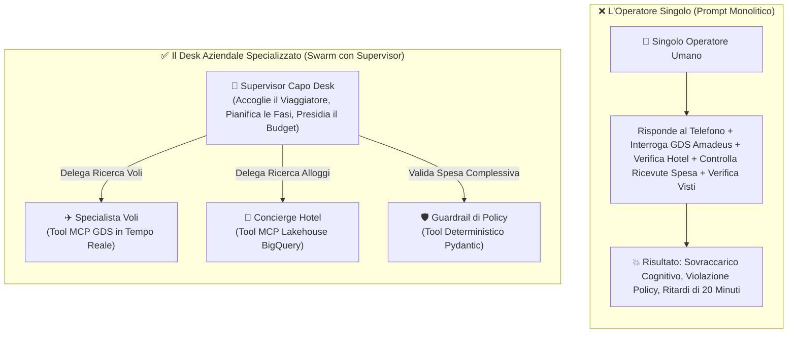
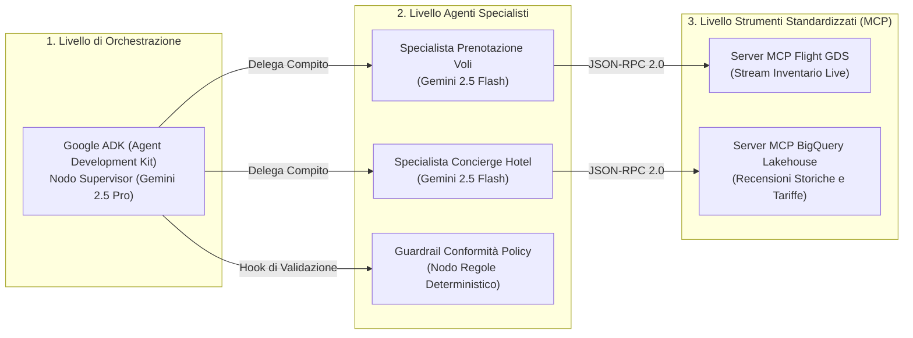
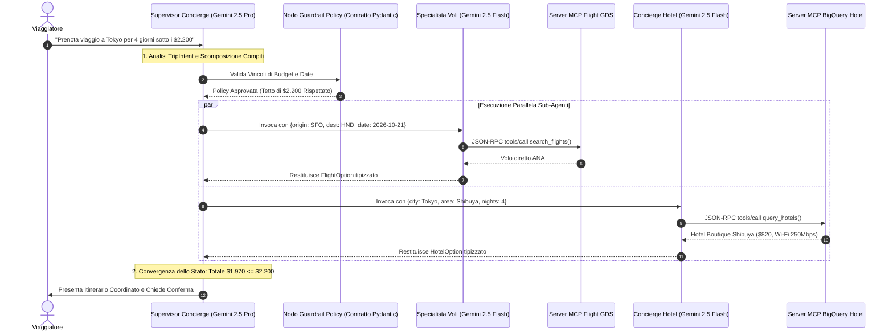

I sistemi a singolo agente si scontrano con un muro cognitivo quando entrano in gioco i vincoli aziendali reali.

Nella [Parte 1 della nostra trilogia](/it/blog/gemini-agent-platform-express-mode-bootstrapping-offvia/), abbiamo avviato il nostro concierge di viaggio, **Offvia**, aggirando gli attriti di onboarding IAM con Express Mode e introducendo contratti di intento basati su Pydantic. Ma quando una richiesta complessa entra nel sistema—voli, hotel boutique, policy di spesa e inventario in tempo reale—un prompt monolitico crolla:

> *"Trovami un viaggio per una conferenza tech di quattro giorni a Tokyo con partenza da San Francisco per meno di 2.200 dollari, con partenza mercoledì prossimo. Ho bisogno di un volo diretto, un hotel boutique vicino a Shibuya con Wi-Fi ad alta velocità e cancellazione gratuita."*

Se affidi questa richiesta a un unico agente con otto strumenti Python allegati, il risultato è il caos:
* Il modello interroga le tabelle dei voli, allucina codici aeroportuali IATA e brucia 15.000 token cercando di analizzare contemporaneamente i servizi alberghieri.
* Prenota un volo di ritorno con partenza due ore prima dell'orario di check-out dell'hotel.
* Quando l'API dei voli restituisce un rate limit 429, l'agente perde lo stato della prenotazione alberghiera, entra in loop ed esaurisce la quota mensile in pochi minuti.

Per costruire sistemi di intelligenza artificiale capaci di reggere il traffico di produzione, è fondamentale scomporre il modello monolitico in un **Sistema Multi-Agente (MAS)**.

In questa seconda guida della nostra trilogia, passiamo dal parsing di singoli intenti all'orchestrazione aziendale completa. Analizzeremo **Google Agent Development Kit (Google ADK)**, implementeremo il **Supervisor Pattern**, integreremo sorgenti esterne tramite **Model Context Protocol (MCP)** e collegheremo uno swarm multi-agente resiliente in Python.

---

## 🏢 Il Modello Mentale: Il Desk Aziendale vs L'Operatore Singolo

Per comprendere perché le architetture multi-agente superano i prompt monolitici, osserviamo il funzionamento di un desk viaggi aziendale:



<div class="my-8 p-6 rounded-2xl bg-sky-50 dark:bg-sky-950/60 border-2 border-sky-300 dark:border-sky-600/70 text-sky-950 dark:text-sky-100">
<h4 class="text-xl font-bold flex items-center gap-2 mb-3">
<span>💡</span> In Parole Semplici: Isolamento del Contesto
</h4>
<p class="leading-relaxed">
Quando un agente cerca voli, ha bisogno delle regole delle compagnie aeree, dei codici bagaglio e delle classi di prenotazione. <b>Non</b> ha bisogno di conoscere la policy sugli animali domestici dell'hotel o la franchigia colazione aziendale. Isolando ogni specialista nel proprio runtime con strumenti dedicati, abbattiamo il consumo di token, eliminiamo l'inquinamento del contesto e preveniamo il degrado del ragionamento.
</p>
</div>

---

## 🏛️ Primitive Architetturali: Google ADK e MCP

Costruire un sistema multi-agente in produzione su Google Cloud richiede tre livelli architetturali distinti:



### 1. Google Agent Development Kit (Google ADK)
**Google ADK (`google-adk`)** è il framework open source, code-first di Google per comporre, valutare ed eseguire agenti AI di livello aziendale. Mentre **Agent Studio** nella Google Cloud Console offre la prototipazione visuale, ADK fornisce il runtime programmatico necessario per il controllo di versione, i test unitari e le pipeline CI/CD.

In ADK, i flussi multi-agente sfruttano due meccanismi principali di delega:

* **Il Transfer Pattern (`sub_agents`):** Il supervisor utilizza `transfer_to_agent()` per cedere la titolarità della conversazione a uno specialista secondario. Lo specialista interagisce direttamente con l'utente per più turni prima di restituire il controllo.
* **L'Invocation Pattern (`AgentTool`):** L'agente secondario viene incapsulato dentro un `AgentTool`. Agli occhi del supervisor, il worker si comporta come una normale funzione Python, esegue il suo ciclo in isolamento e restituisce dati JSON strutturati.

### 2. Model Context Protocol (MCP)
Sviluppato come standard aperto di settore, il **Model Context Protocol (MCP)** definisce un'interfaccia client-server universale tra modelli di intelligenza artificiale e strumenti esterni:
1. **Il Server MCP** espone strumenti, schemi di risorse e documentazione tramite stream standardizzati `stdio` o HTTP/SSE.
2. **Il Client MCP (Google ADK)** si connette al server, scopre dinamicamente i tool disponibili all'avvio e traduce le chiamate di Gemini in richieste JSON-RPC 2.0.
3. **Confine di Sicurezza:** Le credenziali del database e le connessioni risiedono esclusivamente sul server MCP. Il modello non accede mai direttamente a stringhe di connessione riservate.

---

## 📊 Matrice Decisionale Architetturale

<div class="my-8 overflow-x-auto">
<div class="inline-block min-w-full align-middle">
<div class="overflow-hidden rounded-2xl border-2 border-slate-200 dark:border-slate-800 shadow-sm">
<table class="min-w-full divide-y divide-slate-200 dark:divide-slate-800 text-left text-sm">
<thead class="bg-slate-100 dark:bg-slate-900 font-semibold text-slate-800 dark:text-slate-200">
<tr>
<th scope="col" class="px-6 py-4">Dimensione Architetturale</th>
<th scope="col" class="px-6 py-4">Agente Monolitico (Prompt Singolo)</th>
<th scope="col" class="px-6 py-4">Google ADK Multi-Agente + MCP</th>
</tr>
</thead>
<tbody class="divide-y divide-slate-200 dark:divide-slate-800 bg-white dark:bg-slate-950 text-slate-600 dark:text-slate-300">
<tr>
<td class="px-6 py-4 font-semibold text-slate-900 dark:text-white">Scalabilità degli Strumenti</td>
<td class="px-6 py-4 text-rose-600 dark:text-rose-400">Degrada rapidamente oltre 5 tool (allucinazioni e confusione)</td>
<td class="px-6 py-4 text-emerald-600 dark:text-emerald-400 font-medium">Scalabilità orizzontale; ogni specialista gestisce 1–3 tool MCP circoscritti</td>
</tr>
<tr>
<td class="px-6 py-4 font-semibold text-slate-900 dark:text-white">Efficienza dei Token</td>
<td class="px-6 py-4 text-rose-600 dark:text-rose-400">Il contesto si espande con tutte le definizioni e gli output dei tool</td>
<td class="px-6 py-4 text-emerald-600 dark:text-emerald-400 font-medium">Contesti isolati per i sub-agenti; solo i dati aggregati risalgono al supervisor</td>
</tr>
<tr>
<td class="px-6 py-4 font-semibold text-slate-900 dark:text-white">Selezione del Modello</td>
<td class="px-6 py-4">Obbligo di usare modelli flagship costosi per ogni singolo passaggio</td>
<td class="px-6 py-4 font-medium text-sky-600 dark:text-sky-400">Ibrido: Gemini 2.5 Pro per il Supervisor, Gemini 2.5 Flash per i Worker</td>
</tr>
<tr>
<td class="px-6 py-4 font-semibold text-slate-900 dark:text-white">Isolamento dei Guasti</td>
<td class="px-6 py-4 text-rose-600 dark:text-rose-400">Il fallimento di un tool corrompe l'intera sessione di chat</td>
<td class="px-6 py-4 text-emerald-600 dark:text-emerald-400 font-medium">I guasti restano circoscritti al singolo worker; il supervisor attiva un fallback</td>
</tr>
<tr>
<td class="px-6 py-4 font-semibold text-slate-900 dark:text-white">Governance dei Dati</td>
<td class="px-6 py-4">Credenziali del database esposte nel prompt dell'agente</td>
<td class="px-6 py-4 font-medium text-emerald-600 dark:text-emerald-400">Confini MCP rigorosi con IAM, VPC Service Controls e query parametrizzate</td>
</tr>
</tbody>
</table>
</div>
</div>
</div>

---

## 🚨 5 Falsi Miti Critici sui Sistemi Multi-Agente

<div class="my-8 grid grid-cols-1 md:grid-cols-2 gap-6">
<div class="p-6 rounded-2xl bg-rose-50/70 dark:bg-rose-950/30 border border-rose-200 dark:border-rose-800/60">
<div class="flex items-center gap-2 mb-3">
<span class="text-xl">❌</span>
<h4 class="text-lg font-bold text-rose-900 dark:text-rose-200">Mito 1: Gli Agenti Devono Dialogare Senza un Supervisor</h4>
</div>
<p class="text-sm leading-relaxed text-rose-800 dark:text-rose-300">
Lasciare che agenti autonomi dibattano liberamente in una chat senza coordinatore genera loop non deterministici. In produzione, <b>l'orchestrazione gerarchica con un Supervisor deterministico è indispensabile</b>.
</p>
</div>

<div class="p-6 rounded-2xl bg-rose-50/70 dark:bg-rose-950/30 border border-rose-200 dark:border-rose-800/60">
<div class="flex items-center gap-2 mb-3">
<span class="text-xl">❌</span>
<h4 class="text-lg font-bold text-rose-900 dark:text-rose-200">Mito 2: I Sub-Agenti Devono Ricevere Tutta la Cronologia Chat</h4>
</div>
<p class="text-sm leading-relaxed text-rose-800 dark:text-rose-300">
Inviare l'intera trascrizione della conversazione a uno specialista causa un grave degrado del ragionamento. I sub-agenti devono ricevere <b>esclusivamente i parametri essenziali per il loro passaggio operativo</b>.
</p>
</div>

<div class="p-6 rounded-2xl bg-rose-50/70 dark:bg-rose-950/30 border border-rose-200 dark:border-rose-800/60">
<div class="flex items-center gap-2 mb-3">
<span class="text-xl">❌</span>
<h4 class="text-lg font-bold text-rose-900 dark:text-rose-200">Mito 3: MCP è Solo Un'Altra API REST HTTP</h4>
</div>
<p class="text-sm leading-relaxed text-rose-800 dark:text-rose-300">
Gli endpoint REST non possiedono introspezione standardizzata degli schemi. <b>Model Context Protocol standardizza la discovery degli strumenti a runtime</b>, la gestione degli errori JSON-RPC e la separazione dei privilegi di sicurezza.
</p>
</div>

<div class="p-6 rounded-2xl bg-rose-50/70 dark:bg-rose-950/30 border border-rose-200 dark:border-rose-800/60">
<div class="flex items-center gap-2 mb-3">
<span class="text-xl">❌</span>
<h4 class="text-lg font-bold text-rose-900 dark:text-rose-200">Mito 4: Gli Agenti Possono Scrivere SQL Diretto su BigQuery</h4>
</div>
<p class="text-sm leading-relaxed text-rose-800 dark:text-rose-300">
Fornire accesso Text-to-SQL non vincolato su tabelle BigQuery di produzione espone a prompt injection e costi elevati di scansione. <b>Esponi tool MCP con query vincolate e parametrizzate</b> su tabelle partizionate.
</p>
</div>

<div class="p-6 rounded-2xl bg-rose-50/70 dark:bg-rose-950/30 border border-rose-200 dark:border-rose-800/60 md:col-span-2">
<div class="flex items-center gap-2 mb-3">
<span class="text-xl">❌</span>
<h4 class="text-lg font-bold text-rose-900 dark:text-rose-200">Mito 5: I Sistemi Multi-Agente Eliminano il Codice Deterministico</h4>
</div>
<p class="text-sm leading-relaxed text-rose-800 dark:text-rose-300">
È vero il contrario. Più agenti probabilistici operano nel sistema, più rigido deve essere il codice perimetrale. <b>Validazione Pydantic, contatori di ricorsione e circuit breaker</b> sono gli elementi che distinguono una soluzione aziendale da un prototipo.
</p>
</div>
</div>

---

## 🔄 Il Ciclo di Vita dell'Orchestrazione End-to-End

Ecco il ciclo esatto di transizione di stato eseguito dallo swarm Offvia:



---

## ⚠️ 3 Criticità di Produzione e Incident War Stories

### 1. Il Deadlock del "Ping-Pong" Infinito
* **L'Incidente:** Durante i test interni, lo specialista voli ha selezionato un volo con arrivo a Tokyo alle 21:00. Il concierge alberghiero ha respinto la sistemazione perché il check-in chiudeva alle 20:00. Il supervisor ha richiesto un volo anticipato con scalo, che l'agente di policy ha bloccato per violazione dei tempi massimi di viaggio. Gli agenti hanno eseguito 14 cicli consecutivi, consumando 42 dollari prima di andare in timeout.
* **La Soluzione:** Implementare un **budget esplicito di passaggi (`max_steps=10`)** e un contatore anti-oscillazione nel supervisor. Se una coppia di agenti scambia messaggi più di due volte sullo stesso parametro, il loop viene interrotto ed escalato a un operatore umano.

### 2. Inquinamento del Contesto e Degrado dell'Attenzione
* **L'Incidente:** In un primo prototipo, il supervisor trasmetteva l'intera cronologia di chat allo specialista alberghiero, includendo 40 oggetti JSON grezzi delle query dei voli. Confuso dall'aeroporto di partenza nel prompt, l'agente hotel ha iniziato a proporre strutture vicine all'aeroporto di San Francisco invece che a Shibuya.
* **La Soluzione:** Applicare un **Rigoroso Isolamento dei Parametri**. Il supervisor estrae solo città, quartiere, date e tetto di spesa, passando un dizionario compatto all'agente alberghiero.

### 3. Subprocessi MCP Zombie e Blocco dei Trasporti
* **L'Incidente:** Durante un picco di traffico, un server MCP locale `stdio` collegato a BigQuery ha subito rallentamenti. Il processo Python è rimasto bloccato in lettura senza timeout, esaurendo la memoria del container Cloud Run.
* **La Soluzione:** Incapsulare sempre le chiamate MCP in gestori di timeout asincroni (`asyncio.wait_for(timeout=15.0)`). Nei microservizi di produzione, privilegiare **trasporti Streamable HTTP / SSE** rispetto ai processi `stdio`.

---

## 🛠️ Lab Pratico: Costruire lo Swarm Offvia in Python

Costruiamo il concierge multi-agente funzionante utilizzando Python, i pattern di Google ADK e il protocollo MCP.

### Passaggio 1: Configurazione dell'Ambiente

Crea un ambiente virtuale isolato e installa le dipendenze necessarie:

```bash
python3 -m venv venv
source venv/bin/activate
pip install google-adk pydantic google-genai
```

Configura l'autenticazione su Google Cloud:

```bash
export GOOGLE_CLOUD_PROJECT="offvia-production"
export GOOGLE_CLOUD_LOCATION="us-central1"
export GEMINI_API_KEY="your-api-key-here"
```

---

### Passaggio 2: Definire i Tool MCP

In un'architettura MCP reale, gli strumenti sono ospitati da server MCP dedicati. Di seguito definiamo i tool per i voli e il lakehouse BigQuery:

```python
"""
tools/mcp_travel_tools.py
Definizioni standardizzate dei tool MCP per lo Swarm Offvia.
"""
from typing import Dict, Any, List

def mcp_search_flights(origin: str, destination: str, departure_date: str) -> Dict[str, Any]:
    """
    Tool MCP: Interroga il sistema GDS in tempo reale per voli commerciali.
    Esposto via Server MCP: amadeus-flight-mcp
    """
    if origin.upper() == "SFO" and destination.upper() in ["HND", "NRT", "TYO"]:
        return {
            "status": "success",
            "provider": "ANA",
            "flight_number": "NH107",
            "departure": f"{departure_date}T10:45:00",
            "arrival": f"{departure_date}T14:30:00+1",
            "price_usd": 1150.00,
            "cabin": "Economy Flexible",
            "is_nonstop": True,
            "cancellation_policy": "Full refund up to 24h before departure"
        }
    return {
        "status": "error",
        "message": f"Nessun volo diretto trovato per {origin} -> {destination} il {departure_date}"
    }


def mcp_query_hotel_lakehouse(city: str, neighborhood: str, nights: int, max_budget_usd: float) -> Dict[str, Any]:
    """
    Tool MCP: Interroga il Lakehouse BigQuery per hotel boutique verificati.
    Esposto via Server MCP: bigquery-hotels-mcp
    """
    if "tokyo" in city.lower() and "shibuya" in neighborhood.lower():
        total_rate = 205.00 * nights
        if total_rate <= max_budget_usd:
            return {
                "status": "success",
                "hotel_name": "Trunk Hotel Shibuya",
                "neighborhood": "Shibuya, Tokyo",
                "nights": nights,
                "nightly_rate_usd": 205.00,
                "total_price_usd": total_rate,
                "wifi_speed_mbps": 280,
                "cancellation_policy": "Cancellazione gratuita fino a 48 ore prima del check-in",
                "verified_rating": 4.8
            }
    return {
        "status": "error",
        "message": f"Nessun hotel trovato con budget inferiore a ${max_budget_usd} a {neighborhood}, {city}"
    }
```

---

### Passaggio 3: Implementare i Sub-Agenti Specializzati

Ogni agente opera con un ruolo circoscritto e accede solo ai tool MCP autorizzati:

```python
"""
agents/specialists.py
Agenti specialisti verticali in Google ADK.
"""
from google.adk.agents.llm_agent import LlmAgent
from tools.mcp_travel_tools import mcp_search_flights, mcp_query_hotel_lakehouse

flight_specialist = LlmAgent(
    name="FlightSpecialist",
    model="gemini-2.5-flash",
    description="Specializzato nella ricerca e selezione di voli aerei commerciali.",
    instruction="""
    Sei lo specialista voli di Offvia.
    La tua unica responsabilità è individuare il miglior volo in base a origine, destinazione e data.
    Dai sempre priorità a voli diretti con cancellazione flessibile.
    Restituisci solo dati di volo validati e prezzi precisi.
    """,
    tools=[mcp_search_flights],
)

hotel_specialist = LlmAgent(
    name="HotelSpecialist",
    model="gemini-2.5-flash",
    description="Specializzato nella selezione di hotel boutique e verifica dei servizi.",
    instruction="""
    Sei il concierge alloggi di Offvia.
    La tua unica responsabilità è individuare hotel boutique nel quartiere richiesto.
    Verifica che il Wi-Fi ad alta velocità rispetti i requisiti minimi di smart working (>= 100 Mbps).
    Rispetta rigorosamente il tetto di budget assegnato per l'alloggio.
    """,
    tools=[mcp_query_hotel_lakehouse],
)
```

---

### Passaggio 4: Implementare i Guardrail e gli AgentTool

Incapsuliamo i sub-agenti e i controlli di policy come istanze di `AgentTool`:

```python
"""
agents/guardrails.py
Verifica di policy e incapsulamento AgentTool.
"""
from pydantic import BaseModel, Field
from google.adk.tools.agent_tool import AgentTool
from agents.specialists import flight_specialist, hotel_specialist

flight_tool = AgentTool(agent=flight_specialist)
hotel_tool = AgentTool(agent=hotel_specialist)

def audit_travel_policy(flight_cost: float, hotel_cost: float, free_cancellation: bool) -> dict:
    """
    Tool Deterministico di Conformità: Valida l'itinerario rispetto alle policy aziendali di Offvia.
    """
    total_cost = flight_cost + hotel_cost
    if total_cost > 2200.00:
        return {
            "compliant": False,
            "reason": f"Il costo totale di ${total_cost:.2f} supera il tetto massimo di $2.200,00"
        }
    if not free_cancellation:
        return {
            "compliant": False,
            "reason": "L'itinerario non rispetta il requisito obbligatorio di cancellazione gratuita"
        }
    return {
        "compliant": True,
        "total_cost_usd": total_cost,
        "remaining_budget_usd": 2200.00 - total_cost
    }
```

---

### Passaggio 5: Collegare il Supervisor Concierge

Il Supervisor coordina il flusso, gestisce lo stato complessivo e presidia i vincoli operativi:

```python
"""
main.py
Supervisor principale con protezioni dalla ricorsione.
"""
from google.adk.agents.llm_agent import LlmAgent
from agents.guardrails import flight_tool, hotel_tool, audit_travel_policy

supervisor_agent = LlmAgent(
    name="TravelConciergeSupervisor",
    model="gemini-2.5-pro",
    description="Coordinatore del desk viaggi aziendale di Offvia.",
    instruction="""
    Sei il Lead Supervisor del desk viaggi di Offvia.
    Il tuo obiettivo è soddisfare la richiesta del viaggiatore coordinando i tuoi strumenti specializzati:
    
    Flusso Operativo:
    1. Analizza origine, destinazione, date e tetto di budget ($2.200).
    2. Invoca lo strumento FlightSpecialist per trovare un volo diretto.
    3. Invoca lo strumento HotelSpecialist per individuare un hotel boutique a Shibuya.
    4. Chiama audit_travel_policy per verificare che il totale rientri nei $2.200 e che le policy siano rispettate.
    5. Presenta l'itinerario strutturato con il dettaglio dei costi.
    
    Regole di Sicurezza:
    - Non superare mai 5 chiamate ai tool per turno utente.
    - Se i costi totali superano il budget, non confermare la prenotazione e proponi modifiche.
    """,
    tools=[flight_tool, hotel_tool, audit_travel_policy],
)

if __name__ == "__main__":
    test_prompt = (
        "Prenota un viaggio di lavoro di quattro giorni a Tokyo da San Francisco con partenza il 2026-10-21. "
        "Ho bisogno di un volo diretto, un hotel boutique a Shibuya con Wi-Fi veloce "
        "e cancellazione gratuita su entrambi. Budget massimo: $2.200."
    )
    
    print("\n🚀 [ORCHESTRATORE OFFVIA] Inizializzazione Swarm Multi-Agente...\n")
    response = supervisor_agent.run(test_prompt)
    print("\n🎯 [PROPOSTA FINALE SUPERVISOR]:\n")
    print(response.text)
```

---

## 🚀 Prossimi Passi: Verso la Parte 3

In questa guida abbiamo trasformato Offvia da un parser a turno singolo in uno **swarm multi-agente resiliente** governato da Google ADK, il Supervisor Pattern e le interfacce Model Context Protocol.

Tuttavia, l'introduzione di più agenti probabilistici comporta nuove sfide in produzione:
* Come assicurarsi che la modifica al prompt dello specialista voli non degradi la precisione del concierge hotel?
* Come misurare le regressioni di latenza lungo 5 chiamate a catena tra agenti?
* Come eseguire valutazioni automatizzate nelle pipeline CI/CD prima di approvare le modifiche in produzione?

Nel capitolo conclusivo, **Parte 3: Testare l'AI Non Deterministica in CI/CD — Il Runbook di Valutazione per Sistemi Multi-Agente**, affronteremo:
* La configurazione delle **Pipeline di Valutazione degli Agenti** con le metriche native di Vertex AI (faithfulness, hallucination rate e tool selection precision).
* La simulazione di utenti sintetici per effettuare red-teaming sui sistemi multi-agente.
* La creazione di fixture di test automatizzate in Python per bloccare le pull request in CI/CD quando l'accuratezza scende sotto il 95%.

---

## 📖 Documentazione Ufficiale e Standard Verificati

* [Documentazione Google Cloud Vertex AI](https://cloud.google.com/vertex-ai/docs)
* [Piattaforma Google Cloud Gemini Enterprise](https://cloud.google.com/products/gemini)
* [Framework Python Google ADK (Agent Development Kit)](https://github.com/google/adk-python)
* [Specifiche Ufficiali Model Context Protocol (MCP)](https://modelcontextprotocol.io/)
* [Documentazione BigQuery](https://cloud.google.com/bigquery/docs)
* [Documentazione Pydantic V2](https://docs.pydantic.dev/)
