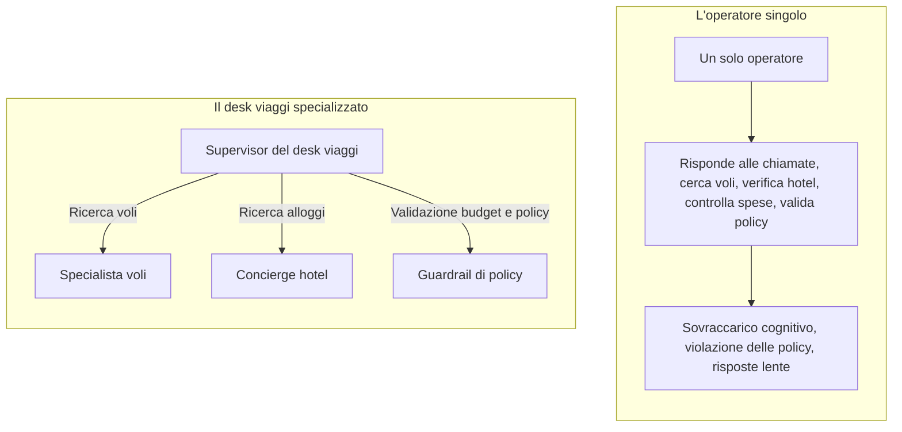
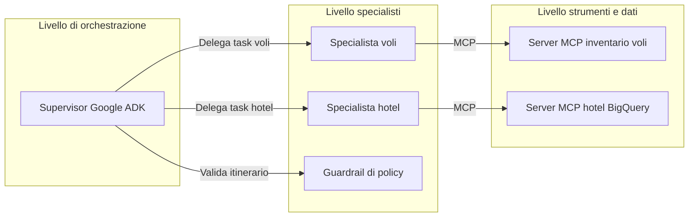
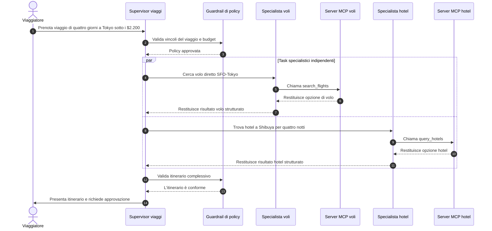

I sistemi a singolo agente si scontrano con un muro cognitivo quando entrano in gioco i vincoli aziendali reali.

Nella [Parte 1 della nostra trilogia](/it/blog/gemini-agent-platform-express-mode-bootstrapping-offvia/), abbiamo avviato **Offvia**, il nostro concierge di viaggio, riducendo gli attriti di onboarding IAM con Express Mode e introducendo contratti di intento basati su Pydantic.

Ma quando una richiesta complessa entra nel sistema—voli, hotel boutique, policy di spesa e inventario in tempo reale—un prompt monolitico inizia a vacillare:

> “Trovami un viaggio per una conferenza tech di quattro giorni a Tokyo con partenza da San Francisco per meno di 2.200 dollari, con partenza mercoledì prossimo. Ho bisogno di un volo diretto, un hotel boutique vicino a Shibuya con Wi-Fi ad alta velocità e cancellazione gratuita nel caso in cui la decisione sul visto subisca ritardi.”

Affidando questa richiesta a un unico agente con otto strumenti Python allegati, i problemi emergono rapidamente:

- Il modello può confondere codici aeroportuali, servizi alberghieri, regole di cancellazione e vincoli di budget.
- Può selezionare un volo di ritorno incompatibile con la data di check-out dell'hotel.
- Se l'API dei voli restituisce un errore di rate limiting, l'agente può perdere traccia dello stato della prenotazione, tentare retry a ripetizione e bruciare token senza fare progressi.

Per costruire sistemi di intelligenza artificiale capaci di reggere il traffico di produzione, è fondamentale scomporre il prompt monolitico in un **sistema multi-agente**.

In questa seconda parte della trilogia, passiamo dal parsing di singoli intenti all'orchestrazione di produzione. Utilizzeremo **Google ADK**, applicheremo il **pattern Supervisor**, integreremo sorgenti esterne tramite **Model Context Protocol (MCP)** e costruiremo uno swarm di viaggio multi-agente resiliente in Python.

---

## Il modello mentale: un desk viaggi aziendale

Un modo efficace per comprendere i sistemi multi-agente è confrontarli con un desk viaggi aziendale.

Un singolo operatore che tenta di rispondere al telefono, consultare i voli, verificare gli hotel, controllare le ricevute di spesa e revisionare i requisiti di visto contemporaneamente finirà per commettere errori. Un desk ben organizzato separa queste responsabilità:



Il supervisor non ha bisogno di conoscere ogni singola regola tariffaria o servizio alberghiero. Il suo compito è comprendere l'obiettivo del viaggiatore, scomporre il lavoro in task, delegarli, riconciliare i risultati e verificare la conformità aziendale.

Questo è l'**isolamento del contesto**.

Quando lo specialista voli cerca le tratte, ha bisogno delle regole di instradamento, classi tariffarie, limiti sul bagaglio e condizioni di cancellazione. Non ha bisogno della policy sugli animali dell'hotel o del rimborso colazione. Assegnando a ciascuno specialista un ruolo circoscritto e un set di strumenti limitato, riduciamo il sovraccarico di token e rendiamo i guasti molto più semplici da isolare.

---

## Architettura di base: Google ADK e MCP

Un sistema multi-agente in produzione su Google Cloud è strutturato generalmente su tre livelli:



### Google Agent Development Kit

**Google ADK** (`google-adk`) è il framework code-first di Google per creare, valutare ed eseguire agenti AI. Mentre le interfacce grafiche sono ottime per prototipare rapidamente, ADK offre un runtime programmatico ideale per il controllo di versione, i test unitari e le pipeline CI/CD.

ADK supporta diverse modalità di composizione degli agenti. Per questo caso d'uso, le due più rilevanti sono:

- **Transfer pattern:** Il supervisor delega il lavoro a un agente secondario tramite `sub_agents`. L'agente secondario completa un task mirato e restituisce il controllo al supervisor.
- **Invocation pattern:** Un agente secondario viene esposto come strumento invocabile tramite `AgentTool`. Il supervisor mantiene la titolarità della conversazione mentre il child esegue un sotto-task delimitato.

Per Offvia, gli specialisti di volo e hotel eseguono task verticali a singolo turno. Utilizzeremo il meccanismo `sub_agents` di ADK con `mode="single_turn"`, che mantiene il supervisor alla guida della conversazione consentendo agli specialisti di completare il proprio lavoro in modo circoscritto.

### Model Context Protocol

Il **Model Context Protocol (MCP)** è uno standard aperto per collegare applicazioni AI a strumenti esterni, sorgenti dati e sistemi aziendali.

Invece di sviluppare un wrapper dedicato per ogni database, API SaaS o servizio interno, puoi esporre le funzionalità tramite server MCP:

1. Il server MCP espone strumenti, metadati delle risorse e schemi.
2. Il client MCP—in questo caso, Google ADK—scopre gli strumenti disponibili.
3. L'agente seleziona uno strumento e ADK instrada la chiamata al server MCP corrispondente.
4. Il server MCP esegue l'operazione e restituisce un risultato strutturato.

MCP è prezioso perché crea una netta demarcazione architetturale tra il runtime dell'agente e i sistemi aziendali. Credenziali del database, connection pool, logiche di query e dettagli specifici dei provider rimangono sul lato server.

Tuttavia, MCP non costituisce di per sé un controllo di sicurezza. È sempre necessario implementare autenticazione, autorizzazione, IAM con privilegi minimi, controlli di rete, validazione degli input, rate limiting e audit logging.

---

## Agente singolo vs Swarm multi-agente

| Dimensione | Agente monolitico | Swarm multi-agente Google ADK con MCP |
|---|---|---|
| Scalabilità dei tool | L'accuratezza nella selezione degli strumenti cala con troppi tool generici | Ciascun specialista gestisce un set ridotto e ben definito di tool |
| Efficienza del contesto | Tutte le definizioni dei tool e i rispettivi output competono per lo stesso contesto | Gli specialisti ricevono solo il contesto strettamente necessario al task |
| Selezione del modello | Un unico modello esegue ogni passaggio | Un modello più potente coordina, mentre modelli più veloci svolgono compiti specifici |
| Isolamento dei guasti | Il fallimento di un tool può corrompere l'intera sessione di ragionamento | Gli errori restano isolati nello specialista e vengono gestiti dal supervisor |
| Debugging | Difficile determinare quale responsabilità sia fallita | Confini precisi tra orchestrazione, logica di dominio e strumenti |
| Governance dei dati | Credenziali e accessi estesi rischiano di trapelare nel runtime dell'agente se mal progettati | I server dei tool mantengono le credenziali ed espongono operazioni circoscritte |
| Determinismo | La logica è ampiamente delegata al modello | La validazione deterministica presidia i confini di ciascun task |

L'architettura multi-agente non rende automaticamente un sistema più scalabile, sicuro o economico. Ne migliora la modularità. Sono comunque indispensabili valutazione continua, osservabilità, controlli di accesso e una solida architettura di deployment.

---

## Cinque falsi miti sui sistemi multi-agente

### 1. Gli agenti dovrebbero comunicare liberamente senza un supervisor

Le conversazioni non strutturate tra agenti possono diventare non deterministiche e costose. Due agenti possono ringraziarsi a vicenda, ripetere richieste o non trovare convergenza.

In produzione, utilizza un supervisor con un workflow definito. Il supervisor stabilisce cosa fare successivamente, delega compiti circoscritti e decide quando concludere l'esecuzione.

### 2. I sub-agenti hanno bisogno dell'intera cronologia di chat

Inoltrare l'intera conversazione a ogni specialista genera rumore superfluo. Un agente alberghiero non ha bisogno di quaranta oggetti JSON grezzi provenienti dalla ricerca voli.

Invia esclusivamente il contesto strutturato minimo necessario per l'operazione:

```python
{
    "city": "Tokyo",
    "neighborhood": "Shibuya",
    "nights": 4,
    "max_budget_usd": 1050.00
}
```

### 3. MCP è solo un'altra API REST

MCP e REST risolvono problemi in parte sovrapposti ma distinti. REST è uno stile architetturale generico per servizi HTTP. MCP è progettato specificamente per collegare applicazioni AI a strumenti e risorse in modo strutturato e scopribile.

MCP fornisce semantiche standardizzate per la discovery e l'invocazione dei tool. Non elimina la necessità di progettazione API, versionamento, autenticazione o monitoraggio operativo.

### 4. Gli agenti dovrebbero scrivere query SQL arbitrarie su BigQuery

Garantire a un agente accesso Text-to-SQL senza restrizioni su tabelle di produzione è rischioso: può causare scansioni onerose, esposizione di dati e query manipolate da prompt injection.

Esponi invece tool MCP con parametri ben definiti. Utilizza tabelle partizionate e clusterizzate, budget di query, colonne autorizzate e account di servizio con privilegi minimi.

### 5. I sistemi multi-agente eliminano la necessità di codice deterministico

È vero l'esatto contrario.

Più componenti non deterministici introduci, più diventano fondamentali i confini deterministici. Utilizza modelli Pydantic, schemi espliciti, funzioni di validazione, timeout, policy di retry, limiti di ricorsione e circuit breaker attorno all'esecuzione degli agenti.

---

## Il ciclo di vita dell'orchestrazione Offvia

Ecco il flusso operativo previsto per la richiesta di viaggio.



Il blocco `par` descrive il comportamento di orchestrazione desiderato: le ricerche di voli e hotel sono indipendenti e possono essere eseguite in parallelo. In produzione, il parallelismo deve essere implementato a livello di applicazione o ambiente di esecuzione; un modello supervisor che seleziona tool uno alla volta non li parallelizzerà automaticamente.

---

## Criticità di produzione

### 1. Il deadlock del ping-pong

Immagina questa sequenza:

1. Lo specialista voli individua un volo con arrivo a Tokyo alle 21:00.
2. Lo specialista hotel lo rifiuta perché il check-in chiude alle 20:00.
3. Il supervisor richiede un volo precedente.
4. Il volo precedente prevede uno scalo.
5. Il guardrail di policy rifiuta lo scalo perché viola i limiti di durata del viaggio.
6. Il supervisor richiede un altro volo ancora.

Senza limiti operativi, questo ciclo può ripetersi all'infinito.

La contromisura non risiede solo in un prompt migliore, ma in rigorosi controlli a runtime:

- Numero massimo di chiamate ai tool per richiesta utente
- Profondità massima di ricorsione o delega
- Rilevamento di chiamate ripetute ai tool con i medesimi parametri
- Circuit breaker in seguito a fallimenti consecutivi
- Percorso di escalation umana quando il sistema non riesce a convergere

### 2. Inquinamento del contesto

In un prototipo iniziale, il supervisor trasmetteva l'intera cronologia di conversazione allo specialista hotel. Il prompt conteneva decine di risultati grezzi della ricerca voli. L'agente alberghiero si è confuso con l'aeroporto di partenza e ha iniziato a consigliare hotel vicini a San Francisco anziché a Shibuya.

La soluzione consiste nel rigoroso isolamento degli input: il supervisor deve estrarre solo i campi essenziali per l'agente hotel:

```python
hotel_request = {
    "city": "Tokyo",
    "neighborhood": "Shibuya",
    "nights": 4,
    "max_budget_usd": 1050.00
}
```

### 3. Blocchi dei subprocessi MCP

Un server MCP locale basato su `stdio` può bloccarsi se il subprocess si arresta o se le pipe di input/output si saturano. Incapsulare la chiamata in `asyncio.wait_for()` evita che la coroutine attenda indefinitamente, ma non termina automaticamente il subprocess né ne libera le risorse.

Un'implementazione per la produzione deve gestire anche:

- Timeout a livello di richiesta
- Propagazione della cancellazione
- Terminazione del processo e shutdown controllato
- Gestione del ciclo di vita di connessioni e subprocessi
- Health check e policy di riavvio

Per servizi di produzione a lunga durata, considera trasporti MCP basati su Streamable HTTP o SSE anziché processi `stdio` locali.

---

## Lab pratico: costruire lo swarm Offvia

Questo esempio illustra l'architettura in modo trasparente. I tool per voli e hotel sono modellati come funzioni Python locali per facilità di lettura; in un'implementazione reale, verrebbero esposti da server MCP dedicati e consumati tramite `McpToolset` di ADK.

### Passaggio 1: Configurazione dell'ambiente

```bash
python3 -m venv venv
source venv/bin/activate

pip install google-adk pydantic
```

Per prototipare localmente con l'API Gemini:

```bash
export GEMINI_API_KEY="your-api-key-here"
```

Per un deployment basato su Vertex AI, configura l'autenticazione Google Cloud e le impostazioni del progetto:

```bash
export GOOGLE_CLOUD_PROJECT="offvia-production"
export GOOGLE_CLOUD_LOCATION="us-central1"
```

Si tratta di due percorsi di integrazione distinti: la chiave API Gemini per la sperimentazione locale e Vertex AI con identità Google Cloud per i carichi di lavoro di produzione.

### Passaggio 2: Definizione dei contratti degli strumenti

In produzione, queste funzioni risiederebbero dietro server MCP. Qui modellano il confine dello strumento e restituiscono dati strutturati.

```python
"""
tools/travel_tools.py

Contratti degli strumenti per lo swarm di viaggio Offvia.

In produzione, queste operazioni sono esposte tramite server MCP dedicati:
- flight-inventory-mcp
- bigquery-hotels-mcp
"""

from typing import Any, Dict


def search_flights(
    origin: str,
    destination: str,
    departure_date: str,
) -> Dict[str, Any]:
    """
    Cerca l'inventario dei voli.

    In produzione, questa funzione è esposta da un server MCP flight-inventory
    e invocata tramite McpToolset di ADK.
    """
    if origin.upper() == "SFO" and destination.upper() in {"HND", "NRT", "TYO"}:
        return {
            "status": "success",
            "provider": "ANA",
            "flight_number": "NH107",
            "origin": origin.upper(),
            "destination": "HND",
            "departure": f"{departure_date}T10:45:00",
            "arrival": f"{departure_date}T14:30:00+1",
            "price_usd": 1150.00,
            "cabin": "Economy Flexible",
            "is_nonstop": True,
            "free_cancellation": True,
            "cancellation_policy": "Rimborso completo fino a 24 ore prima della partenza",
        }

    return {
        "status": "error",
        "message": (
            f"Nessun volo diretto trovato da {origin} a {destination} "
            f"in data {departure_date}."
        ),
    }


def query_hotels(
    city: str,
    neighborhood: str,
    nights: int,
    max_budget_usd: float,
) -> Dict[str, Any]:
    """
    Interroga il lakehouse alberghiero.

    In produzione, questa funzione è esposta da un server MCP basato su BigQuery.
    La query sottostante deve essere parametrizzata e vincolata nei costi.
    """
    if city.lower() == "tokyo" and neighborhood.lower() == "shibuya":
        nightly_rate = 205.00
        total_price = nightly_rate * nights

        if total_price <= max_budget_usd:
            return {
                "status": "success",
                "hotel_name": "Trunk Hotel Shibuya",
                "city": "Tokyo",
                "neighborhood": "Shibuya",
                "nights": nights,
                "nightly_rate_usd": nightly_rate,
                "total_price_usd": total_price,
                "wifi_speed_mbps": 280,
                "free_cancellation": True,
                "cancellation_policy": (
                    "Cancellazione gratuita fino a 48 ore prima del check-in"
                ),
                "verified_rating": 4.8,
            }

    return {
        "status": "error",
        "message": (
            f"Nessun hotel corrispondente ai criteri trovato a {neighborhood}, "
            f"{city} sotto ${max_budget_usd:.2f}."
        ),
    }
```

### Passaggio 3: Creazione degli agenti specialisti

Ciascun specialista ha una responsabilità unica, un'istruzione mirata e accesso solo agli strumenti necessari.

```python
"""
agents/specialists.py
"""

from google.adk.agents.llm_agent import LlmAgent
from tools.travel_tools import search_flights, query_hotels


flight_specialist = LlmAgent(
    name="FlightSpecialist",
    model="gemini-2.5-flash",
    description=(
        "Trova voli corrispondenti a tratta, data, classe di viaggio, "
        "condizioni di cancellazione e vincoli di budget."
    ),
    instruction="""
    Sei lo specialista voli di Offvia.

    La tua unica responsabilità è individuare un volo adeguato utilizzando lo
    strumento di ricerca voli a disposizione.

    Regole:
    - Preferisci voli diretti.
    - Preferisci tariffe flessibili o con cancellazione gratuita.
    - Non inventare aeroporti, compagnie aeree, numeri di volo, prezzi o orari.
    - Se nessun volo adeguato viene trovato, restituisci un esito negativo chiaro.
    - Non cercare hotel e non prendere decisioni sulle policy.
    """,
    tools=[search_flights],
    mode="single_turn",
)


hotel_specialist = LlmAgent(
    name="HotelSpecialist",
    model="gemini-2.5-flash",
    description=(
        "Trova hotel corrispondenti a posizione, durata del soggiorno, servizi "
        "e vincoli di budget per l'alloggio."
    ),
    instruction="""
    Sei lo specialista hotel di Offvia.

    La tua unica responsabilità è individuare un alloggio adeguato utilizzando lo
    strumento di ricerca hotel a disposizione.

    Regole:
    - Rispetta il quartiere richiesto e la durata del soggiorno.
    - Richiedi una connessione Wi-Fi ad alta velocità di almeno 100 Mbps.
    - Rispetta rigorosamente il budget per l'alloggio.
    - Non inventare hotel, prezzi, valutazioni o servizi.
    - Se nessun hotel adeguato viene trovato, restituisci un esito negativo chiaro.
    - Non cercare voli e non prendere decisioni sulle policy.
    """,
    tools=[query_hotels],
    mode="single_turn",
)
```

### Passaggio 4: Validazione deterministica delle policy

Il controllo delle policy aziendali non deve dipendere dal giudizio probabilistico del modello: deve essere una funzione deterministica con un contratto di input rigoroso.

```python
"""
agents/policy.py
"""

from pydantic import BaseModel, Field


class PolicyAuditRequest(BaseModel):
    flight_cost_usd: float = Field(ge=0)
    hotel_cost_usd: float = Field(ge=0)
    flight_free_cancellation: bool
    hotel_free_cancellation: bool

    total_budget_usd: float = Field(default=2200.00, gt=0)


class PolicyAuditResult(BaseModel):
    compliant: bool
    total_cost_usd: float
    remaining_budget_usd: float | None = None
    reason: str | None = None


def audit_travel_policy(request: PolicyAuditRequest) -> PolicyAuditResult:
    """
    Verifica deterministica di conformità per l'itinerario proposto.
    """
    total_cost = request.flight_cost_usd + request.hotel_cost_usd

    if total_cost > request.total_budget_usd:
        return PolicyAuditResult(
            compliant=False,
            total_cost_usd=total_cost,
            reason=(
                f"Il costo totale di ${total_cost:.2f} supera il budget "
                f"di ${request.total_budget_usd:.2f}."
            ),
        )

    if not request.flight_free_cancellation:
        return PolicyAuditResult(
            compliant=False,
            total_cost_usd=total_cost,
            reason="Il volo selezionato non include la cancellazione gratuita.",
        )

    if not request.hotel_free_cancellation:
        return PolicyAuditResult(
            compliant=False,
            total_cost_usd=total_cost,
            reason="L'hotel selezionato non include la cancellazione gratuita.",
        )

    return PolicyAuditResult(
        compliant=True,
        total_cost_usd=total_cost,
        remaining_budget_usd=request.total_budget_usd - total_cost,
    )
```

### Passaggio 5: Creazione del supervisor

Il supervisor coordina il workflow: non cerca direttamente voli o hotel, ma delega questi compiti e valida il risultato combinato.

```python
"""
agents/supervisor.py
"""

from google.adk.agents.llm_agent import LlmAgent
from agents.policy import audit_travel_policy
from agents.specialists import flight_specialist, hotel_specialist


supervisor_agent = LlmAgent(
    name="TravelConciergeSupervisor",
    model="gemini-2.5-pro",
    description=(
        "Coordina la ricerca voli, la ricerca hotel, la validazione delle policy "
        "e la presentazione dell'itinerario per Offvia."
    ),
    instruction="""
    Sei il Lead Travel Concierge Supervisor di Offvia.

    Il tuo compito è coordinare gli specialisti e restituire un'unica proposta
    di viaggio coerente e conforme alle policy.

    Workflow:
    1. Estrai origine, destinazione, date, durata del soggiorno, preferenza di quartiere
       e budget complessivo del viaggiatore.
    2. Delega la ricerca voli a FlightSpecialist.
    3. Delega la ricerca alloggi a HotelSpecialist.
    4. Somma i costi restituiti per volo e hotel.
    5. Valida l'itinerario combinato tramite audit_travel_policy.
    6. Se l'itinerario è conforme, presentalo chiaramente con i costi dettagliati.
    7. Se non è conforme, spiega la problematica e proponi un adeguamento pratico.
    8. Non finalizzare né addebitare alcunché senza l'esplicita approvazione dell'utente.

    Guardrail:
    - Preferisci non più di cinque chiamate ai tool per richiesta utente.
    - Trasmetti solo parametri specifici del task agli specialisti.
    - Non inventare mai dati su voli, hotel, prezzi, disponibilità o condizioni di cancellazione.
    - Se gli specialisti divergono o falliscono ripetutamente, interrompi ed escala
      anziché ciclare in loop.
    """,
    sub_agents=[flight_specialist, hotel_specialist],
    tools=[audit_travel_policy],
)
```

L'istruzione specifica "preferisci non più di cinque chiamate ai tool" poiché costituisce una linea guida per il modello, non un vincolo rigido a livello di runtime. In produzione, questo limite va imposto nel livello di orchestrazione.

### Passaggio 6: Esecuzione dell'agente con ADK Runner

Gli agenti ADK vengono eseguiti tramite un `Runner`, che gestisce le sessioni ed emette uno stream di eventi.

```python
"""
main.py
"""

import asyncio

from google.adk.runners import Runner
from google.adk.sessions import InMemorySessionService
from google.genai import types

from agents.supervisor import supervisor_agent


APP_NAME = "offvia"
USER_ID = "traveler_1"


async def run_offvia() -> None:
    session_service = InMemorySessionService()

    runner = Runner(
        agent=supervisor_agent,
        app_name=APP_NAME,
        session_service=session_service,
    )

    session = await session_service.create_session(
        app_name=APP_NAME,
        user_id=USER_ID,
    )

    test_prompt = (
        "Prenota un viaggio di lavoro di quattro giorni a Tokyo da San Francisco "
        "con partenza il 2026-10-21. Ho bisogno di un volo diretto, un hotel boutique "
        "a Shibuya con Wi-Fi veloce e cancellazione gratuita su entrambi. "
        "Il budget massimo è di $2.200."
    )

    message = types.Content(
        role="user",
        parts=[types.Part(text=test_prompt)],
    )

    final_response = None

    async for event in runner.run_async(
        user_id=USER_ID,
        session_id=session.id,
        new_message=message,
    ):
        if event.is_final_response() and event.content and event.content.parts:
            final_response = "".join(
                part.text or ""
                for part in event.content.parts
                if part.text
            )

    print("\nProposta finale Offvia:\n")
    print(final_response)


if __name__ == "__main__":
    asyncio.run(run_offvia())
```

Esecuzione locale:

```bash
python main.py
```

### Passaggio 7: Utilizzo di server MCP reali

Le funzioni Python locali sono ideali per comprendere i contratti degli strumenti, ma non costituiscono server MCP veri e propri.

In una configurazione di produzione, esporta `search_flights` e `query_hotels` tramite server MCP dedicati, collegandoli poi con `McpToolset`:

```python
from google.adk.tools.mcp_tool.mcp_toolset import (
    McpToolset,
    StdioServerParameters,
)


flight_mcp = McpToolset(
    connection_params=StdioServerParameters(
        command="python",
        args=["-m", "offvia_mcp.flight_server"],
    ),
    tool_filter=["search_flights"],
)

hotel_mcp = McpToolset(
    connection_params=StdioServerParameters(
        command="python",
        args=["-m", "offvia_mcp.hotel_server"],
    ),
    tool_filter=["query_hotels"],
)
```

Collega quindi i toolset ai rispettivi agenti specialisti:

```python
flight_specialist = LlmAgent(
    name="FlightSpecialist",
    model="gemini-2.5-flash",
    instruction="...",
    tools=[flight_mcp],
    mode="single_turn",
)

hotel_specialist = LlmAgent(
    name="HotelSpecialist",
    model="gemini-2.5-flash",
    instruction="...",
    tools=[hotel_mcp],
    mode="single_turn",
)
```

In questo modo, credenziali dei provider, pool di connessioni, logiche SQL e gestione degli errori specifici dei vendor rimangono isolati sul lato server MCP.

---

## Risultato atteso

Per la richiesta di esempio, l'output sintetizzato atteso è:

```text
Volo:
- ANA NH107
- Da SFO a Tokyo Haneda (HND)
- Partenza: 2026-10-21 alle 10:45
- Arrivo: 2026-10-22 alle 14:30
- Prezzo: $1.150,00
- Diretto e rimborsabile

Hotel:
- Trunk Hotel Shibuya
- Shibuya, Tokyo
- Quattro notti
- Prezzo: $820,00 totali
- Wi-Fi 280 Mbps
- Cancellazione gratuita fino a 48 ore prima del check-in

Riepilogo finanziario:
- Volo: $1.150,00
- Hotel: $820,00
- Totale: $1.970,00
- Budget residuo: $230,00
- Stato policy: Conforme
```

L'aspetto fondamentale non è lo specifico hotel o volo, bensì la netta separazione dei ruoli:

- Il supervisor governa l'interazione con il viaggiatore e la sintesi finale.
- Lo specialista voli gestisce la ricerca dei voli.
- Lo specialista hotel gestisce la ricerca degli alloggi.
- La funzione di policy governa la validazione deterministica.
- I server MCP presidiano le integrazioni con i provider e i dettagli riservati di connessione.

---

## Cosa non include questa demo

Questo esempio è focalizzato intenzionalmente sull'orchestrazione. Una piattaforma di prenotazione reale richiede inoltre:

- Sessioni persistenti e gestione dell'identità utente
- Integrazioni reali con compagnie aeree, catene alberghiere e circuiti di pagamento
- Approvazione umana esplicita prima di prenotazioni o addebiti irreversibili
- Gestione sicura dei segreti aziendali
- Rate limiting e budget di retry
- Tracing strutturato e log di audit
- Valutazioni online e offline degli agenti
- Deployment, autoscaling e procedure di incident response

---

## Checklist di produzione

- [ ] Utilizza dati di riferimento canonici per aeroporti, città, hotel e valute.
- [ ] Valida ogni input degli agenti e output dei tool tramite schemi rigorosi.
- [ ] Trasmetti agli agenti specialisti solo il contesto circoscritto al task.
- [ ] Applica budget di chiamate ai tool, timeout, retry e circuit breaker nel codice di orchestrazione.
- [ ] Esegui query BigQuery parametrizzate e con vincoli di costo definiti.
- [ ] Mantieni credenziali e connection pool sul lato server dei tool o di MCP.
- [ ] Applica controlli IAM e di rete basati sul principio del privilegio minimo.
- [ ] Registra nei log ogni delega, chiamata ai tool, decisione di policy, retry e fallback.
- [ ] Esegui valutazioni degli agenti prima di rilasciare modifiche a prompt, strumenti o modelli.
- [ ] Vincola i deployment ad accuratezza, precisione nella selezione dei tool, latenza e controllo delle regressioni di costo.
- [ ] Richiedi l'approvazione umana prima di qualsiasi azione irreversibile di prenotazione o pagamento.

---

## Verso la Parte 3

Abbiamo trasformato Offvia da un parser a turno singolo in uno swarm multi-agente modulare guidato da Google ADK, dal pattern Supervisor e da confini basati su MCP.

Tuttavia, i sistemi non deterministici richiedono test rigorosi.

Nella Parte 3, **Testare l'AI Non Deterministica in CI/CD — Il Runbook di Valutazione per Sistemi Multi-Agente**, affronteremo:

- Pipeline automatizzate di valutazione degli agenti con le funzionalità native di Vertex AI
- Metriche come faithfulness, hallucination rate, precisione nella selezione dei tool, latenza e costi
- Simulazioni con utenti sintetici e scenari avversari di edge case
- Test fixture automatizzate in Python per bloccare le pull request su GitHub Actions o GitLab CI/CD in caso di regressioni

---

## Documentazione ufficiale

- [Documentazione Google Cloud Vertex AI](https://cloud.google.com/vertex-ai/docs)
- [Repository Python Google ADK](https://github.com/google/adk-python)
- [Documentazione strumenti MCP Google ADK](https://adk.dev/tools-custom/mcp-tools/)
- [Specifiche Model Context Protocol](https://modelcontextprotocol.io/)
- [Documentazione BigQuery](https://cloud.google.com/bigquery/docs)
- [Documentazione Pydantic](https://docs.pydantic.dev/)
