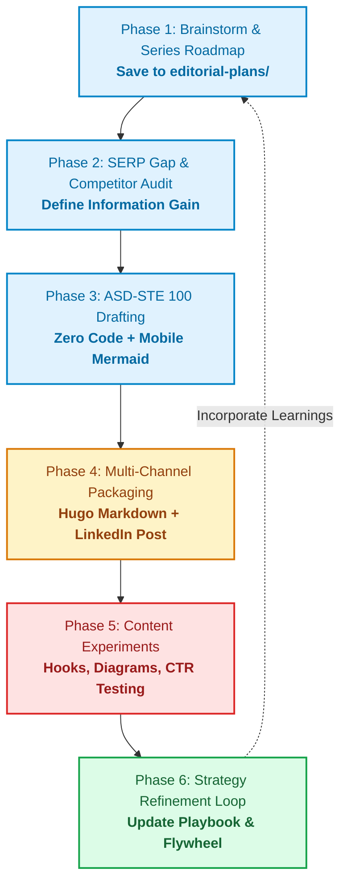

# Architecture Content Engine: Step-by-Step Playbook & Experimentation Guide

This playbook defines the exact operational process for planning, writing, experimenting with, and refining system architecture deep dives on **Gcloudcafe**. 

It is designed to be a living document: as we run content experiments, analyze reader retention, and test social hooks, we update this playbook to permanently compound our publishing advantages.

---

## 🗺️ High-Level Operational Lifecycle

---

## 🧭 Phase 1: Brainstorming & Series Architecture

### Goal:
Establish the complete multi-part syllabus and persistent roadmap before writing the first sentence.

### Step-by-Step:
1. **Choose the Domain:** Select a high-scale architectural theme (e.g., *Database Storage Engines*, *Consensus Protocols*, *Cache Topologies*).
2. **Apply the Dual-Filter Test:**
   - **Trending Score (1–10):** Is this actively debated on Hacker News, engineering blogs, or in recent incidents?
   - **Evergreen Score (1–10):** Will this chapter remain foundational and true in 2035?
   - *Rule:* Both scores must be $\ge 8/10$.
3. **Deconstruct into a 2-to-3 Part Focused Syllabus (Max 3 Parts):**
   - **Part 1:** Core Primitive (e.g., The Write-Ahead Log).
   - **Part 2:** Primary Data Structure (e.g., LSM-Tree vs B-Tree).
   - **Part 3:** Hardware & In-Memory Accelerators (e.g., SkipLists & Bloom Filters).
   - **Part 4:** Background I/O & Compaction (e.g., Leveled vs Tiered).
   - **Part 5:** Multi-Node Replication & Consensus (e.g., Quorum & Merkle Trees).
4. **Save Persistent Files:**
   - Create `editorial-plans/<series-slug>/SERIES_ROADMAP.md`.
   - Update `editorial-plans/CONTENT_MATRIX.md`.

---

## 🔍 Phase 2: Pre-Writing SERP Gap & Information Gain Audit

### Goal:
Ensure the article introduces deep, unique insights that outrank surface-level tutorials.

### Step-by-Step:
1. **Query Top 5 Google Search Results:** Search for the primary target keyword.
2. **Audit Competitor Flaws:**
   - Do they rely on trivial toy code snippets instead of explaining storage mechanics?
   - Do they omit real failure modes (split-brain, clock drift, write amplification)?
   - Are their diagrams blurry, unreadable on mobile, or completely missing?
3. **Formulate the 1-Sentence Information Gain Statement:**
   > *"Competitors explain how to configure [X], but omit [Y failure mode / hardware bottleneck]. This article provides the visual mental model of [Storage/Network flow] and gives engineers the decision rubric to handle [Failure Scenario] in production."*
4. **Capture Snippet Target:** Write a 40-word direct definition answering the core search intent for Google Featured Snippets and LLM retrieval engines (Perplexity, Gemini, ChatGPT).

---

## ✍️ Phase 3: ASD-STE 100 Drafting (Kleppmann & Xu Style)

### Goal:
Authoritative, calm, humanized engineering writing with maximum clarity and zero promotional fluff.

### Step-by-Step:
1. **Enforce the Zero-Code Directive:**
   - No Python, Go, or Java code snippets.
   - Use clear text, schemas, mathematical invariants, and block diagrams to describe state transitions.
2. **Apply ASD-STE 100 Rules:**
   - **Sentence Length:** Target 12–18 words. Hard cap at 22 words.
   - **One Thought per Sentence:** Never combine cause, effect, and edge case in one sentence.
   - **Active Voice with Named Actors:** *"The leader appends to the log"*, not *"The log is appended to"*.
   - **Anchor Sentences:** Interlock medium sentences with 3–6 word impact statements (*"BigQuery does not guess."*).
3. **Embed Mobile-Safe Mermaid Architecture Diagrams:**
   - Default to `flowchart TD` (Top-to-Down) for mobile viewport responsiveness.
   - Label lines must not exceed 25 characters (use ` ` explicitly).
   - Group components into clean subgraphs (Client, Memory, Persistent Disk, Network).
4. **Dissect Brutal Failure Modes:**
   - Detail where the system breaks under stress: network partitions, write stalls, disk saturation, GC pauses.
5. **Conclude with a Decision Matrix:**
   - 3-to-4 column trade-off table comparing alternative designs.

---

## 📦 Phase 4: Packaging & Multi-Channel Distribution

### Step-by-Step:
1. **Save Hugo Article:**
   - Save to `content/english/blog/<article-slug>.md` (or relevant Hugo content section).
   - Add standard metadata frontmatter (title, description, categories, tags, author, date).
2. **Draft the Companion LinkedIn Post:**
   - Under 1,300 characters.
   - Scroll-stopping technical hook (counter-intuitive truth or 2 AM incident).
   - 4 standalone architectural takeaways.
   - Visual asset callout: `👇 Architecture diagram below`.
   - Conversation-starting discussion prompt.
   - Save copy to `editorial-plans/<series-slug>/specs/<slug>-linkedin.md`.

---

## 🧪 Phase 5: The Content Experimentation Framework

To continuously refine our strategy, run one controlled experiment per article or series.

### Experiment Track A: Hook Variations (Reader Retention)
| Experiment ID | Hook Strategy | Implementation | Success Metric |
| :--- | :--- | :--- | :--- |
| **EXP-H1** | *Incident Hook* | Open with a 2:15 AM production outage and dollar impact. | Avg. Read Time > 4:30 min |
| **EXP-H2** | *System Paradox* | Open with a counter-intuitive truth (*"Adding 3 nodes made writes 4x slower"*). | Bounce Rate < 45% |
| **EXP-H3** | *Hardware Reality* | Open with physical hardware mechanics (*"SSDs write 4KB pages but erase 2MB blocks"*). | Scroll Depth > 75% |

### Experiment Track B: Diagram Visual Layouts
| Experiment ID | Visual Strategy | Implementation | Success Metric |
| :--- | :--- | :--- | :--- |
| **EXP-D1** | *Lifecycle Subgraphs* | Vertical RAM vs Disk separation with distinct color tokens. | Mobile user dwell time |
| **EXP-D2** | *Incident Trace* | Split-screen diagram showing Normal State vs Partitioned State. | Image saves / bookmarks |

### Experiment Track C: LinkedIn Distribution & CTR
| Experiment ID | Post Format | Implementation | Success Metric |
| :--- | :--- | :--- | :--- |
| **EXP-L1** | *Contrarian Stance* | Challenging a sacred cow (*"Why B-Trees are dying on modern NVMe"*). | Comment-to-Impression ratio |
| **EXP-L2** | *Visual Carousel* | 5-slide PDF carousel breaking down the Mermaid diagram steps. | Click-Through Rate (CTR) > 3.5% |

---

## 🔄 Phase 6: The Strategy Refinement & Flywheel Protocol

### The Bi-Weekly Review Loop:
1. **Analyze Metrics:** Review Google Search Console, Hugo analytics, and LinkedIn impressions.
2. **Identify Top Performing Formats:** Note which hooks drove the highest dwell time and comment engagement.
3. **Log Experiment Results:** Record winning patterns directly into this playbook.
4. **Replenish the Backlog:**
   - Extract user comments and reader questions.
   - Convert contentious architectural debates into new spin-off topics in `SERIES_ROADMAP.md`.
5. **Update AI Skill Directives:** If an experiment proves that a specific diagram structure or sentence cadence performs 2x better, update the corresponding reference file in `architecture-articles/references/`.

---

## âš¡ Context-Switching Cheat Sheet for Writers & AI

When resuming or jumping across articles:
1. **Run:** `/architecture-articles switch <series-slug> [part-N]`
2. **Review:** Check `editorial-plans/<series-slug>/SERIES_ROADMAP.md`.
3. **Identify:**
   - What did previous articles cover? (Do not repeat).
   - What terms were locked in? (Maintain strict consistency).
   - What is the upcoming chapter? (Build the bridge).
