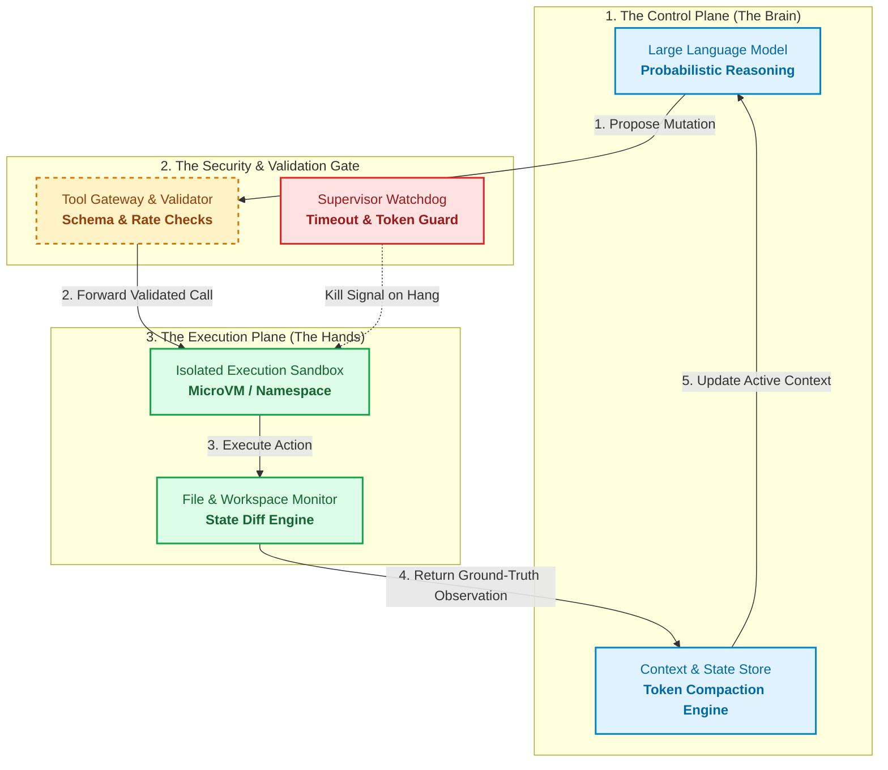

# Series Roadmap: Harness Engineering for AI Agents
**Series Slug:** `agent-harness-engineering`  
**Domain Category:** Autonomous AI Systems, Runtime Sandboxing & Distributed Systems  
**Target Audience:** Staff Software Engineers, Infrastructure Architects, Tech Leads  
**Length:** 3-Part Focused Series  
**Created:** 2026-10-23 | **Last Updated:** 2026-10-23  

---

## 🧭 The Dual-Filter Evaluation Score

| Metric | Score (1–10) | Concrete Justification |
| :--- | :--- | :--- |
| **Trending Score** | **9.9 / 10** | Moving beyond prompt engineering to harness engineering is the #1 shift in autonomous AI. Developers, architects, and managers navigating Claude Code, Codex CLI, Cursor, and Antigravity need architectural clarity on state, tools, and execution under the hood. |
| **Evergreen Score** | **9.6 / 10** | A harness is fundamentally an operating system and distributed coordinator for an untrusted process. The principles (isolation, IPC, state restoration, oracles, circuit breakers) are permanent computer science fundamentals. |

---

## 🏛️ The Overarching Architectural Mental Model

An LLM is a stateless token predictor. The **Harness** is the stateful computer that houses it:
$$\text{Agent} = \text{Model} + \text{Harness}$$

---

## 📋 The 3-Part Master Series Syllabus

| Part | Catchy, Humanized Title | Slug | Core Concept & Scope | Invariant Behind It | Status |
| :--- | :--- | :--- | :--- | :--- | :--- |
| **01** | *Beyond the Prompt: Inside the AI Agent Harness* | `beyond-the-prompt-inside-the-ai-agent-harness` | What an agent harness is, 4 core concepts, the 3 archetypes (CLI, IDE, Cloud), and the universal blueprint for switching harnesses without vendor lock-in. | Control Plane vs Execution Plane; CLI REPL vs Reactive IDE; MCP tool virtualization and universal `AGENTS.md` rules. | `[✍️ In Progress]` |
| **02** | *When Tools Fail: How AI Agents Mutate State Safely* | `how-agents-execute-tools-safely` | What happens when an agent drops a network socket halfway through writing to disk? Two-phase execution, idempotency, and rollbacks. | Distributed RPCs, Two-Phase Commits, Idempotency Keys, and Copy-on-Write snapshot rollbacks. | `[💡 Planned]` |
| **03** | *The Truth Machine: How AI Agents Test Their Own Code* | `how-agents-test-their-own-code` | How do you verify an agent solved a task without hallucinating? Supervisor watchdogs, token budgets, and circuit breakers. | The Oracle Problem; property-based verification, watchdog timers, and circuit breakers. | `[💡 Planned]` |

*Status Legend:* `[💡 Planned]` ➔ `[🔍 Researched]` ➔ `[📝 Outlined]` ➔ `[✍️ In Progress]` ➔ `[🚀 Published]`

---

## 🔗 Cross-Article Continuity & Breadcrumbs

- **Part 1 builds the foundational scaffolding:**
  - Explains the formula $\text{Agent} = \text{Model} + \text{Harness}$.
  - Introduces the 3 archetypes: Terminal CLI, Reactive Workspace IDE, and Cloud MicroVM.
  - Explains how engineering teams avoid vendor lock-in by standardizing rules (`AGENTS.md`) and tools (MCP).
- **Part 2 dives into tool execution and state safety:**
  - Takes the harness established in Part 1 and explores mutations against files and databases.
  - Explains why distributed RPCs fail without two-phase commits and snapshot rollbacks.
- **Part 3 installs the safety and verification rails:**
  - Explains how the harness acts as an authoritative Oracle for testing and kills infinite token-burning loops.
